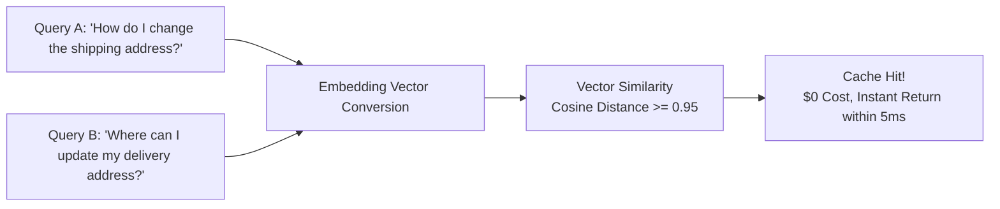

# FinOps Token Budget Management & Semantic Cache

As generative AI adoption scales, an enterprise's biggest challenge is **unpredictable API cost growth**. SyncLLM solves this problem through precision semantic caching and real-time cost governance.

---

## 1. Vector-Based Semantic Caching

Traditional web caches (Key-Value) suffer a cache miss if even a single character in a string differs. In contrast, the **SyncLLM Semantic Cache** compares the semantic embeddings of prompts.



- **Threshold-Based Similarity Verification**: Reuses cached entries only when cosine similarity is \(\ge 0.95\), preventing distorted or inaccurate responses.
- **TTL & Invalidation Policies**: Configures cache Time-to-Live (TTL) flexibly based on data refresh cycles, and supports immediate invalidation of tagged cache entries when specific domain knowledge is updated.

---

## 2. FinOps Token Budget Ledger

SyncLLM performs real-time accounting for every token consumed.

| Governance Tier | Control Item | Policy Example |
| :--- | :--- | :--- |
| **Organization Level** | Monthly Fixed Budget Cap | Switch to new prompt approval mode if company-wide spend exceeds $10,000/month |
| **Department / Project** | Team Quota & Alert Threshold | Trigger manager Slack alert if Marketing team exceeds 500,000 tokens/day |
| **User / Agent** | Single-Request Token Limit | Enforce Max Input 16k and Max Output 4k per individual prompt |

```json
{
  "transaction_id": "tx_9f82a1c0",
  "tenant_id": "dept_sales_01",
  "model": "gpt-4o-mini",
  "tokens": {
    "prompt": 420,
    "completion": 180,
    "total": 600,
    "cached": 0
  },
  "cost_usd": 0.000171,
  "latency_ms": 342,
  "status": "SUCCESS"
}
```
