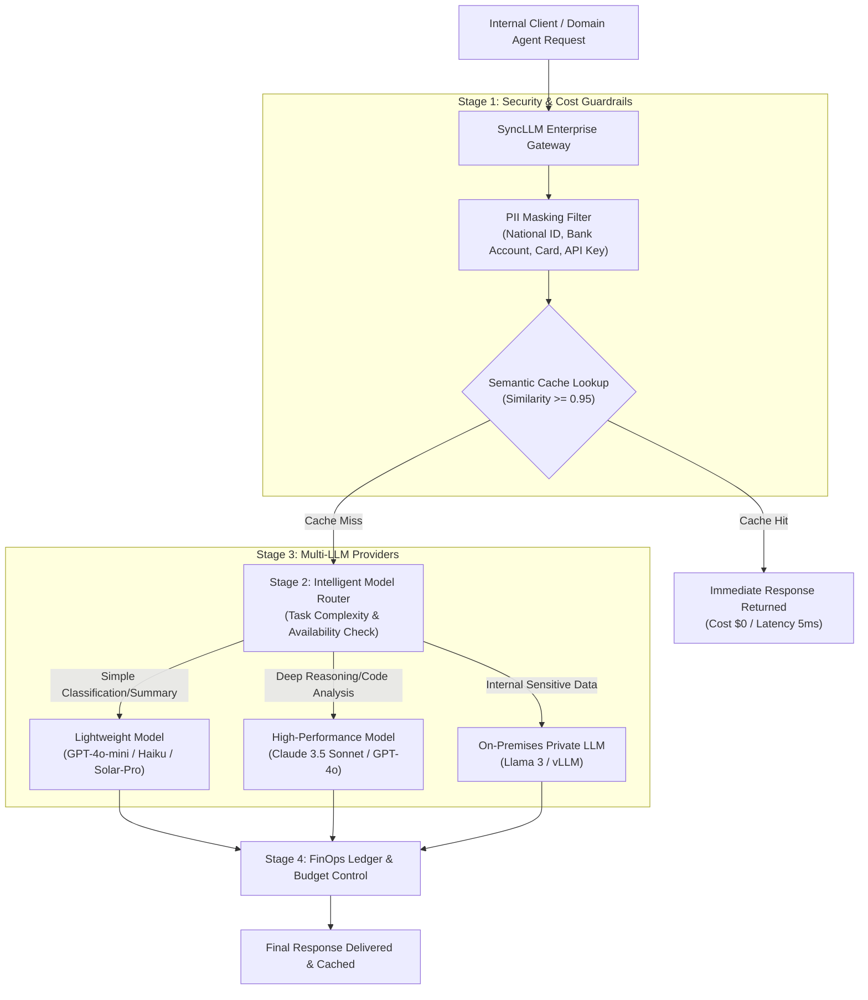
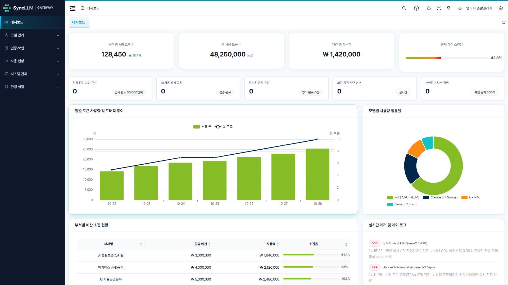
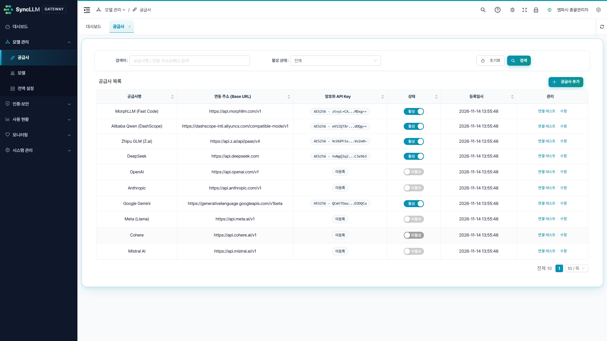
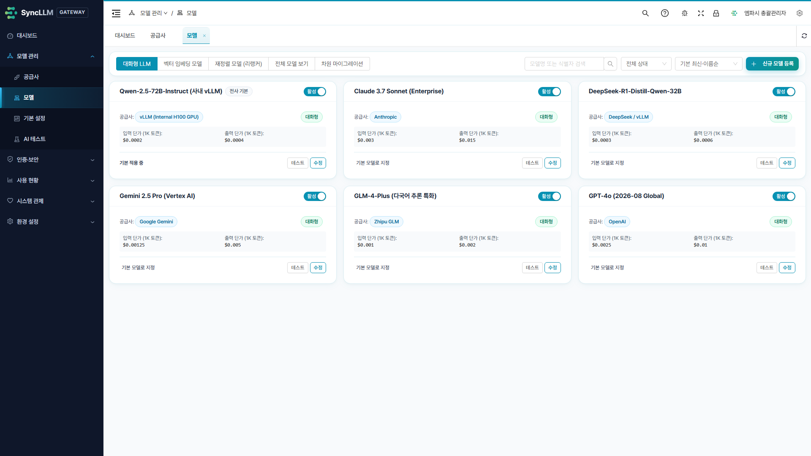
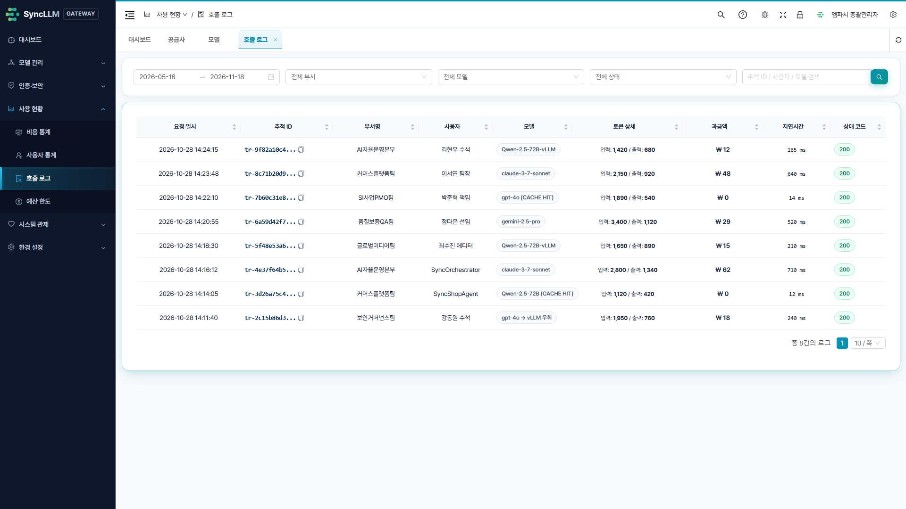

# SyncLLM: Enterprise AI Gateway & FinOps

> **Guide for Non-Developers & Decision Makers**: For an accessible product overview, visit the [SyncLLM Product Homepage (empasy.io)](https://empasy.io/en/solutions/sync-llm.html){target="_blank" rel="noopener"}. To explore the UI with zero installation, try the [Unified Demo Portal](https://demo.empasy.io/en/products/sync-llm/#demo){target="_blank" rel="noopener"}, or download brochures and proposal PDFs from the [Proposal Library](/en/proposals/).

**SyncLLM** is an **Enterprise AI Gateway** that centralizes and governs all AI calls distributed across your organization.

When multiple teams and agents independently call commercial LLM APIs (such as OpenAI, Anthropic, Google, or local on-premises models), organizations face **fragmented cost control, wasted tokens from redundant requests, and risks of leaking sensitive personally identifiable information (PII)**. SyncLLM prevents these issues by providing systematic governance and cost optimization from a single entry point.

---

## Core Value Proposition

1. **Intelligent Multi-LLM Routing**:
   - Analyzes prompt complexity and intent in real time to dynamically route requests to the most cost-effective model (lightweight vs. high-performance).
   - Performs automatic failover to secondary providers immediately if a vendor API experiences downtime or hits a rate limit.

2. **Vector-Based Semantic Caching**:
   - Goes beyond exact string matching by supporting caching based on embedding vector cosine similarity (\(\ge 0.95\)).
   - Serves cached responses for semantically similar recurring queries without calling external APIs, reducing both token costs and latency.

3. **Enterprise FinOps Token Budget Ledger**:
   - Aggregates token consumption in real time by organization, project, and user, enforcing daily and monthly quota limits.
   - Sends alerts and applies usage-blocking policies when budget thresholds are reached.

4. **Strict Data Privacy & Safety Guardrails (PII Masking & Safety Guardrails)**:
   - Masks sensitive information—including national ID numbers, mobile phone numbers, credit card numbers, and internal authentication keys—in real time during preprocessing.
   - Blocks malicious prompt injections and unauthorized data exfiltration attempts proactively at the gateway level.

---

## Summary of 4 Core Capabilities

| Area | Key Features | Expected Benefits |
| :--- | :--- | :--- |
| **Gateway & Routing** | OpenAI-compatible endpoints, dynamic model switching, load balancing | Consistent single API specification, elimination of vendor lock-in |
| **Semantic Caching** | Vector similarity-based cache hits, TTL expiration management, in-memory/Redis integration | Up to 40% reduction in token costs, faster response times |
| **FinOps Ledger** | Real-time token usage tracking, quota enforcement, budget overrun prevention | Predictable AI operational cost management |
| **Security Guardrails** | Regex/NER-based automatic PII masking, prompt injection blocking | Enterprise compliance adherence, data leakage prevention |

---

## Live Screenshots & Core Workflows

### 1. Unified AI Gateway Traffic & Token Budget Dashboard
Monitor enterprise-wide agent and department LLM API call volumes, semantic cache hit rates, token consumption costs, and response latencies in real time.

### 2. Multi-LLM Provider Routing & Failover Management
Configure availability status, rate limits, and automatic failover priorities across commercial cloud models and internal on-premises inference servers.

### 3. Tiered Model Catalog & Semantic Cache Policy Configuration
Manage complexity-based model mapping, per-1K input/output token pricing ledgers, and similarity thresholds for semantic response caching.

### 4. Real-Time Prompt Audit Logs & PII Masking Traceability
Inspect token usage, cache hit status, and audit trails of automatically masked sensitive data (such as national IDs, bank accounts, and API keys) for every request and response passing through the unified gateway.

