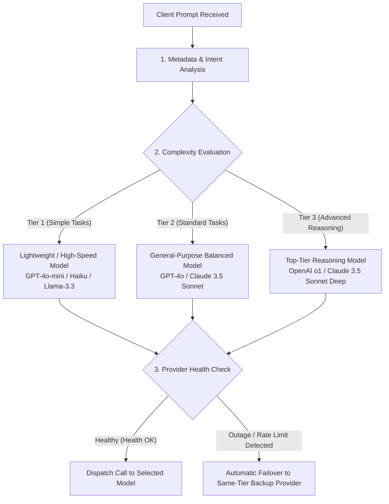

# Intelligent Model Routing & Load Balancing

Using top-tier, high-cost flagship models for every enterprise AI task leads to unnecessary budget waste. Conversely, relying solely on overly lightweight models degrades response quality.

The **SyncLLM Intelligent Router** dynamically assigns the optimal model by evaluating input prompt complexity, Service Level Agreements (SLA), and cost efficiency together.

---

## 3-Stage Routing Strategy

### 1. Complexity-Based Tiering
- **Simple Processing (Tier 1)**: Structured JSON conversion, proofreading, text summarization, and sentiment analysis are immediately routed to compact models with significantly lower per-token costs.
- **Deep Reasoning (Tier 2/3)**: Multi-step business planning, complex algorithm implementation, and SQL query optimization requiring rigorous logical reasoning are safely assigned to high-performance models.

### 2. Availability-Based Automatic Failover
Commercial cloud AI services can experience intermittent rate limits (429) or server overloads (503).
- SyncLLM includes a built-in Circuit Breaker that automatically reroutes traffic within 0.1 seconds to an equivalent-tier fallback model when a provider outage occurs.
- End users receive consistent, valid responses without errors, guaranteeing uninterrupted service continuity.

### 3. Weighted Round-Robin Load Balancing
- Register multiple provider accounts for the same model (e.g., Azure OpenAI Region 1, Region 2, and the direct OpenAI API) and distribute traffic according to configured weights to overcome per-account quota limits.
