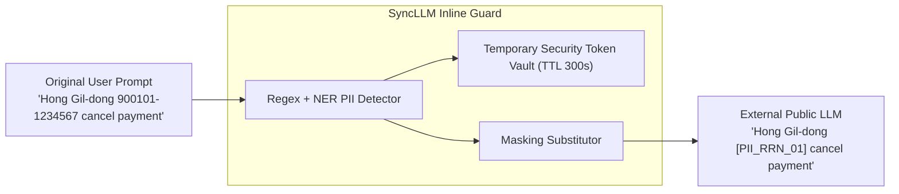

# Enterprise Security & PII Protection

When leveraging external public LLMs in an enterprise environment, the highest priority is **preventing the leakage of customer personally identifiable information (PII) and internal corporate secrets**.

SyncLLM enforces strict inline security filters at the gateway level before any data packet leaves your network.

---

## 1. Real-Time Automatic PII Masking Pipeline

### Primary Detection and Masking Targets
- **Personal Identification Numbers**: National registration numbers, alien registration numbers, passport numbers, and driver's license numbers.
- **Financial Information**: Credit/debit card numbers and bank account numbers.
- **Contact Information**: Mobile phone numbers, landline numbers, and email addresses.
- **System Credentials**: AWS Access Keys, OpenAI API Keys, DB connection strings, and internal JWT tokens.

---

## 2. Prompt Injection & Exfiltration Defense (Prompt Defense)

Detects patterns in which malicious users attempt to extract system prompts (jailbreaking) or abuse agent privileges.
- **Heuristic Injection Detection**: Proactively blocks known injection signatures such as `Ignore previous instructions` and `System prompt bypass`.
- **Full Audit Trail**: All blocked events and API access records are streamed in real time to your Security Operations team (SIEM) to enable immediate incident response.
