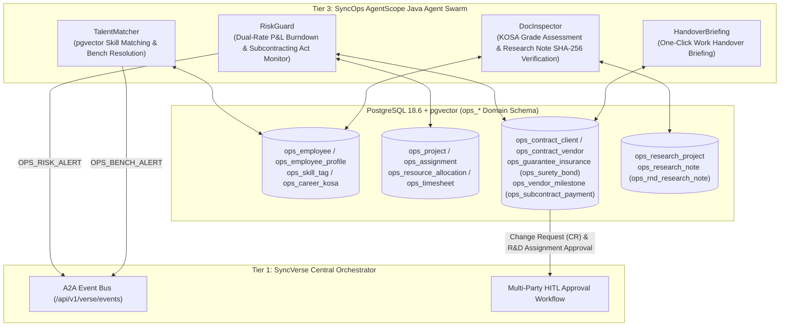

# SyncOps System Architecture and Database Design

`SyncOps` is an enterprise PMO domain agent platform built on the standard technology stack of **Java 25**, **Spring Boot 4.0**, **AgentScope Java (`io.agentscope:agentscope-harness`)**, **PostgreSQL 18.6 (`pgvector`)**, and **Vue 3 + Vben Admin (`@empasy/sync-ops-admin`)**.

---

## 1. Embedded Autonomous Agent Swarm (Intra-Agent Swarm) Architecture

Going beyond a simple CRUD back office, SyncOps coordinates four specialized sub-agents within the domain to autonomously optimize staffing assignments, detect project deficits and Subcontracting Act violations, synthesize handover briefings, and verify research note integrity.



### 1.1 `TalentMatcher` (Staff Matching and Idle Bench Resolution Agent)
- Performs initial hard filtering based on the required KOSA technical grade (`SPECIAL`, `ADVANCED`, `INTERMEDIATE`, `BEGINNER`) and resource availability window.
- Computes cosine similarity between `ops_employee.embedding` (`VECTOR(1536)`) and the required tech stack, and simulates the margin spread between the client billing rate and the company's actual monthly cost (`base_monthly_cost`) to recommend optimal idle (bench) personnel.

### 1.2 `RiskGuard` (Real-Time P&L Burndown and Subcontracting Act Compliance Monitoring Agent)
- Upon weekly timesheet (`ops_timesheet`) approval, calculates the burn rate of actual effort against planned effort (`budgeted_total_mm`) and logs risks of falling below the target operating margin in `ops_ai_risk_log`.
- Continuously monitors subcontract progress payments (`ops_vendor_milestone` / `ops_subcontract_payment`) for violations or approaching deadlines (D-7) under the **15-day rule after prime contract payment receipt** and the **60-day rule after inspection**, as well as statutory late interest at **15.5% per annum**.

### 1.3 `HandoverBriefing` (One-Click Offboarding & Role-Change Handover Agent)
- Transfers all client and vendor contacts (`ops_contact`) and open tasks (`ops_contact_task`) previously managed by the predecessor (`predecessor_id`) to the successor (`successor_id`) in a single transaction.
- Synthesizes recent business correspondence history (`ops_contact_interaction`) to automatically generate a core handover briefing summary (`ai_summary_briefing`) for the successor.

### 1.4 `DocInspector` (KOSA Career Assessment and Research Note Timestamp Verification Agent)
- Automatically calculates KOSA technical grades under the Software Industry Promotion Act based on academic background, national technical certifications, and career days.
- Verifies **SHA-256 timestamp authentication hashes** and Git commit consistency based on body content, author, and timestamp for electronic research notes (`ops_research_note` / `ops_rnd_research_note`) qualifying for R&D tax credits under Article 10 of the Restriction of Special Taxation Act.

---

## 2. Core Business Engine Design

### 2.1 Dual-Rate Profit and Loss (P&L) Calculation Engine
Real-time contribution margin and operating margin for contract-based SI projects are calculated by separating client contract billing rates from actual input unit costs by employment type:

\[
\text{Operating Margin (\%)} = \frac{\text{Net Contract Revenue} - \sum (\text{Actual M/M}_i \times \text{Cost Unit Price}_i) - \text{Direct Expenses}}{\text{Net Contract Revenue}} \times 100
\]

- **Full-Time Employees (`FULL_TIME`)**: Base salary (`base_salary`) + fixed allowances (`fixed_allowance`) + employer-share social insurance (`social_insurance_cost`) + monthly severance reserve (`severance_reserve_monthly`)
- **Freelancers (`FREELANCER`)**: Monthly contract rate (withholding deduction of 3.0% business income tax + 0.3% local income tax upon settlement)
- **Partner Subcontracting (`SUBCONTRACT`)**: Calculated based on the supply price in the subcontract agreement (`ops_contract_vendor`)
- **Direct Expenses (`Direct Expenses`)**: Premium fees paid for the four major surety bond insurances (`premium_amount`) and warranty reserve liabilities (`warranty_reserve_amount`)

### 2.2 Subcontracting Act Statutory Payment Deadline Determination Algorithm
Automatically determines the statutory payment deadline (`statutory_deadline_date`) pursuant to Article 6 (Advance Payments) and Article 13 (Payment of Subcontract Consideration) of the Fair Transactions in Subcontracting Act:

```java
LocalDate inspectionLimit = inspectionDate.plusDays(60); // Inspection completion date + 60 days
LocalDate StatutoryDeadline = (clientPaymentReceivedDate != null)
    ? Stream.of(clientPaymentReceivedDate.plusDays(15), inspectionLimit)
            .min(LocalDate::compareTo).get()
    : inspectionLimit;
```

When the deadline is exceeded, the engine prorates the statutory late interest rate of **15.5% per annum** by the number of overdue days (`delay_days`) and immediately triggers an alert on the financial risk dashboard.

---

## 3. Core Domain Database Schema (`db/02_schema_domain.sql`)

SyncOps adheres to the enterprise-wide 6-stage standard DB script structure (`db/00_extensions.sql` – `05_sample_dev.sql`), with core tables structured as follows:

| Category | Physical Table Name (Catalog Alias) | Key Columns and Role |
| :--- | :--- | :--- |
| **Project Master** | `ops_project` | `project_code`, `consortium_type`, `my_share_rate`, `net_contract_amount`, `target_margin_rate`, `budgeted_total_mm`, `warranty_reserve_amount` |
| **Employee Profile & KOSA** | `ops_employee`<br/>(`ops_employee_profile`),<br/>`ops_career_kosa`, `ops_skill_tag` | `emp_type` (`FULL_TIME`/`FREELANCER`/`SUBCONTRACT`), `kosa_grade`, `base_monthly_cost`, `is_rnd_qualified`, `embedding VECTOR(1536)` |
| **Resource M/M Allocation** | `ops_assignment`<br/>(`ops_resource_allocation`),<br/>`ops_timesheet` | `roll_in_date`, `roll_out_date`, `input_rate` (M/M), `billing_unit_price` (billing rate), `cost_unit_price` (cost rate), `billed_kosa_grade`, `work_nature` |
| **Four Major Surety Bonds** | `ops_guarantee_insurance`<br/>(`ops_surety_bond`) | `insurance_type` (`BID`/`PERFORMANCE`/`ADVANCE`/`DEFECT`), `policy_no`, `issuer` (`SGI_SEOUL`/`KOSA_COOP`), `guarantee_amount`, `premium_amount`, `end_date` |
| **Subcontract Milestones & Settlement** | `ops_vendor_milestone`<br/>(`ops_subcontract_payment`),<br/>`ops_contract_vendor`, `ops_invoice` | `inspection_date`, `client_payment_received_date`, `statutory_deadline_date` (15-day / 60-day), `delay_days`, `delay_interest_amount` (15.5% p.a.) |
| **R&D Electronic Research Notes** | `ops_research_note`<br/>(`ops_rnd_research_note`),<br/>`ops_research_project` | `research_project_id`, `author_id`, `note_date`, `content_summary`, `git_commit_hashes`, `author_signed_at`, `witness_signed_at`, `tsa_timestamp` (SHA-256 hash) |
| **Clients, Contracts & Handover** | `ops_client`, `ops_vendor`,<br/>`ops_contact`, `ops_handover_log`,<br/>`ops_official_letter` | Client and vendor masters, key-man contacts (`key_man_score`), bulk offboarding handover briefing logs, official correspondence PDFs with corporate seals |

---

## 4. Backend Module Structure and Dynamic Menu Routing

- **Maven Coordinates**:
  - Root parent POM: `com.empasy.sync.ops:sync-ops-parent`
  - Backend parent POM: `com.empasy.sync.ops:sync-ops-server-parent`
  - System core module: `Server/sync-ops-module-system` (`/api/v1/ops/sys/...`)
  - Business domain module: `Server/sync-ops-module-ops` (`/api/v1/ops/...`)
- **DB Single-Source-of-Truth Dynamic Routing**:
  - The frontend (`admin/`) operates in `PermissionModeEnum.BACK` mode without hardcoding static routes; upon login, it calls `/api/v1/ops/sys/permission/getUserPermissionByToken` to dynamically construct the 6-directory, 26-screen permission tree defined in `db/04_seed_domain.sql`.
