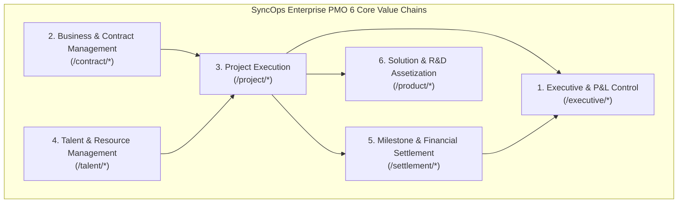
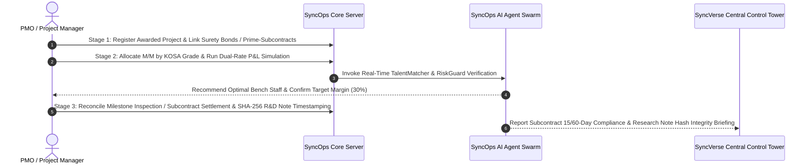
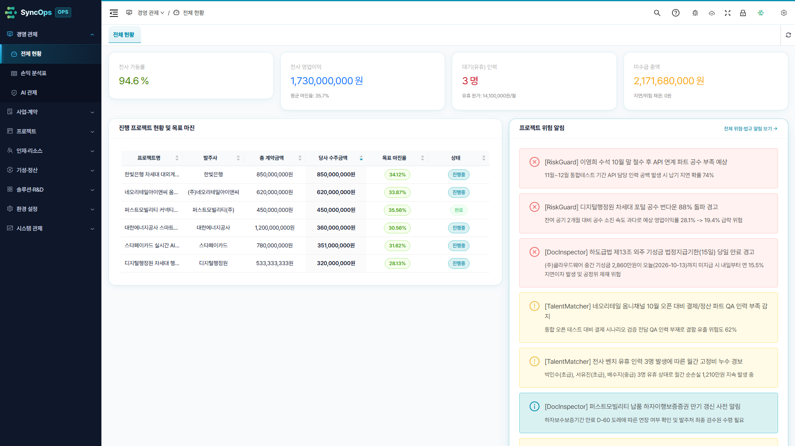
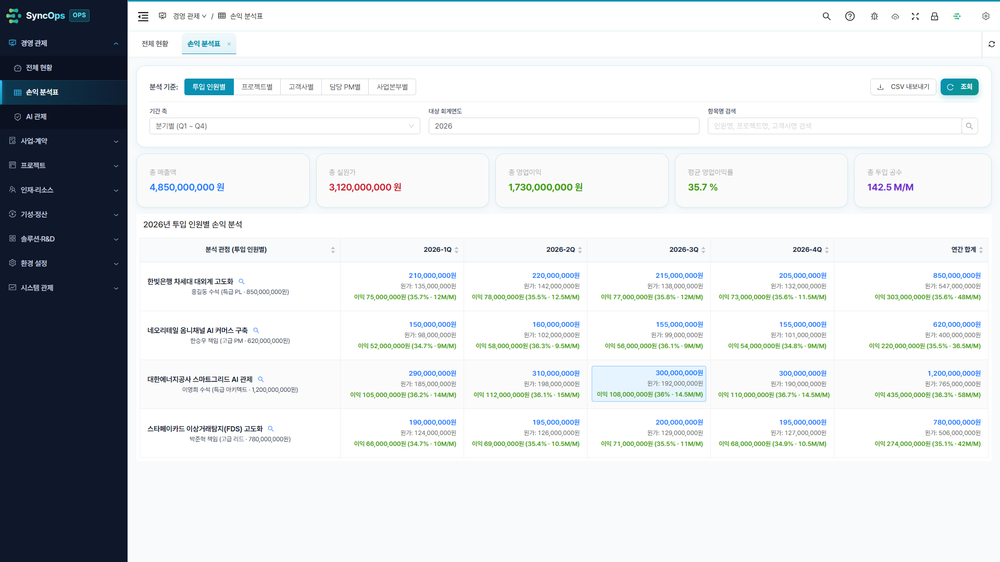
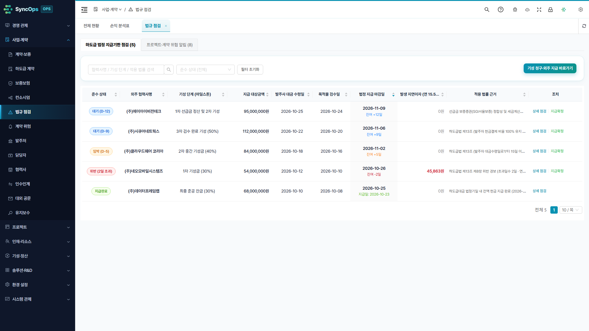
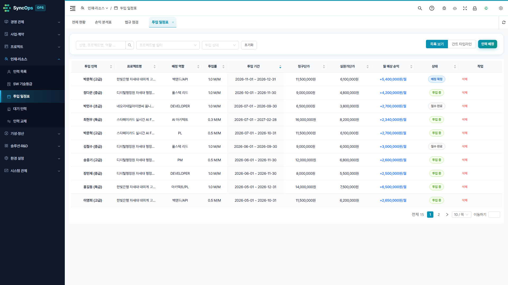

# SyncOps: Korean SI/Solution Operations & P&L/Compliance Control Platform

> **For Non-Developers & Adoption Evaluation**: For a straightforward product overview, visit the [SyncOps Product Homepage (ops.empasy.io)](https://ops.empasy.io/en/){target="_blank" rel="noopener"}. To explore the UI without installation, try the [Unified Demo Portal](https://sync.empasy.io/en/products/sync-ops#demo){target="_blank" rel="noopener"}, or download brochures and proposal PDFs from the [Proposal Library](/en/proposals/).

> **Tier 3 Enterprise SI PMO & Profit/Compliance Agent Platform**  
> Service Domain: `https://ops.empasy.io` · Standard API Prefix: `/api/v1/ops`

**SyncOps** is an enterprise business operations (PSA/PMO) agent that autonomously manages the core performance and compliance indicators of contract-based SI (System Integration) and software solution companies on a single platform—including **dual P&L tracking (client contract billing rate vs. actual input cost)**, **KOSA software engineer grade and monthly M/M utilization matrices**, **expiration tracking for the four major surety bond insurances (bid, performance, advance payment, and defect warranty)**, **Subcontracting Act 15-day/60-day payment deadline monitoring**, and **SHA-256 timestamp-authenticated electronic research notes for R&D tax credits under the Restriction of Special Taxation Act**.

---

## 1. Key Drivers and Challenges Addressed

With legacy manual spreadsheets or general manufacturing-oriented ERPs, it is difficult to track in real time the **dual-rate gap (client billing rate vs. actual costs across full-time staff, freelancers, and subcontracts)**, **complex consortium share settlements**, and **statutory deadlines under the Subcontracting Act** unique to contract-based IT service firms.

| Comparison Item | Legacy Excel & Fragmented ERP Operations | SyncOps Korean SI Operations Platform |
| :--- | :--- | :--- |
| **Project P&L Calculation** | Client contract rates and actual assigned labor costs are managed separately, so deficits are discovered only after project completion | **Contract rate vs. actual cost dual-rate engine** automatically calculates real-time contribution margin and operating margin upon weekly timesheet approval |
| **Staffing & Utilization** | Manual spreadsheet tracking causes over-allocation (`>1.0 M/M`) and delays visibility into idle (bench) personnel | **Automated KOSA grade calculation and monthly M/M utilization heatmap matrix** paired with `pgvector`-based AI recommendations for optimal replacement staff |
| **Surety Bonds & Subcontracting Act** | Manual tracking of bid, performance, advance, and defect surety bond renewals and 15-day/60-day subcontract payment deadlines risks legal penalties | **D-Day expiration alerts for four major surety bonds** and **automated subcontract statutory deadline and late interest (15.5% p.a.) calculator** proactively eliminate legal risks |
| **R&D Research Note Evidence** | Handwritten research notes for national R&D projects and corporate R&D center tax credits leave audit trails vulnerable | **SHA-256 hash timestamp-authenticated electronic research notes** with automated Git commit hash mapping satisfy Article 10 R&D tax credit requirements |
| **Staff Offboarding & Handover** | When a PM or sales representative leaves, key-man client contacts and verbal negotiation histories are lost | **One-click handover center** and AI handover summary briefings (`HandoverBriefing`) reliably preserve client operational continuity |

---

## 2. Six Core Value-Chain Domains

### 2.1 Executive & P&L Control (`/executive/dashboard`, `/executive/profit-matrix`, `/executive/ai-control`)
- **Real-Time Dual-Rate P&L Control**: Separates client-billed contract unit prices (`billing_unit_price`) from actual input unit costs (`cost_unit_price` covering payroll, social insurance, severance reserves, and outsourcing fees) to simulate real-time cost of goods sold (COGS) and operating margins per project.
- **5-Dimensional P&L Pivot Matrix**: Drills down into P&L by client, project, delivery department, employment type (full-time/freelancer/subcontract), and period.
- **AI Staffing & Risk Control**: Detects budget burndown overruns and projects at risk of turning unprofitable early, providing actionable remediation guidance.

### 2.2 Business & Contract Management (`/contract/list`, `/contract/clients`, `/contract/vendors`, `/contract/compliance-alerts`)
- **Unified Prime/Subcontract Management & Sequential Addendums**: Systematically tracks solo awards and consortium share ratios (joint execution and split execution), along with change-request (CR)-linked contract addendum histories.
- **Unified Tracking for Four Major Surety Bonds**: Monitors expiration dates and direct insurance premium costs for bid (`BID`), performance (`PERFORMANCE`), advance payment (`ADVANCE`), and defect warranty (`DEFECT`) surety policies issued by Seoul Guarantee Insurance (SGI) and the Korea Software Financial Cooperative.
- **Client & Vendor Key-Man CRM and One-Click Handover**: Manages client and vendor contact records, consultation histories, and official correspondence PDFs with corporate seals, transferring ownership in bulk to successors in a single transaction during personnel changes.

### 2.3 Project Execution & P&L Simulation (`/project/list`, `/project/profit-simulator`, `/project/timesheet-approval`)
- **Weekly Timesheet & Effort Approval**: Separates and aggregates weekly actual effort (M/M) into client SI cost (`CLIENT_SI`) and core R&D assetization (`CORE_RD`).
- **Change Request (CR) Governance**: Quantifies additional effort and incremental billing amounts for new client requirements and links them directly to contract amendments.

### 2.4 Talent & Resource Management (`/talent/employee`, `/talent/kosa-grade`, `/talent/assignment-gantt`, `/talent/bench-monitor`)
- **KOSA Software Engineer Grade Assessment**: Automatically determines Special (`SPECIAL`), Advanced (`ADVANCED`), Intermediate (`INTERMEDIATE`), and Beginner (`BEGINNER`) grades based on academic credentials, national technical certifications, and KOSA-recognized career days.
- **Monthly M/M Utilization Gantt Chart & Bench Monitoring**: Visualizes per-person project allocation rates to prevent over-allocation exceeding 100% (`1.0 M/M`) while tracking idle (bench) staff and upcoming roll-offs in real time.
- **Staff Replacement Approval Governance**: Automatically verifies whether replacement candidates meet equivalent or higher KOSA grades and manages formal client approval letters.

### 2.5 Milestone & Financial Settlement (`/settlement/milestone`, `/settlement/ar-aging`)
- **Automated Subcontracting Act Article 6 & 13 Deadline Monitoring**: Automatically computes statutory payment deadlines (**within 15 days** of receiving prime contract milestone payment and **within 60 days** of deliverable inspection), triggers violation and approaching-deadline (D-7) alerts, and calculates statutory late interest (15.5% per annum) when overdue.
- **Electronic Tax Invoices & AR Aging Settlement**: Tracks proportional advance payment deductions, 3.3% freelancer withholding tax deductions, and accounts receivable aging days.

### 2.6 Solution & R&D Assetization (`/product/releases`, `/product/rnd-notes`)
- **Electronic Research Notes for Article 10 R&D Tax Credits**: Preserves tamper-evident electronic research notes by combining KOITA-registered dedicated researchers' R&D activity logs, Git commit hashes, author and reviewer electronic signatures, and **SHA-256 timestamp authority (TSA) hashes**.
- **SI Custom Feature Core Backport Hub**: Manages the review pipeline for assetizing high-value features built during SI projects back into core proprietary solutions (`SyncBoot`, `SyncCMS`, etc.), along with per-client deployed configurations (Installed Base).

---

## 3. Three-Stage Standard Business Operations Process

---

## Live Screens & Core Workflows

### 1. Executive Summary Dashboard & Contract Project P&L Control
Monitor enterprise-wide total contract value, real-time operating margins by project, staffing utilization (M/M), and legal compliance alerts from a single executive dashboard.

### 2. Client Contract Rate vs. Actual Input Cost Dual-Rate P&L Matrix
Separately aggregate client billing rates and actual costs across full-time staff, freelancers, and subcontractors to analyze real-time contribution margins by client, project, department, and period.

### 3. Four Major Surety Bond Expiration Tracking & Subcontracting Act Payment Monitoring
Proactively eliminate legal risks by automatically computing renewal D-Days for bid, performance, advance payment, and defect surety policies alongside statutory subcontract payment deadlines (15 days after receipt, 60 days after inspection) and late interest.

### 4. KOSA Grade Staffing Matrix, Utilization Gantt Chart & Electronic Research Notes
Visualize project assignment schedules (Gantt chart) and over-allocations by KOSA software engineer grade, and manage timestamp-authenticated electronic research notes.

---

## 4. Official Technical Documentation Index

- **[System Architecture & DB Schema](./architecture)**: Detailed specifications of the four AgentScope Java internal agent swarms, dual-rate P&L engine, and PostgreSQL 18.6 domain schema (`ops_*`)
- **[MCP Tools & REST API Reference](./mcp-tools)**: Tool specifications for `ops_analyze_project_profitability`, `ops_check_allocation_overload`, `ops_audit_subcontract_payment`, and `ops_verify_rnd_note_hash`, plus the `/api/v1/ops/...` API guide
