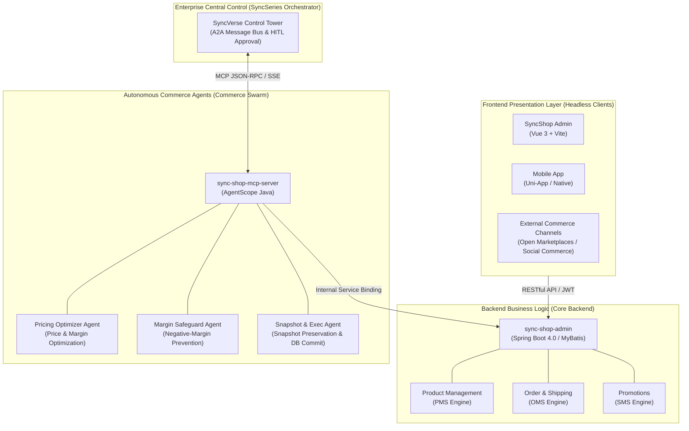
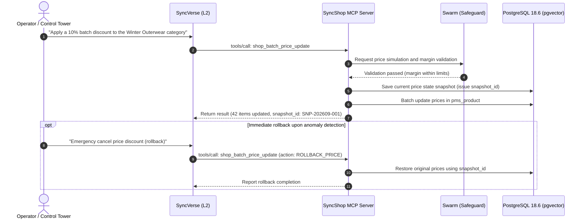

# System and AI Agent Architecture

SyncShop adopts a **Headless architecture** that guarantees complete decoupling between the frontend and backend, along with an **AgentScope Java-based multi-agent swarm** for autonomous commerce operations.

---

## 1. Enterprise System Layer Architecture

---

## 2. Intra-Agent Commerce Swarm

Instead of relying on a single LLM call, the SyncShop agent server executes safe autonomous operations through a granular, three-stage agent swarm architecture.

1. **Pricing Optimizer Agent**:
   * Analyzes inventory turnover by category, sales trends, and competitor pricing data to calculate optimal discount rates and target adjusted prices.
2. **Margin Safeguard Agent**:
   * Exhaustively validates every calculated price to ensure it does not violate each product's cost price or minimum margin rate thresholds.
   * Immediately blocks execution and logs the rejection reason if a negative-margin risk is detected.
3. **Snapshot & Execution Agent**:
   * Preserves the original price state as a snapshot (`TB_SHOP_PRICE_SNAPSHOT`) immediately before database updates.
   * Applies transactions to the `pms_product` table and reports the change results back to the control tower.

---

## 3. Dynamic Pricing and Lossless Rollback Sequence

---

## 4. Security and Transaction Integrity

* **A2A Inbound Security**: Validates secret keys and inbound tokens via `A2ASessionKeyHolder` to prevent control requests from unauthorized agents before execution.
* **Saga Pattern Consistency**: Tracks a unique `task_id` per unit of work and preserves prior consistent state through compensating transactions if an integration step fails.
* **Zero-Mock Principle**: All tool calls exclude in-memory dummy data and integrate 100% with the live persistent database.
