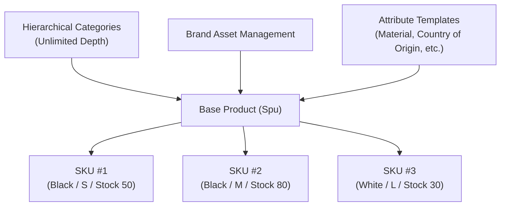
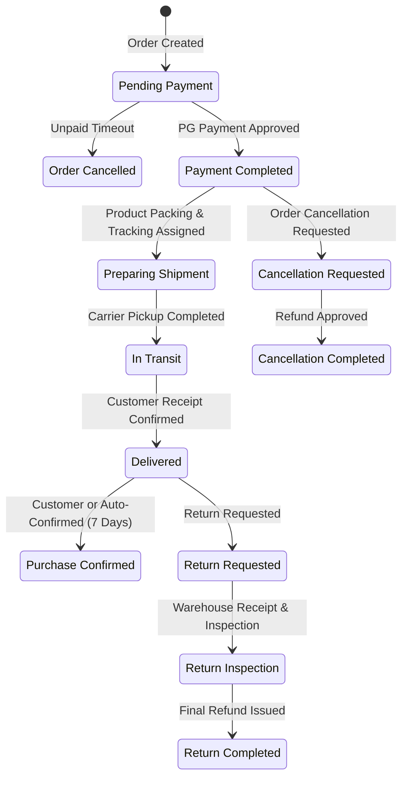

# Product Catalog and Order Logistics Management

SyncShop's Product Management System (PMS) and Order Management System (OMS) are engineered to guarantee data consistency and high throughput in large-scale e-commerce operations.

---

## 1. Product Catalog Management (PMS)

### 1.1 Hierarchical Categories and Brands
* **Unlimited Hierarchy**: Supports multi-level categories spanning major, medium, and minor classifications, dynamically recalculating downstream mappings when a parent category changes.
* **Brand Asset Management**: Manages logos, brand stories, and official certification status, integrating directly with brand-dedicated storefront curations.

### 1.2 Dynamic SKUs and Inventory Lock
* **SKU Separation by Option Combination**: Assigns a unique SKU code, individual selling price, and safety stock quantity for each combination of options such as color, size, and capacity.
* **Inventory Lock Mechanism**: When a user enters the order checkout stage, inventory is temporarily reserved (locked) using a Redis distributed lock, and physical stock is deducted upon payment completion. If payment fails or times out (default 15 minutes), the reservation is automatically released immediately.

---

## 2. Order and Logistics Management (OMS)

### 2.1 Order State Transition Lifecycle

### 2.2 Core Order Processing Features
* **Automated Bulk Tracking Registration**: Binds tracking numbers in bulk and transitions orders to the In Transit state in batches via Excel uploads and carrier API integrations.
* **Two-Stage Return/Refund Review**: Separates physical return receipt inspection from refund approval after a customer submits a return request, preventing erroneous payouts.
* **Fulfillment Center Management**: Registers multiple logistics warehouses (e.g., Gangnam, Songpa, Pangyo) and assigns the optimal shipping hub when an order arrives.

---

## 3. Related Admin Screen Code Mapping

| Functional Area | Screen ID | Vue Component Path | Description |
|:---|:---|:---|:---|
| **Catalog Search** | `SHOP-02` | `src/views/pms/product/index.vue` | Product list search, display status toggle, dynamic price adjustment |
| **New Product Registration** | `SHOP-03` | `src/views/pms/product/add.vue` | Basic info, SKU matrix configuration, attribute template entry |
| **Categories & Brands** | `SHOP-04` | `src/views/pms/productCate/index.vue` | Tree-based category organization and brand list management |
| **Order & Shipping Control** | `SHOP-05` | `src/views/oms/order/index.vue` | Real-time order intake, tracking processing, delivery tracking |
| **Return & Refund Review** | `SHOP-06` | `src/views/oms/orderReturnApply/index.vue` | Return reason review, logistics status check, refund approval |
