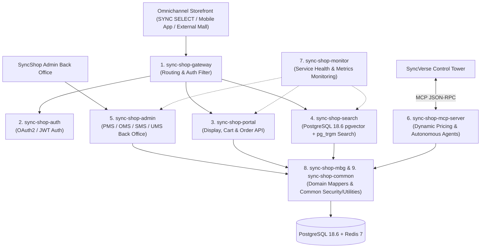

# SyncShop Enterprise Adoption FAQ

These are the technical questions and answers most frequently raised by e-commerce business units, logistics/ERP operations teams, and IT architects when adopting and operating `SyncShop`, an autonomous commerce platform built on 8 independent microservices.

---

## 1. Eight-Microservice (MSA) Architecture and Legacy Integration



### Q1. Why is it structured as 8 independent microservices instead of a single monolith?
- **Answer**: E-commerce workloads have completely different traffic profiles between routine back-office product/settlement management (`sync-shop-admin`) and customer-facing catalog browsing/ordering traffic (`sync-shop-portal`, `sync-shop-search`, `sync-shop-gateway`) that surges during major promotions and flash sales.
- `SyncShop` physically separates 8 independent modules (`gateway`, `auth`, `admin`, `portal`, `search`, `monitor`, `mbg`, `mcp-server`, `common`) so that when customer traffic spikes, only the `portal` and `search` containers scale out immediately while systematically isolating the stability of the back office and AI agents (`mcp-server`).

### Q2. How does it integrate with existing enterprise ERP (SAP, Douzone, etc.), WMS (Warehouse Management Systems), and PG payment networks?
- **Answer**: `SyncShop` is a Headless Commerce architecture in which every commerce domain is exposed via `/api/v1/shop/*` standard Canonical REST APIs and event webhooks.

| Integration Area | Standard Integration Interface | Sync Cadence & Transaction Guarantee |
| :--- | :--- | :--- |
| **ERP (Enterprise Resource Planning)** | `POST /api/v1/shop/pms/products/sync`<br>`GET /api/v1/shop/oms/settlements` | Real-time webhooks or daily batch bidirectional reconciliation for item masters, purchase costs, and sales vouchers |
| **WMS / 3PL Logistics** | `manage_orders` MCP tool (`action: SHIP`)<br>`POST /api/v1/shop/oms/orders/delivery-callback` | Automated dispatch order transmission, tracking number callback, and delivery state transition automation |
| **PG (Payment Gateway)** | Approval/cancellation webhooks and `idempotency_key` verification | 1:1 consistency verification between `oms_order_return` state and the PG ledger during network cancellations and partial refunds |

---

## 2. Dynamic Pricing Margin Protection and Snapshot Rollback

### Q3. Is there a risk of negative margins when AI agents batch-adjust prices via dynamic pricing (`shop_batch_price_update`)?
- **Answer**: During price adjustments, the internal **3-stage commerce agent swarm (`Pricing Optimizer` -> `Margin Safeguard` -> `Executor`)** and multiple safeguards operate to prevent negative margins proactively:
  1. **Minimum Guaranteed Margin Guardrail**: Cross-checks each item's purchase cost (`cost_price`) in the product master (`pms_product`) against category-level minimum margin thresholds (e.g., `15%`). If even a single item falls below the floor, the entire batch transaction is immediately rejected (Fail-Fast).
  2. **HITL Pre-Approval Gate**: Discounts exceeding a threshold (e.g., over `10%`) or large-scale category batch price changes are automatically routed to the `SyncVerse` HITL approval queue and are applied only after approval by the commerce lead.
  3. **Pre-Change Price Snapshot & 1-Click Instant Restore**: Immediately before prices change, a snapshot of the existing selling prices for all target SKUs (`SNP-YYYYMM-NNN`) is automatically preserved in the database. When needed, a single `action: "ROLLBACK_PRICE"` call restores 100% of prior prices within `1 second`.

```json
{
  "jsonrpc": "2.0",
  "id": "shop-pricing-rollback-01",
  "method": "tools/call",
  "params": {
    "name": "shop_batch_price_update",
    "arguments": {
      "action": "ROLLBACK_PRICE",
      "snapshotId": "SNP-202609-089",
      "reason": "Immediate restoration to regular price due to early termination of flash sale promotion"
    }
  }
}
```

---

## 3. High-Traffic Inventory Concurrency Control and Air-Gapped Deployment

### Q4. How does SyncShop prevent overselling caused by concurrent traffic during flash sales or major promotions?
- **Answer**: It uses a **two-stage inventory reservation architecture combining Redis atomic distributed locks with PostgreSQL 18.6 SKU inventory locking (`pms_sku_stock.lock_stock`)**.
  1. **Stage 1 (Reservation on Checkout Entry)**: The moment a customer initiates a payment request, available inventory is immediately reserved via Redis atomic operations and a DB `lock_stock` increment query (`WHERE stock - lock_stock >= :quantity`).
  2. **Stage 2 (Payment Confirmation & Timeout Auto-Release)**: Upon PG payment approval, both `stock` and `lock_stock` are decremented simultaneously. If payment is not completed within the configured payment window (default `15 minutes`), a delay-queue worker automatically releases the reserved stock (`lock_stock`) back into available inventory.

### Q5. Can fast product search and AI semantic recommendations run without a separate search engine (Elasticsearch)?
- **Answer**: Yes. The `sync-shop-search` microservice combines **PostgreSQL 18.6 `pgvector` HNSW vector indexes with `pg_trgm` full-text search indexes**. This delivers ultra-low-latency natural-language intent-based semantic product search (e.g., `"lightweight jacket for autumn office wear"`) alongside exact brand and SKU code matching from a single PostgreSQL 18.6 cluster, eliminating heterogeneous search engine index sync lag and dual-cluster operational overhead.

### Q6. Can it be deployed independently in an on-premises or private cloud (VPC) environment?
- **Answer**: Yes. All 8 microservices, the back office (`admin/`), the flagship storefront (`web/`), and the 6-File DB SSOT scripts (`sync-shop/db/00_extensions.sql` ~ `05_sample_dev.sql`) are packaged as standard containers (`docker-compose-dev.yml` and K8s manifests), allowing immediate deployment on enterprise-owned infrastructure with zero external SaaS dependencies.

---

## 4. Eight Independent Microservice Modules and Port Configuration

| No. | Module ArtifactId (`Server/`) | Default Port | Core Responsibilities & Technical Role |
| :---: | :--- | :---: | :--- |
| **1** | `sync-shop-gateway` | `8201` | Spring Cloud Gateway-based single-entry routing and JWT authorization filter |
| **2** | `sync-shop-auth` | `8401` | OAuth2 / JWT token issuance and unified admin/consumer authentication server |
| **3** | `sync-shop-admin` | `8080` (`18082`) | PMS (Product), OMS (Order), SMS (Promotion), and UMS (Member) back-office REST APIs (`/api/v1/shop/*`) |
| **4** | `sync-shop-portal` | `8085` | Customer-facing APIs for flagship storefront (`SYNC SELECT`) display, cart, and order checkout |
| **5** | `sync-shop-search` | `8081` | Hybrid product search and semantic recommendations powered by `PostgreSQL 18.6 pgvector` + `pg_trgm` |
| **6** | `sync-shop-monitor` | `8101` | Spring Boot Admin-based microservice health checks, JVM metrics, and log monitoring |
| **7** | `sync-shop-mcp-server` | `8086` | `AgentScope Java`-based autonomous pricing swarm and MCP tool server (`/api/v1/shop/mcp/*`) |
| **8** | `sync-shop-mbg` | Library | Domain entities and MyBatis mapper layer (`pms_*`, `oms_*`, `sms_*`, `ums_*`) |
| **9** | `sync-shop-common` | Library | Enterprise standard response wrappers, RFC 7807 exception handling, Redis caching, and security utilities |
