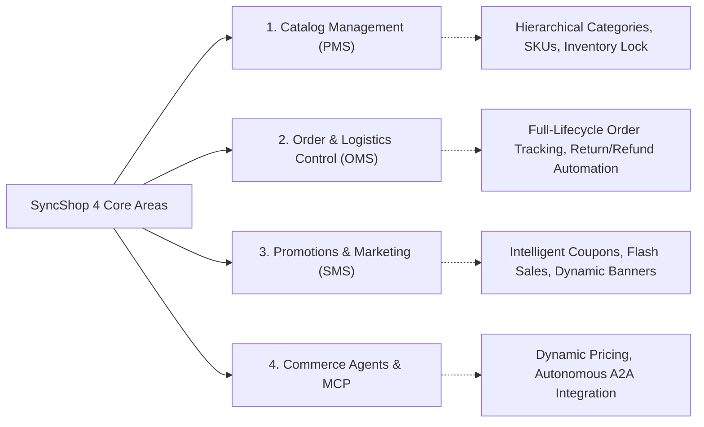
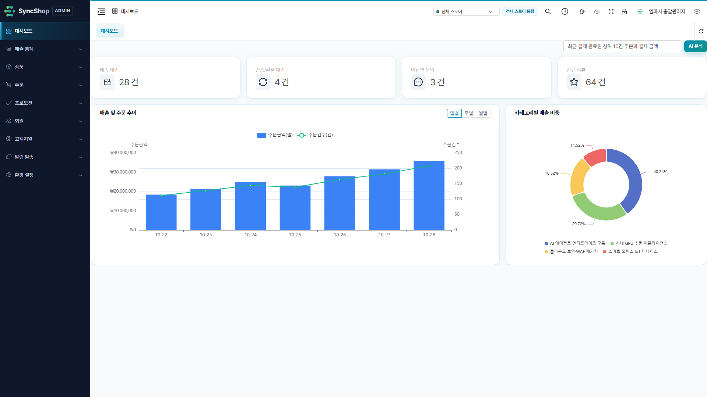
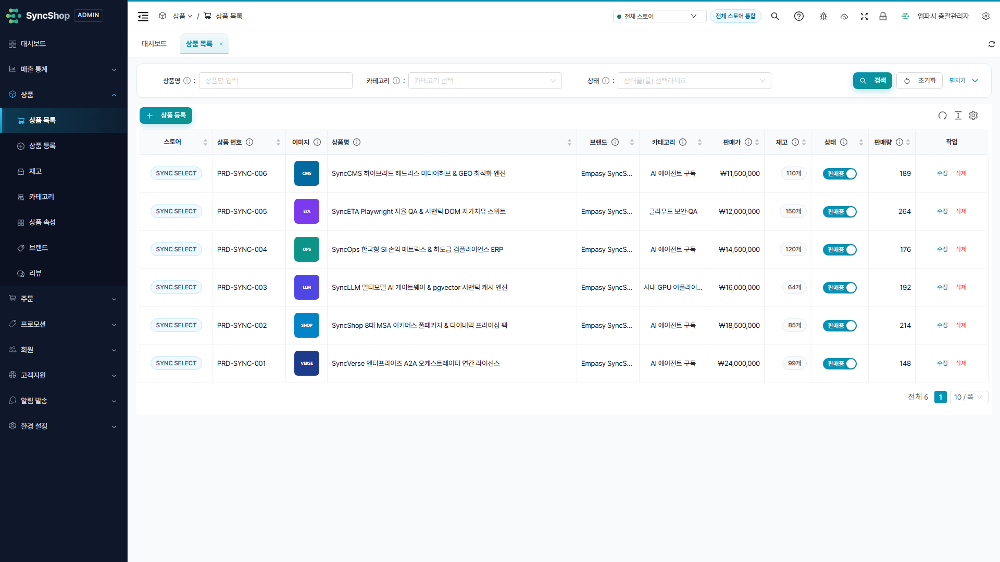
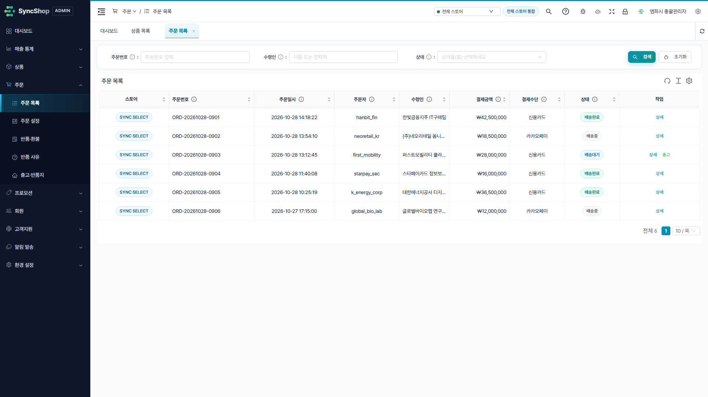
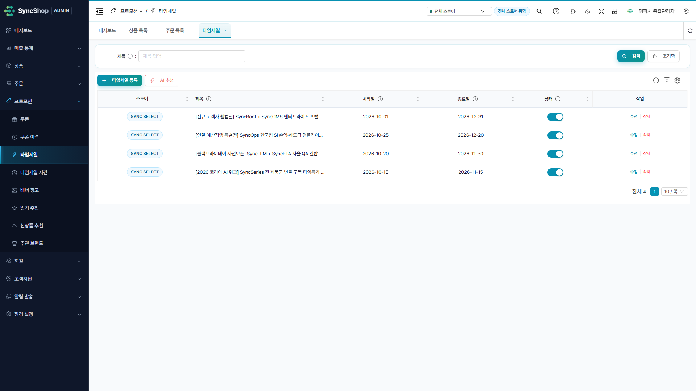

# SyncShop: Intelligent Commerce Operations Platform Overview

> **Non-Developer & Evaluation Guide**: Visit the [SyncShop Product Homepage (empasy.io)](https://empasy.io/en/solutions/sync-shop.html){target="_blank" rel="noopener"} for an accessible product overview, try the live UI without installation on the [Unified Demo Portal](https://demo.empasy.io/en/products/sync-shop/#demo){target="_blank" rel="noopener"}, or download brochure and proposal PDFs from the [Proposals Archive](/en/proposals/).

SyncShop is a **Headless eCommerce** platform that decouples backend commerce logic from the frontend presentation layer for business agility and channel scalability.

By exposing every core capability as RESTful APIs and standard MCP (Model Context Protocol) tools, it unifies control across web, mobile apps, kiosks, and social commerce touchpoints, while supporting autonomous commerce operations through a Spring Boot 4.0-based MSA architecture and the AgentScope Java agent harness.

---

## Four Core Functional Areas

1. **Product Management System (PMS)**:
   * Hierarchical categories of unlimited depth and brand asset management.
   * Granular SKU pricing and inventory control across option combinations such as color, size, and capacity.
   * Real-time inventory locking and low-stock alerts to prevent both stockouts and overstocking.

2. **Order Management System (OMS)**:
   * Full-state tracking from pending payment through shipment preparation, transit, and delivery confirmation.
   * Standardized return and refund review workflows.
   * Unified management of multiple shipping addresses and multi-warehouse fulfillment centers.

3. **Sales Management System (SMS)**:
   * Conditional targeted coupon engine (sign-up, membership tier, and specific product categories).
   * Time-boxed, limited-quantity flash sale session management.
   * Control over featured brands and strategic product display ordering on primary storefronts.

4. **Commerce Agents & MCP Integration**:
   * Real-time database dynamic pricing and snapshot rollback via `shop_batch_price_update`.
   * Autonomous control over inventory and order states via `manage_product_catalog` and `manage_orders`.
   * AgentScope Java-based agent swarm and A2A collaboration with the SyncVerse central control tower.

---

## Solution Architecture Summary

| Area | Component | Primary Tech Stack | Description |
|:---|:---|:---|:---|
| **Backend Server** | `sync-shop-admin` | Java 25, Spring Boot 4.0, MyBatis | RESTful commerce APIs, transactions, and security (JWT, RBAC) |
| **Agent Server** | `sync-shop-mcp-server` | AgentScope Java, Spring Web, MCP SDK | A2A tool provisioning, dynamic pricing, asynchronous control integration |
| **Admin UI** | `SyncShop Admin` | Vue 3, Vite, TypeScript, Ant Design Vue | Comprehensive commerce operations dashboard and back-office control UI |
| **Mobile / Client** | `SyncShop App` | Vue / Uni-App | Omnichannel mobile commerce frontend |

---

## Live UI Screens and Core Workflows

### 1. Omnichannel Sales, Order, Inventory, and Agent Control Dashboard
Monitor real-time revenue, order throughput, available stock, and dynamic pricing agent status across the 9 distributed microservices at a glance.

### 2. Multi-Level Product Catalog, Inventory Lock, and Dynamic Pricing
Manage hierarchical categories, brand assets, and option-level SKU inventory locks while executing dynamic pricing within minimum margin rate guardrails.

### 3. Full-Lifecycle Order Tracking and Claim/Settlement Automation
Track every order stage from pending payment through warehouse dispatch, delivery completion, and return/refund review in real time while automatically detecting anomalous orders.

### 4. Flash Sales, Targeted Coupons, and 1-Click Price Snapshot Restore
Operate time-boxed limited-quantity flash sales and conditional coupon campaigns, and compare pre-/post-adjustment price snapshots for instant 1-click restoration.

---

## Key Documentation Links

* [System Architecture and Agent Swarm](/en/syncshop/architecture)
* [Product Catalog and Order Logistics Operations](/en/syncshop/catalog-and-order)
* [Promotions, Coupons, and Campaigns](/en/syncshop/promotion-and-marketing)
* [MCP Tools and A2A Orchestration](/en/syncshop/mcp-and-agent)
* [Frequently Asked Questions (FAQ)](/en/syncshop/enterprise-faq)
