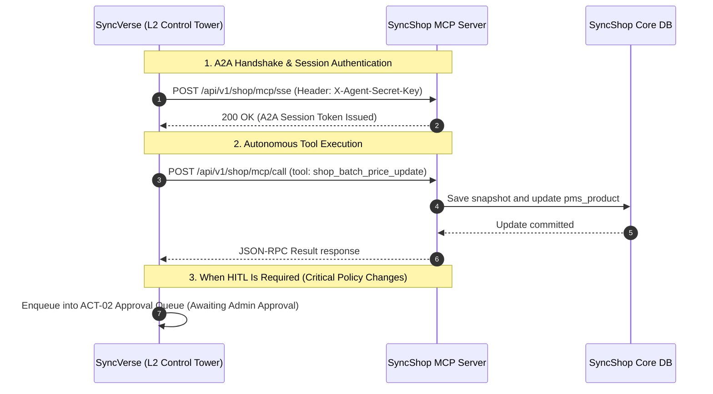

# MCP Tools and A2A Orchestration

SyncShop exposes all management functions and commerce control interfaces as standard **Model Context Protocol (MCP)** tools, enabling autonomous collaboration with the SyncVerse central control tower and cross-domain agents.

---

## 1. MCP Tool Registry Specification

The following production tools are provided out of the box by the SyncShop MCP Server (`sync-shop-mcp-server`).

| Tool Name | Key Input Parameters | Return Type (JSON) | Description |
|:---|:---|:---|:---|
| **`shop_batch_price_update`** | `action` (BATCH_UPDATE_PRICE / ROLLBACK_PRICE)<br>`categoryId` (Long, optional)<br>`rate` (Double, discount/markup rate)<br>`snapshotId` (String, required for rollback) | `PriceUpdateResult` | Batch price adjustment against the live `pms_product` DB and snapshot rollback |
| **`manage_product_catalog`** | `action` (CREATE / UPDATE / DELETE / STOCK)<br>`productPayload` (Map) | `CatalogActionResult` | Product master CRUD and per-option inventory quantity updates |
| **`manage_orders`** | `action` (SEARCH / CONFIRM / CANCEL / REFUND / SHIP)<br>`orderSn` (String)<br>`payload` (Map, optional) | `OrderActionResult` | Order status transitions, shipment processing, and return review approval |
| **`shop_update_checkout_policy`** | `policyKey` (String)<br>`policyValue` (String) | `PolicyUpdateResult` | Updates free-shipping thresholds, minimum order amounts, and payment policies |
| **`shop_fetch_commerce_logs`** | `logLevel` (INFO/WARN/ERROR)<br>`orderSn` (String, optional)<br>`limit` (Integer) | `List<CommerceLogRecord>` | Collects trace logs for payment anomalies, PG integration failures, and stock shortages |
| **`revert_data_state`** | `taskId` (String)<br>`snapshotId` (String) | `RevertResult` | Compensating restoration to a prior stable state upon distributed Saga transaction failure |

---

## 2. Detailed Tool Parameter Specifications

### 2.1 `shop_batch_price_update` (Dynamic Pricing)

Binds directly to the live commerce database to update prices in bulk and automatically issues a snapshot immediately prior to modification.

```json
{
  "name": "shop_batch_price_update",
  "arguments": {
    "action": "BATCH_UPDATE_PRICE",
    "categoryId": 104,
    "rate": 0.9,
    "reason": "Season-off outerwear promotion applied"
  }
}
```

* **Success Response Example**:
```json
{
  "status": "SUCCESS",
  "snapshotId": "SNP-202609-089",
  "affectedCount": 42,
  "backupTimestamp": "2026-09-24T10:15:30Z",
  "message": "Batch price reduction completed for 42 items in category 104 (10% discount)"
}
```

### 2.2 `manage_orders` (Order State Control)

```json
{
  "name": "manage_orders",
  "arguments": {
    "action": "SHIP",
    "orderSn": "ORD-20260924-0012",
    "payload": {
      "deliveryCompany": "CJ Logistics",
      "deliverySn": "6892019482"
    }
  }
}
```

---

## 3. A2A Integration Specification with SyncVerse Control Tower



* **Security Handshake**: Inbound security verification through `A2ASessionKeyHolder` blocks unauthorized external requests.
* **Governance Approval Integration**: High-impact operations such as enterprise payment policy changes (`shop_update_checkout_policy`) must pass through the SyncVerse HITL approval gateway before execution.
