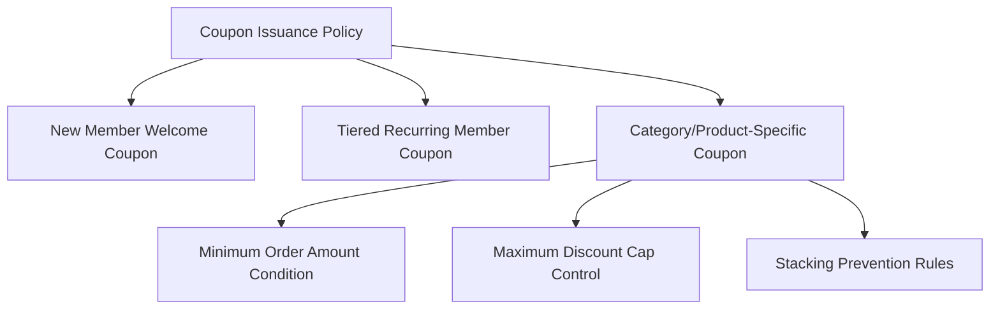

# Promotions, Coupons, and Marketing Management

SyncShop's Marketing Management (SMS) provides powerful promotional tools designed to maximize conversion rates and rapidly reflect marketers' campaign strategies on the storefront.

---

## 1. Intelligent Coupon Engine

* **Precision Targeted Issuance**: Issues tailored coupons for new members, specific membership tiers, and long-dormant customers.
* **Application Constraint Controls**: Protects profit margins by restricting usage to specific categories or designated products, enforcing minimum payment thresholds, and setting maximum discount caps.
* **Redemption Tracking**: Aggregates real-time redemption rates against issued coupon quantities to measure promotional ROI.

---

## 2. Flash Sale Session Operations

Provides a time-sale capability that offers limited stock at deep promotional discounts during designated time windows.

* **Time-Slot Session Management**: Creates and operates independent sessions by date and time window (e.g., 10:00–14:00, 20:00–24:00).
* **Limited-Quantity Sales & Countdown**: Configures per-session purchasable stock limits and integrates with real-time frontend countdowns for remaining time and inventory.
* **Concurrency Control**: Prevents overselling under heavy traffic spikes at session launch using atomic Redis operations.

---

## 3. Merchandising and Content Marketing

* **Strategic Product Merchandising**: Instantly reorders product display positions across home screen sections—including recommended items, new arrivals, and weekly bestsellers—via drag-and-drop.
* **Dynamic Banner Management**: Supports HTML5 and video-based dynamic banners in addition to static image banners, tracking click-through rates (CTR) and attributed conversion revenue by placement.
* **Magazine-Style Theme Campaigns**: Publishes curated landing pages combining editorial content and products around specific themes (e.g., Spring Home Styling, Office Desk Setup).

---

## 4. Related Admin Screen Code Mapping

| Functional Area | Screen ID | Vue Component Path | Description |
|:---|:---|:---|:---|
| **Promotional Coupons** | `SHOP-07` | `src/views/sms/coupon/index.vue` | Coupon creation, issuance history, and redemption statistics |
| **Flash Sale Campaigns** | `SHOP-08` | `src/views/sms/flash/index.vue` | Time-sale session configuration and promotional product mapping |
| **Main Banner Display** | `SHOP-09` | `src/views/sms/advertise/index.vue` | Home/category banner registration and display order control |
| **Sales Analytics** | `SHOP-10` | `src/views/sms/statistic/index.vue` | Daily/product sales trends, average order value, and conversion rate reports |
