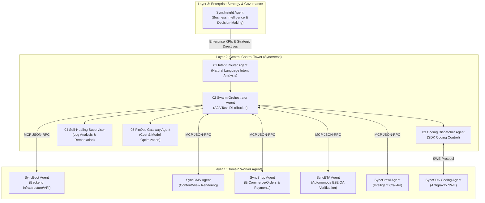
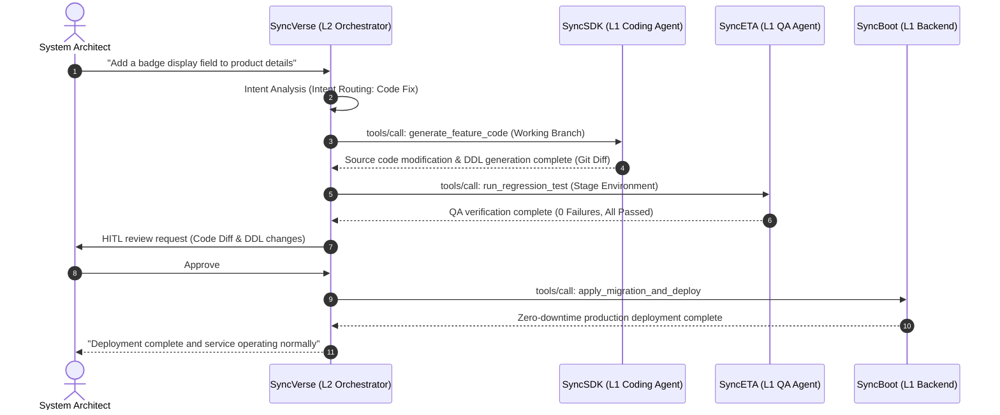
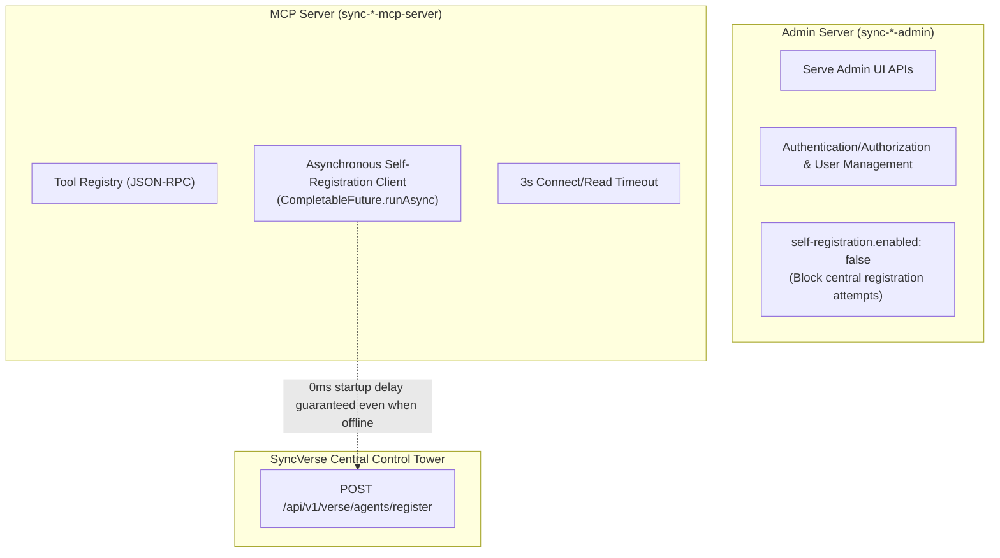

# 4-Tier Autonomous Agent Federation Architecture & A2A Communication

To systematically operate complex enterprise systems, SyncVerse adopts a **4-Tier Autonomous Agent Federation Architecture** and a **standard MCP (Model Context Protocol)-based Agent-to-Agent (A2A) communication network**.

---

## 1. 4-Tier Autonomous Agent Federation Hierarchy

By cleanly separating responsibilities and permissions across tiers, the architecture prevents single points of failure (SPOF) while ensuring security and execution reliability.



### Detailed Responsibilities by Layer

1. **Layer 3: Enterprise Governance & Strategic Decision-Making (Strategic Layer)**
   - **Primary Agent**: `SyncInsight Agent`
   - **Role**: Analyzes enterprise-wide business metrics, traffic shifts, and marketing data to deliver high-level operational strategies and action plans to the Layer 2 Control Tower.

2. **Layer 2: Central Control Tower & Orchestration (Control Tower Layer - SyncVerse)**
   - **Primary Agents**: `Intent Router`, `Swarm Orchestrator`, `Coding Dispatcher`, `Self-Healing Supervisor`, `FinOps Gateway`
   - **Role**: Translates natural language requirements into concrete system action plans, coordinates dependencies as well as sequential/parallel execution across domain worker agents, and manages transactions and costs.

3. **Layer 1: Domain-Specific Worker Agents (Domain Worker Layer)**
   - **Primary Agents**: `SyncBoot`, `SyncCMS`, `SyncShop`, `SyncETA`, `SyncCrawl`, `SyncSDK`
   - **Role**: Directly executes core domain business logic (database CRUD, page rendering, order processing, autonomous QA testing, code modification, etc.).

---

## 2. A2A Communication Protocol (Model Context Protocol)

All inter-agent communication within SyncVerse operates on open standards: **MCP (Model Context Protocol)** and **JSON-RPC 2.0**.

### Communication Sequence Diagram



### Standard MCP Request/Response Payload Specification

#### Agent Tool Invocation Request (Request Payload)
```json
{
  "jsonrpc": "2.0",
  "id": "req-syncverse-98213",
  "method": "tools/call",
  "params": {
    "name": "syncboot_apply_migration",
    "arguments": {
      "targetService": "product-service",
      "ddlScript": "ALTER TABLE tb_product ADD COLUMN badge_type VARCHAR(20) DEFAULT 'NONE';",
      "safeMode": true,
      "timeoutSeconds": 30
    }
  }
}
```

#### Agent Execution Result Response (Response Payload)
```json
{
  "jsonrpc": "2.0",
  "id": "req-syncverse-98213",
  "result": {
    "content": [
      {
        "type": "text",
        "text": "Migration successfully applied. 0 rows affected. DDL lock released."
      }
    ],
    "isError": false,
    "metadata": {
      "executionTimeMs": 142,
      "affectedTables": ["tb_product"]
    }
  }
}
```

---

## 3. Technology Stack & Runtime Architecture

SyncVerse adopts the following technology stack to support high-volume enterprise traffic and zero-downtime operations.

| Layer | Technology Stack | Purpose |
| :--- | :--- | :--- |
| **Backend Core** | Java 25, Spring Boot 4.0 | Enterprise runtime, Virtual Threads, transaction management |
| **AI Framework** | **AgentScope Java** (`io.agentscope:agentscope-harness`) | Enterprise standard AI framework, multi-agent MsgHub collaboration, ReActAgent autonomous tool execution |
| **Frontend UI** | Vue 3, TypeScript, Vite, **Vue Flow** | Node-edge topology visualization, control tower dashboard |
| **State & Cache** | Redis 7.x (Cluster) | Real-time agent state sharing, semantic caching, distributed locking |
| **Database** | PostgreSQL 18.6 (`pgvector`) | RDBMS data consistency, JSONB audit logs, vector embedding persistence |
| **Infrastructure** | Docker, Kubernetes, GitHub Actions | Containerized isolated execution, CI/CD deployment pipelines |

---

## 4. Role Separation Between Admin Server and MCP Server (Guaranteed 0ms Startup Delay)

Every subproject under SyncSeries strictly separates the responsibilities of its Admin server (serving management UIs) and its MCP server (providing agent collaboration tools).



1. **Preemptive Isolation of Admin Server from SyncVerse Dependencies**:
   * Each service's Admin server focuses exclusively on UI rendering and business REST APIs, preventing unnecessary Control Tower registration attempts via `self-registration.enabled: false`.
2. **Asynchronous MCP Server Self-Registration and Timeout**:
   * On MCP server startup, `AgentSelfRegistrationClient` performs registration asynchronously on a background thread via `CompletableFuture.runAsync`.
   * Enforcing a 3-second connect/read timeout based on `SimpleClientHttpRequestFactory` ensures the main process never blocks and starts immediately with 0ms delay even if the SyncVerse Control Tower is down or not yet running.
