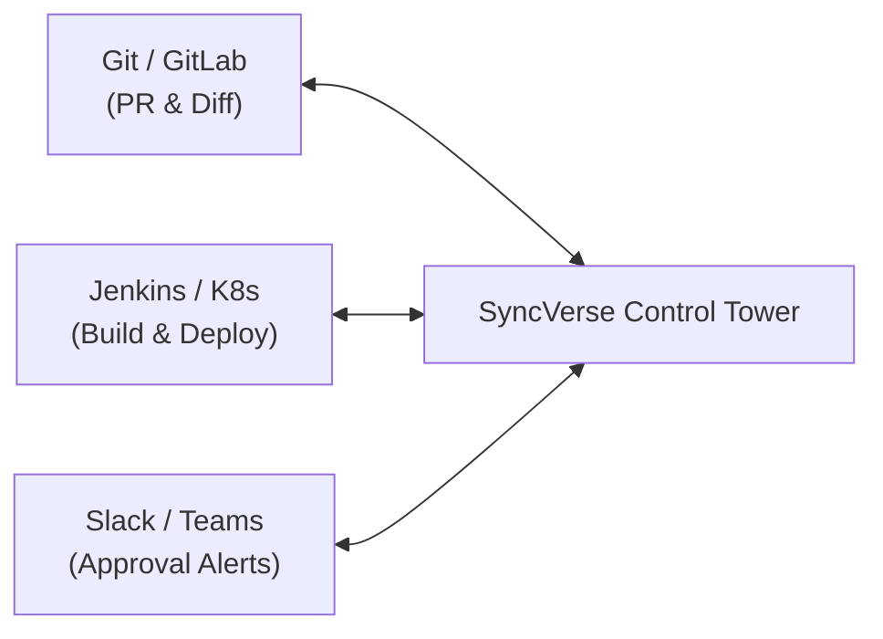

# Enterprise Adoption FAQ & Private AI Security

This page compiles frequently asked questions and technical answers from enterprise architects and security officers evaluating SyncVerse for production environments.

---

## 1. Security & Private AI Environment

### Q1. Can SyncVerse be configured so that internal source code and data are never sent to external AI vendors (such as OpenAI)?
> **A. Yes, air-gapped and on-premises deployments are fully supported.**  
> SyncVerse integrates with self-hosted open-source LLMs (vLLM, Ollama, internally fine-tuned Llama 3 / Solar-Pro, etc.) and internal GPU servers. Even when using commercial cloud LLMs, data is protected through **automatic PII masking filters** and **enterprise Zero Data Retention endpoints**.

### Q2. Is there any risk of AI accidentally damaging a production database?
> **A. No, destructive changes are blocked preemptively by HITL (Human-In-The-Loop) governance.**  
> All schema-altering DDL statements (such as `ALTER TABLE` or `DROP`) and production deployments cannot be executed autonomously by agents alone; they require explicit approval from a system architect along with 2FA verification.

---

## 2. Existing Infrastructure & System Integration

### Q3. Can SyncVerse integrate with our existing Git repositories, CI/CD pipelines, and internal messaging tools?
> **A. Yes, it provides standard integration interfaces for enterprise infrastructure.**  
> - **Source Control**: GitHub, GitLab, Bitbucket (working branch creation, PR submission, code diff inspection)
> - **CI/CD Pipelines**: Jenkins, GitHub Actions, GitLab CI, ArgoCD
> - **Container Orchestration**: Kubernetes, Docker Compose
> - **Collaboration Tools**: Slack, Microsoft Teams, Jira, Dooray (approval request notifications and status checks)

### Q4. Does SyncVerse support legacy systems written in languages other than Java Spring Boot?
> **A. Yes, it does.**  
> Because SyncVerse communicates over the standard **Model Context Protocol (MCP)** and **REST/JSON-RPC**, microservices written in any language—such as Python (FastAPI), Node.js (NestJS), Go, or C#—can be integrated into the Control Tower by attaching a standard MCP Server wrapper.

---

## 3. Adoption Process & PoC Roadmap

### Phase 1: Preparation & PoC (2–4 Weeks)
- Select one target domain service and connect it to the SyncVerse Control Tower
- Register the target service's Git repository and MCP servers for `SyncBoot`, `SyncCMS`, and `SyncETA` agents
- Test intent routing accuracy and natural language command execution

### Phase 2: Pilot Operation (4–8 Weeks)
- Operate autonomous QA and self-healing pipelines in Dev/Stage environments
- Enable the architect HITL approval console and measure reductions in feature delivery lead time (TTM)

### Phase 3: Enterprise-Wide AI DLC Expansion (Ongoing)
- Expand Control Tower coverage across all enterprise microservices
- Connect business data directly to development execution through `SyncInsight` integration

---

## 4. Licensing & Technical Support

SyncVerse is available in both an Open-Source Community Edition and an Enterprise Edition.
- **Adoption Inquiries & PoC Support**: `poh@empasy.com`
- **Official Technical Support Portal**: [https://doc.empasy.com](https://doc.empasy.com)
