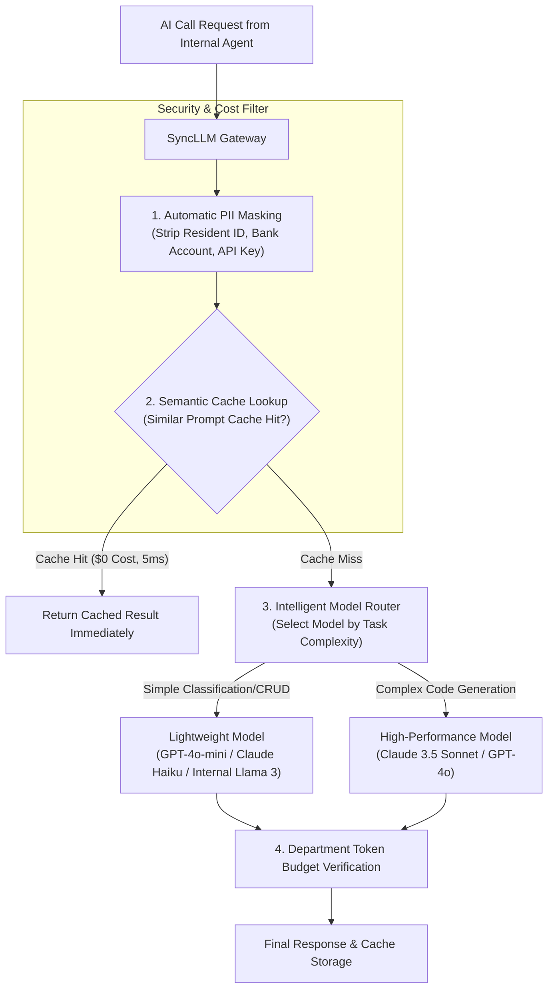

# SyncLLM Gateway & FinOps Cost Optimization

When multiple internal teams and agents independently call commercial LLM APIs (OpenAI, Anthropic, Google, etc.), organizations face **fragmented cost control, wasted tokens from duplicate requests, and the risk of leaking sensitive personally identifiable information (PII)**.

SyncVerse's **FinOps Gateway Agent (SyncLLM)** centralizes all AI requests through a unified gateway to **strengthen security and systematically optimize API costs**.

---

## 1. Four Core Capabilities of the FinOps Gateway



---

## 2. Semantic Cache Lookup

Traditional exact-match string caching suffers from low reuse rates whenever phrasing or whitespace differs slightly.

SyncLLM supports semantic caching based on **embedding vector similarity (Cosine Similarity $\ge 0.95$)**:
- *"Write an API to query the product list"*
- *"Generate API code that fetches the list of products"*

By evaluating the semantic similarity between the two requests, SyncLLM immediately returns the cached result without invoking an external LLM, reducing both response latency and token spend.

---

## 3. Real-Time Automatic PII Masking

Before any payload is transmitted to external LLM vendors, the gateway uses regular expressions and NER (Named Entity Recognition) to detect and pseudonymize/mask sensitive data (national ID numbers, phone numbers, email addresses, credit card numbers, internal database passwords, etc.).

```json
// Example of automatic masking transformation before sending to LLM
{
  "originalPrompt": "Cancel the order for customer John Doe (010-1234-5678, 900101-1234567)",
  "sanitizedPrompt": "Cancel the order for customer [MASK_USER_1] ([MASK_PHONE_1], [MASK_RRN_1])"
}
```

---

## 4. Department-Level Token Budget Control

Administrators can configure monthly AI token consumption limits per department and project from the admin console.
- **Warning Threshold (80%)**: Sends an alert notification to administrators
- **Hard Limit Reached (100%)**: Restricts non-critical agents from invoking high-tier models and automatically downgrades them to lightweight models
