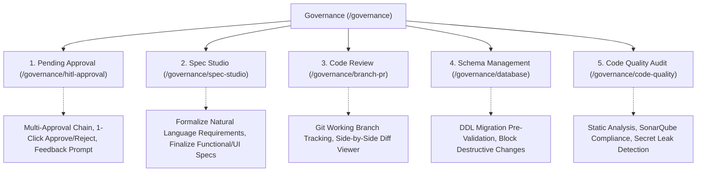

# Enterprise Task Approval (HITL) Governance Console

To maximize the generation velocity of AI agents while preventing data loss or service outages, SyncVerse promotes **Task Approval (Governance)** into an independent top-level control category.

---

## 1. Five-View Governance Control Structure

The SyncVerse Admin Console separates complex approval workflows into five dedicated, operations-focused screens.

### 1.1 Pending Approval (`HitlApprovalView.vue`)
* A real-time queue awaiting architect approval for critical changes requested by agents (production deployments, bulk price updates, privilege escalations, etc.).
* Supports multi-approval chains and automatically feeds rejection reasons back to the agent when a request is rejected.

### 1.2 Spec Studio (`SpecStudioManageView.vue`)
* A specification studio that formalizes unstructured natural language user requests into standardized functional specifications and screen specifications.
* Only finalized specifications are dispatched as work orders to coding agents.

### 1.3 Code Review (`BranchPrManageView.vue`)
* Monitors Git working branches and Pull Request (PR) changes generated by agents in real time.
* Visualizes before-and-after source code in a side-by-side diff view so human reviewers can quickly inspect modifications.

### 1.4 Schema Management (`DatabaseGovernanceView.vue`)
* Pre-validates DDL migration scripts for creating new tables, altering columns, and other schema changes.
* Blocks irreversible destructive DDL statements such as `DROP TABLE` or large-scale `TRUNCATE`, enforcing soft deletes or phased deprecation instead.

### 1.5 Code Quality Audit (`CodeQualityAuditView.vue`)
* Automatically runs compilation integrity checks, Zero-Mock compliance verification, SonarQube rulesets, and secret leak scanning, then outputs an audit report.

---

## 2. R&R Between AI Agents and System Architects

| Operational Stage | AI Agent Responsibilities | System Architect (Human) Responsibilities |
|:---|:---|:---|
| **01. Requirements Analysis** | Interpret natural language directives, analyze impact, draft functional/UI specifications | Submit requirements and grant final Spec Studio approval |
| **02. Code & DDL Generation** | Create working branch, author code, derive 6-File SQL (`db/00_extensions.sql ~ 05_sample_dev.sql`) scripts | *(No intervention — executed autonomously)* |
| **03. Testing & Quality Audit** | Autonomous QA regression verification, static analysis, Zero-Mock harness verification | Review audit reports and quality metrics |
| **04. Review & Approval Gate** | Provide change diff summary report and ERD change diagrams | **Code review and schema approve/reject decision** |
| **05. Production Deployment & Audit** | Zero-downtime rollout, Saga transaction commit, audit trail preservation | Trigger emergency Kill-Switch in critical situations |

---

## 3. Enterprise Safety Guardrails

* **Two-Factor Authentication for Production Deployment**: Passing 2FA/OTP verification is mandatory when triggering a production deployment pipeline.
* **Preemptive Blocking of Destructive DDL**: Immediately halts execution whenever destructive SQL patterns that could cause data loss are detected.
* **Enterprise Emergency Kill-Switch**: Safely halts (Safe Halt) all running agents and isolates connections with a single click when anomalous transactions are detected.
