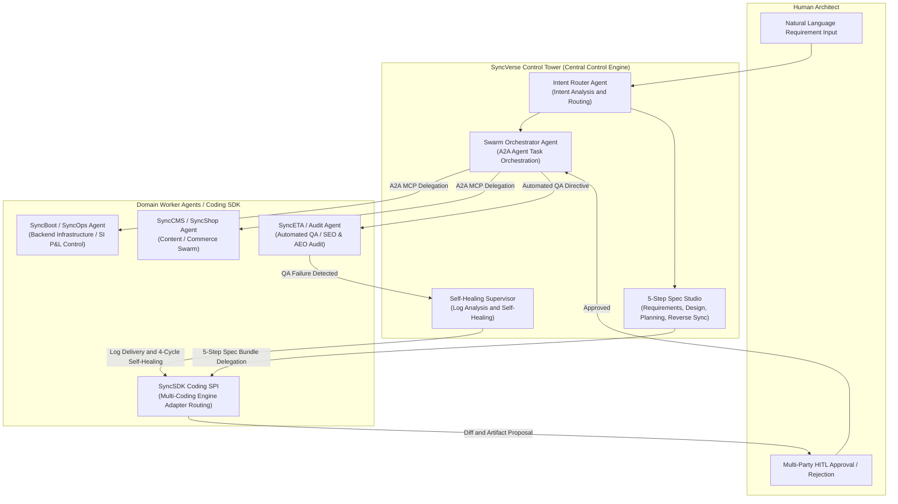
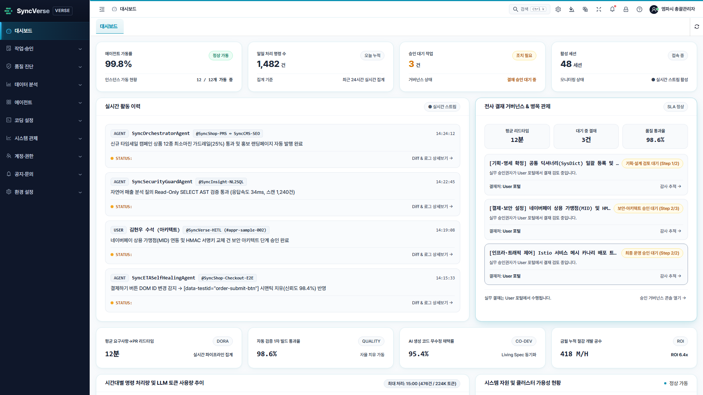
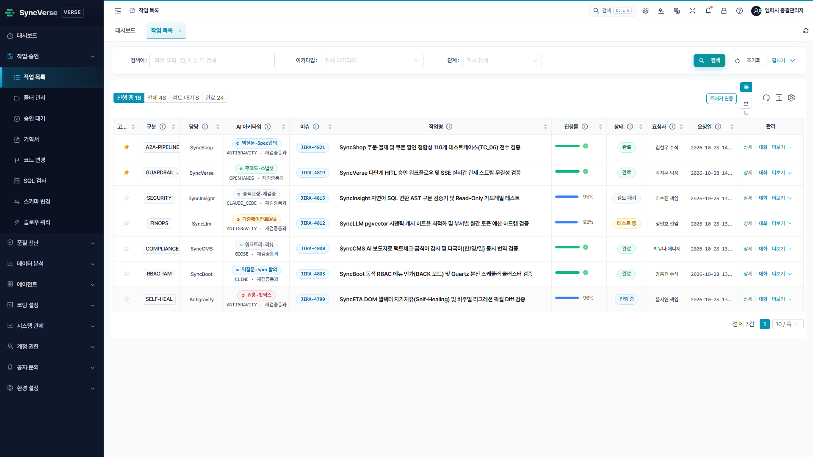
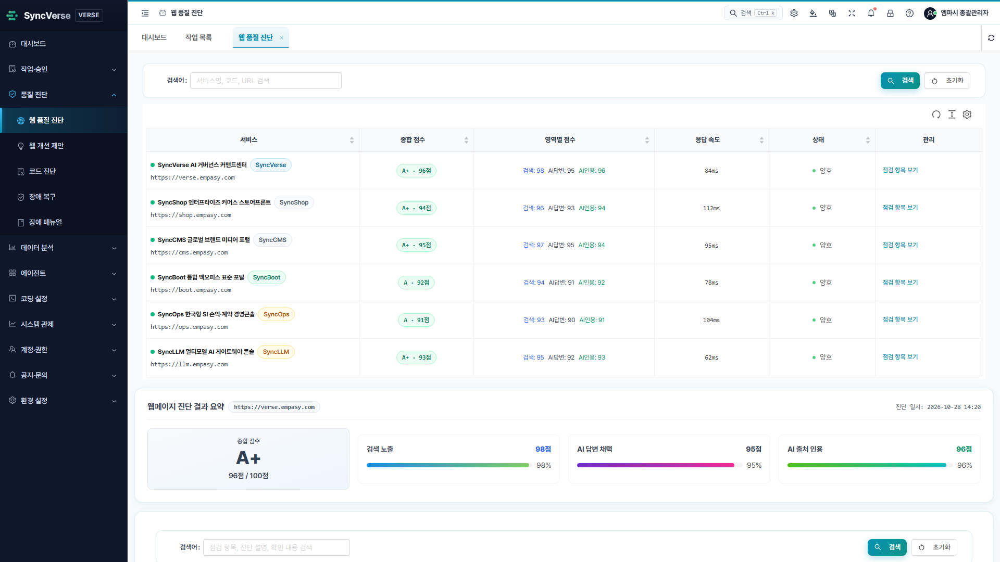
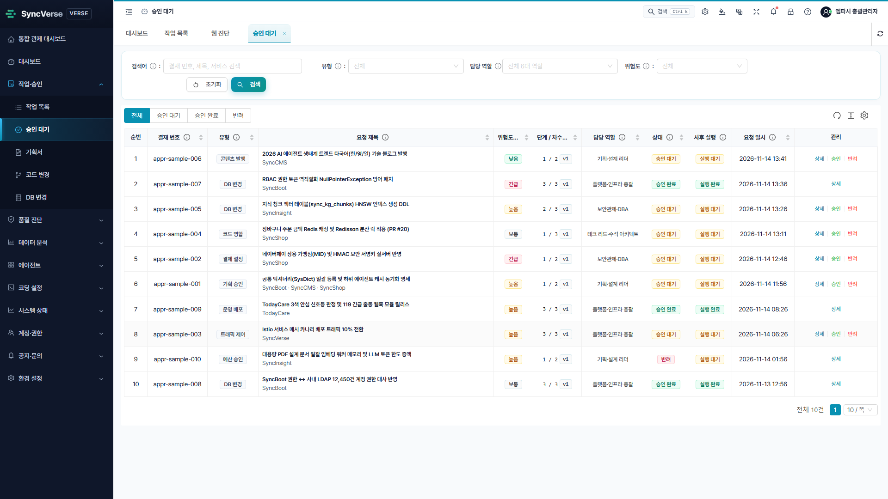

# SyncVerse: Multi-Agent Central Control and Orchestration Platform

> **For Non-Developers & Evaluation Teams**: Explore an accessible product overview on the [SyncVerse Product Website (verse.empasy.io)](https://verse.empasy.io/en/){target="_blank" rel="noopener"}, try the no-install UI experience in the [Unified Demo Portal](https://sync.empasy.io/en/products/sync-verse#demo){target="_blank" rel="noopener"}, or download brochures and proposal PDFs from the [Proposals Library](/en/proposals/).

**SyncVerse** is a **central orchestration platform (Control Tower)** that connects independently operating, distributed domain solutions through standardized interfaces to unify requirements organization, task delegation, quality verification tracking, and multi-stage approval workflows.

The SyncVerse central orchestrator communicates with subordinate domain modules (`SyncWatch`, `SyncAPIM`, `SyncBoot`, `SyncCMS`, `SyncShop`, `SyncOps`, `SyncLLM`, `SyncInsight`, `SyncETA`, `SyncCrawl`) over standard **[MCP](/en/glossary/#mcp)** and **[A2A](/en/glossary/#a2a)** protocols. In addition, it inspects repository vulnerabilities and generates patch PR drafts based on the `VerseAuditPack` (SCA dependency, SAST code, and DAST inspection rule pack) received from [`SyncWatch`](/en/syncwatch/).

---

## 1. Four Core Components

SyncVerse provides four core engines to support the end-to-end software development and operations lifecycle (AI DLC).

| Core Engine | Role and Capabilities | Key Technical Mechanisms |
| :--- | :--- | :--- |
| **01. Natural Language Intent Classification & A2A Delegation** | Determines whether an incoming request is an operational data task or a source code change task and delegates it to the appropriate domain module | `A2ASwarmDelegationStrategyHandler`, domain-context Tri-Hybrid RAG injection |
| **02. 5-Step Spec Studio** | Acceptance Criteria (AC) refinement -> detailed technical specification -> implementation plan -> branch task delegation -> reverse sync of four standard artifacts | Decision Queue, Living Spec, Requirements Coverage Matrix |
| **03. Multi-Coding Engine SPI Routing (`SyncSDK`)** | Selects an active coding adapter registered under enterprise policy when modifying source code and generates patches on an isolated branch | `CodingAgentRoutingProxy` (`ICodingAgentClient` plugin adapter architecture) |
| **04. Automated Deployment Integration & Self-Healing Recovery** | 4-Cycle build error analysis and remediation, plus snapshot-based compensating rollback on deployment failure | `sync-module-deploy`, [Multi-Party HITL](/en/glossary/#hitl) approval chain, snapshot compensating rollback |

---

## 2. 6-Step AI DLC Lifecycle

SyncVerse tracks pipeline status across six stages, from requirement intake through approval and deployment.

1. **Requirements Analysis and Spec Refinement (Spec Studio Steps 1–3)**: Analyzes requirement prompts to generate Acceptance Criteria (AC), technical specifications, implementation plans, and a Requirements Coverage Matrix.
2. **Isolated Branch Code Authoring (Spec Studio Step 4)**: Authors source code and 6-File DB SSOT (`db/00_extensions.sql` ~ `05_sample_dev.sql`) DDL change proposals on an isolated working branch through the `SyncSDK` adapter.
3. **Automated Regression Verification (Automated QA)**: Executes automated builds alongside Playwright and `SyncETA` E2E regression tests.
4. **Build & Test Error Remediation (4-Cycle Self-Healing Loop)**: When compilation or tests fail, collects distributed logs to perform root-cause analysis and retry patching.
5. **Multi-Party Architect Approval (Multi-Party HITL Approval)**: System architects review code diffs and impact analysis reports to approve or reject across multi-stage approval chains.
6. **Deployment and Artifact Reverse Sync (Spec Studio Step 5)**: Passes approved changes to the deployment pipeline and updates the four standard artifacts (Requirements Definition, Screen Design Specification, DB Design Specification, and Test Results Report).

---

## 3. Operational Architecture Comparison (Manual Operations vs. SyncVerse Central Control)

| Category | Individual Manual Development & Operations | SyncVerse Central Control Architecture |
| :--- | :--- | :--- |
| **Requirements Specification Tracking** | Specs, issues, and code diverge, causing change history drift | Specification, implementation, and artifacts stay reverse-synced via 5-Step Spec Studio |
| **Code Change Workflow** | Tooling fragmentation and manual branching/verification procedures per developer | Isolated branch creation and consistent verification gates via the `SyncSDK` standard SPI |
| **Incident Root-Cause Analysis & Re-verification** | Manual server log collection and reproduction upon errors | Automated cluster log collection linked with 4-Cycle build and test re-verification |
| **LLM Cost Control** | Per-team individual API keys make cost tracking and limits difficult | Unified `SyncLLM` gateway, [Semantic Cache](/en/glossary/#semantic-cache), and [FinOps](/en/glossary/#finops) budget caps |
| **Tool & Module Governance** | Fragmented standalone tools prevent auditing and access control | Centralized management via the standard [MCP](/en/glossary/#mcp) registry and [RBAC](/en/glossary/#rbac) |
| **Deployment Safeguards** | Manual rollbacks and late-night incident response overhead | Multi-Party HITL pre-approval gates and snapshot compensating rollback |

---

## 4. Enterprise Security and Reliability Principles

SyncVerse enforces the following governance rules to safeguard core enterprise business assets:

- **Private AI Security Environment**: Supports on-premises and private cloud (VPC) deployments for sensitive data that must never leave the corporate network.
- **Multi-Party HITL Safety Gates**: Enforces multi-party approval chains by policy for high-impact operations such as DDL changes, permission updates, and production deployments.
- **Direct Live Service Integration (Zero-Mock)**: 100% directly integrated with live PostgreSQL 18.6 databases and backend services without hardcoded dummy logic.
- **Enterprise Audit Trail & KMS**: Records all task issuers, approval histories, and agent tool invocations, and supports one-click AES-256 master key rotation.

---

## Live Runtime Screens & Core Workflows

### 1. Unified Command Center and Agent Topology Monitoring
Receives natural language business directives, routes intent to subordinate domain agents (`SyncBoot`, `SyncCMS`, `SyncShop`, `SyncOps`, `SyncAPIM`, `SyncWatch`, etc.), and monitors real-time A2A collaboration status.

### 2. Enterprise Autonomous Agent Tasks and Quality Verification Pipeline Monitoring
Tracks autonomous tasks delegated to domain agents, AI archetypes (clarification & spec consensus, no-code & snapshots, visual regression & self-healing, etc.), and quality verification pipeline progress and status in a single view.

### 3. Unified Web Quality and Repository Security Audit
Combines headless browser rendering with security inspection rules to continuously diagnose web quality scores (SEO/AEO/GEO) and repository security vulnerabilities.

### 4. Multi-Party Approval and Snapshot Rollback Center
Reviews before-and-after diffs and impact analysis for high-risk DDL changes, source code patch PRs, and production deployments, enabling multi-party approval or one-click snapshot rollback.

