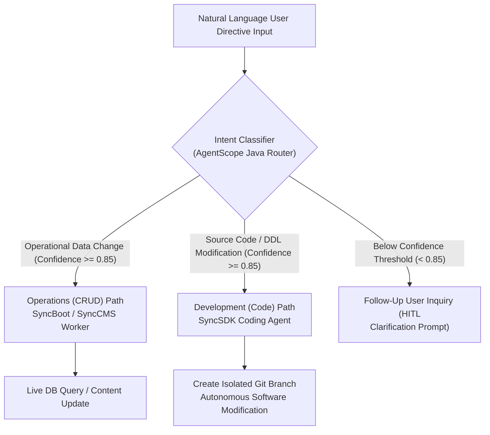
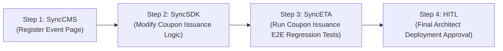

# Intent Routing Engine

The SyncVerse **Intent Routing Engine** is the primary entry point that analyzes every natural language directive entering the system, identifies the nature of the task, and dispatches it to the most appropriate domain agent and toolchain.

---

## 1. Separation of Operations (CRUD) vs. Development (Code)

To ensure system stability, SyncVerse strictly separates execution paths for **operational data tasks** and **source code modification tasks**.



### Classification Criteria by Category

| Intent Type | Description and Example | Invoked Agents | Code Access Scope |
| :--- | :--- | :--- | :---: |
| **`OPS_DATA_CRUD`** | "Update the VIP member tier threshold to 1,000,000 KRW" | `SyncBoot`, `SyncShop` | Restricted (DB DML only) |
| **`OPS_CONTENT_UPDATE`** | "Change the main banner copy to the summer promotion" | `SyncCMS` | Restricted (Content API only) |
| **`DEV_CODE_FIX`** | "Fix the bug where point refunds are missed on payment cancellation" | `SyncSDK`, `SyncETA` | Allowed (within working branch) |
| **`DEV_NEW_FEATURE`** | "Add Kakao social login OAuth integration to user registration" | `SyncSDK`, `SyncBoot` | Allowed (within working branch) |
| **`QA_VERIFICATION`** | "Re-run the E2E tests for the shopping cart checkout flow" | `SyncETA` | Restricted (test runtime only) |

---

## 2. Confidence Score Governance

To prevent tasks from being routed down the wrong path due to intent analysis errors, the engine enforces a **Confidence Score threshold policy (default: 0.85)**.

- **Confidence $\ge 0.85$**: Automatically dispatched to the designated agent pipeline.
- **Confidence $< 0.85$**: Treated as an ambiguous directive; presents a confirmation modal to the user to request additional input.

---

## 3. Multi-Task Decomposition for Composite Requirements (Task Decomposition)

When a business user submits a multi-part request, the engine decomposes it into atomic tasks and constructs an execution chain (DAG).

### Composite Request Example:
> *"Register the new event page, add 1-per-user limit validation code to the coupon issuance logic, and run the tests."*

### Decomposition Result (DAG Chain):


---

## 4. Enterprise RAG Architecture Context Injection

For accurate intent classification and code modification, the system augments the prompt with the project's architecture specifications, DB schema DDL, and domain glossary before invoking the model.

```java
// SyncVerse internal IntentRouterService (based on AgentScope Java)
@Service
@RequiredArgsConstructor
public class IntentRouterService {

    private final ChatModel chatModel;
    private final ProjectContextRetriever contextRetriever;

    public RoutingResult route(String userPrompt, Long projectId) {
        // 1. Retrieve enterprise project context and DB schema via RAG
        String domainContext = contextRetriever.retrieveContext(projectId, userPrompt);

        // 2. Build structured prompt and run AgentScope Java ReActAgent inference
        ReActAgent routerAgent = ReActAgent.builder()
                .name("IntentRouter")
                .sysPrompt(IntentPromptTemplate.createSystemPrompt(domainContext))
                .model(chatModel)
                .build();

        Msg response = routerAgent.call(Msg.builder().role(MsgRole.USER).textContent(userPrompt).build()).block();
        return RoutingResult.fromJson(response.getTextContent());
    }
}
```
