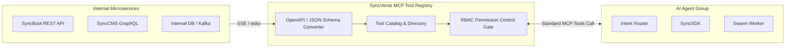

# MCP Tool Registry and RBAC Permission Management

SyncVerse unifies internal microservices and external tools under the **Model Context Protocol (MCP)** standard interface.

Through the control tower's **MCP Tool Registry**, administrators can browse the enterprise tool catalog, validate each tool's input/output schemas, and enforce execution permissions (RBAC).

---

## 1. Standard MCP Tool Registration and Architecture



---

## 2. JSON Schema-Based Parameter Validation

Every registered MCP Tool is defined with a strict JSON Schema, preventing invalid parameter invocations before execution.

### Tool Specification Example (`syncboot_create_entity`):
```json
{
  "name": "syncboot_create_entity",
  "description": "Generates a new JPA Entity class and DDL script in the specified domain module.",
  "inputSchema": {
    "type": "object",
    "properties": {
      "moduleName": {
        "type": "string",
        "enum": ["member", "order", "product", "coupon"]
      },
      "entityName": {
        "type": "string",
        "pattern": "^[A-Z][a-zA-Z0-9]+$"
      },
      "fields": {
        "type": "array",
        "items": {
          "type": "object",
          "properties": {
            "name": { "type": "string" },
            "type": { "type": "string", "enum": ["String", "Long", "Integer", "LocalDateTime", "Boolean"] },
            "nullable": { "type": "boolean" }
          },
          "required": ["name", "type"]
        }
      }
    },
    "required": ["moduleName", "entityName", "fields"]
  }
}
```

---

## 3. Fine-Grained Per-Tool Permission Management (Fine-grained RBAC)

Not every agent can execute every tool. Execution permissions are controlled by agent and user role according to system security tiers.

| Tool Security Level | Example Tools | Permitted Agents | Administrator Approval |
| :--- | :--- | :--- | :---: |
| **Level 1 (Read-Only)** | `query_schema`, `get_logs`, `search_api` | All Worker Agents | Auto-approved |
| **Level 2 (Data Write)** | `insert_record`, `publish_content` | `SyncBoot`, `SyncCMS` | Policy-based approval |
| **Level 3 (Code Edit)** | `checkout_branch`, `modify_source` | `SyncSDK Coding Agent` | Verified after auto-build |
| **Level 4 (Critical DDL)** | `alter_table`, `deploy_production` | None (cannot be executed autonomously by agents) | **Architect Approval Required** |

---

## 4. OpenAPI / Swagger-Based MCP Conversion

Existing Spring Boot REST APIs running in production can be converted and registered as standard MCP tools.

1. Enter the internal microservice's `swagger.json` or `openapi.yaml` URL in the control tower console.
2. Select target endpoints and map MCP tool names.
3. Click `[Register MCP Server]` to activate the tools for invocation by enterprise agents.
