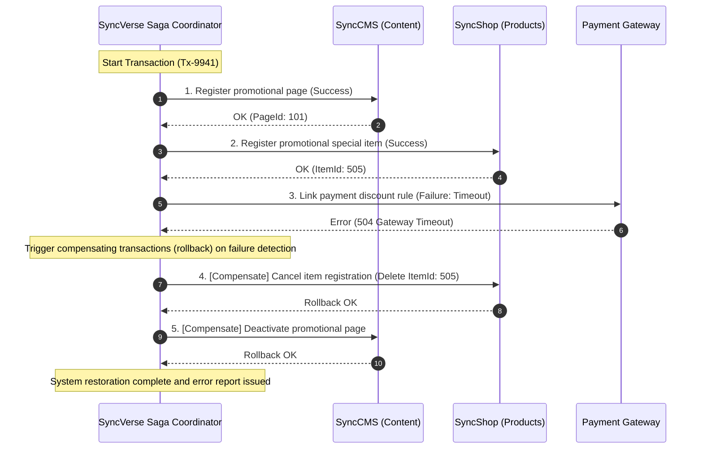

# Saga Distributed Transactions & Enterprise Audit Trail

In a multi-agent environment, a single user instruction sequentially invokes APIs across multiple systems (`SyncBoot`, `SyncCMS`, `SyncShop`, and others). If a failure occurs mid-way through execution, **changes may be committed to only a subset of systems, resulting in data inconsistency**.

SyncVerse safeguards system data consistency and compliance reliability through the **Saga orchestration pattern** and a **comprehensive Audit Trail**.

---

## 1. Saga Distributed Transactions & Compensating Rollback Mechanism

The SyncVerse central coordinator defines a chain of operations as step-by-step transactions and pre-registers a corresponding **Compensating Transaction** for every step.



---

## 2. Task State Persistence & Failure Recovery

To prevent workflow state loss even if a server restarts unexpectedly or the network disconnects during orchestration, transaction snapshots are persisted in **Redis Cluster and PostgreSQL**.

- **State Machine Persistence**: `PENDING` $\rightarrow$ `EXECUTING` $\rightarrow$ `COMPENSATED` $\rightarrow$ `COMMITTED`
- **Idempotency Guarantee**: Assigns a unique `Idempotency-Key` to every agent tool invocation to prevent duplicate execution
- **Timeouts & Circuit Breakers**: Automatically times out delayed individual tool calls and transitions into the rollback path

---

## 3. Enterprise-Wide A2A Audit Trail & Compliance

To meet security and regulatory compliance requirements, every activity within the system is recorded in the audit log.

```json
{
  "auditId": "audit-20260823-0091",
  "timestamp": "2026-08-23T07:15:00Z",
  "actor": {
    "type": "USER",
    "userId": "architect_kim",
    "ipAddress": "10.0.12.44"
  },
  "action": "HITL_APPROVE_DEPLOYMENT",
  "targetService": "syncboot-product-api",
  "changes": {
    "commitHash": "a7b8c9d",
    "ddlExecuted": "ALTER TABLE tb_product ADD COLUMN discount_rate NUMERIC(5,2);",
    "approverOtpVerified": true
  },
  "subAgentTraces": [
    {
      "agent": "IntentRouterAgent",
      "model": "gpt-4o-mini",
      "tokensUsed": 340
    },
    {
      "agent": "SyncSDKCodingAgent",
      "model": "claude-3-5-sonnet",
      "tokensUsed": 2150
    }
  ]
}
```

### Information Available in the Audit Console:
1. **Requester & Approver Identity/IP**: Identifies which user initiated the task and who approved the production deployment
2. **Full Record of Per-Agent Prompts & Tool Invocations**: Captures the reasoning decisions each agent made and the exact parameters used to execute tools
3. **Token Consumption & Latency**: Tracks cost and execution duration for each stage
