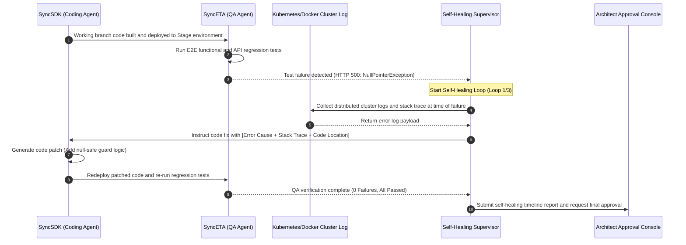

# Self-Healing Pipeline

In traditional software development, detecting a defect during the QA phase required a manual sequence of **[Notify Developer $\rightarrow$ Manually Collect Logs $\rightarrow$ Local Debugging $\rightarrow$ Patch Code $\rightarrow$ Rebuild $\rightarrow$ Redeploy]**.

SyncVerse's **Self-Healing Pipeline** automates this entire cycle through agent-to-agent (A2A) collaboration, drastically reducing resolution time.

---

## 1. The 4-Stage Self-Healing Loop



---

## 2. Detailed Operating Mechanism

### 1) Defect Detection & Anomaly Capture (SyncETA)
The SyncETA agent runs API unit tests and UI scenario E2E tests against the application deployed in the Stage environment. Whenever an assertion failure or HTTP 5xx response is detected, it immediately publishes a failure event to the `Self-Healing Supervisor` agent.

### 2) Automated Distributed Cluster Log Collection (Log Harvester)
The `Self-Healing Supervisor` extracts all logs associated with the failing transaction ID (`Trace-Id`) from the container cluster (Docker/Kubernetes/Spring Boot Logback).

```json
{
  "traceId": "trace-77a8-4c12-9901",
  "errorType": "java.lang.NullPointerException",
  "exceptionMessage": "Cannot invoke \"String.trim()\" because \"userCoupon.getCouponCode()\" is null",
  "culpritClass": "com.empasy.syncshop.service.CouponService",
  "culpritLine": 142,
  "stackTraceSnippet": "at com.empasy.syncshop.service.CouponService.applyCoupon(CouponService.java:142)..."
}
```

### 3) Root Cause Analysis & SDK Code Patching (SyncSDK)
The coding agent combines the original source code, the failed test case, and the collected log stack trace to diagnose the root cause of the bug and write defensive code.

```diff
// Example fix in CouponService.java
- if (userCoupon.getCouponCode().trim().isEmpty()) {
+ if (userCoupon.getCouponCode() == null || userCoupon.getCouponCode().trim().isEmpty()) {
      throw new BusinessException(ErrorCode.INVALID_COUPON_CODE);
  }
```

### 4) Regression Verification & Safe Completion
The patched code is rebuilt and handed back to SyncETA. SyncETA re-runs not only the previously failing test, but the entire regression test suite to verify that no side effects were introduced in other features.

---

## 3. Infinite Loop Prevention & Safety Rails

To prevent unnecessary consumption of tokens or server resources caused by repeated self-healing cycles, the following policies are enforced:

- **Max Retry Limit**: Capped at **3 attempts** by default. If the issue is not resolved within 3 attempts, the circuit breaker trips immediately and escalates the issue to the assigned developer.
- **Circuit Breaker**: Immediately halts execution if the same error fails to be resolved across two consecutive attempts with the same fix pattern.
- **Audit Timeline Visualization**: Records the entire self-healing lifecycle (Logs $\rightarrow$ Diff $\rightarrow$ Test Results) in detail as a visual timeline in the admin console.
