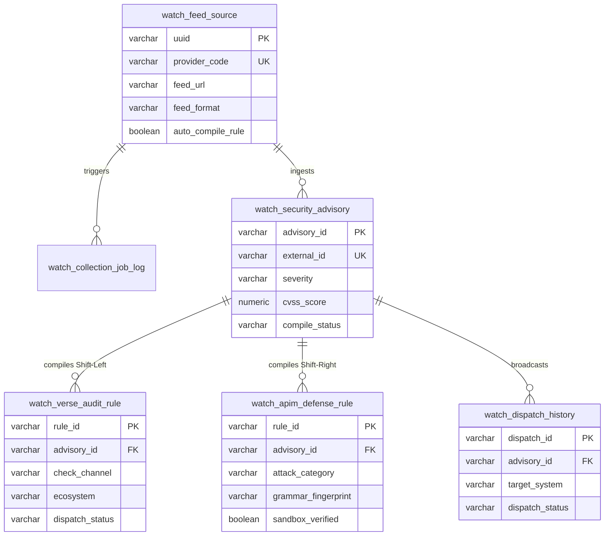

# SyncWatch DB Schema and Standard REST/MCP API Specification

`SyncWatch` adheres to the enterprise 6-File DB SSOT database standard (`sync-watch/db/00_extensions.sql` to `05_sample_dev.sql`), **PostgreSQL 18.6 (`pgvector/pgvector:pg18`)**, and the `/api/v1/watch/*` single URL mapping principle to persist the entire lifecycle from collecting **8 global threat feeds (OSV.dev, GitHub GHSA, NVD CVE, CISA KEV, Nuclei, OWASP CRS, MITRE ATT&CK, KISA)** to dual-rule compilation and dispatch.

---

## 1. Entity-Relationship Diagram (ER Diagram) and Six Domain Tables (`watch_*`)



### 1.1 Domain Table Detailed Specification (`sync-watch/db/02_schema_domain.sql`)

| No. | Table Name | Role and Key Columns |
| :---: | :--- | :--- |
| **1** | **`watch_feed_source`** | **8 Global Threat Feed Source Master**<br>• PK: `uuid` / UK: `provider_code` (`OSV_DEV_FEED`, `GITHUB_GHSA`, `NVD_CVE_FEED`, `CISA_KEV_CATALOG`, `NUCLEI_TEMPLATES`, `OWASP_CRS_FEED`, `MITRE_ATTACK_STIX`, `KISA_BOHO_NOTICE`)<br>• Key columns: `provider_name`, `site_url`, `feed_url`, `feed_format` (`REST_JSON`, `YAML_NUCLEI`, `CRS_CONF`, `STIX_TAXII`, `RSS_XML`), `source_channel`, `auth_type`, `sync_interval_min`, `auto_compile_rule`, `auto_broadcast`, `enabled`, `last_sync_time`, `last_sync_status`, `last_sync_count`, `total_ingested_count` |
| **2** | **`watch_security_advisory`** | **Normalized Security Advisory Ledger**<br>• PK: `advisory_id`<br>• Key columns: `source_channel`, `feed_provider`, `external_id` (CVE/GHSA/KISA ID), `cwe_id`, `mitre_code`, `title`, `severity` (`CRITICAL`, `HIGH`, `MEDIUM`, `LOW`), `cvss_score`, `exploit_status`, `affected_ecosystem`, `affected_packages`, `vulnerable_version_range`, `patched_version`, `summary_text`, `raw_payload_json` (`jsonb`), `matched_asset_count`, `matched_repo_count`, `compile_status` |
| **3** | **`watch_verse_audit_rule`** | **Security Audit Rules for SyncVerse (`VerseAuditPack`)**<br>• PK: `rule_id` / FK: `advisory_id`<br>• Key columns: `external_id`, `rule_title`, `severity`, `check_channel` (`SCA_DEPENDENCY`, `SAST_CODE`, `DAST_PENTEST`), `ecosystem`, `package_name`, `vulnerable_version_range`, `patched_version`, `sast_pattern_regex`, `dast_probe_method`, `dast_probe_path`, `dast_probe_payload`, `remediation_guide_md`, `target_agent_code`, `verified`, `dispatch_status` |
| **4** | **`watch_apim_defense_rule`** | **Attack Pattern Rules for SyncAPIM (`ApimDefensePack`)**<br>• PK: `rule_id` / FK: `advisory_id`<br>• Key columns: `external_id`, `rule_name`, `attack_category` (`SQLI`, `XSS`, `SSRF`, `RCE`, `PATH_TRAVERSAL`), `mitre_tactic`, `severity`, `target_locations` (`HEADER,URI,QUERY,BODY`), `target_method`, `target_path`, `detection_regex`, `defense_expression`, `grammar_fingerprint`, `positive_samples_json`, `negative_samples_json`, `sandbox_verified`, `tp_rate`, `fp_rate`, `dispatch_status` |
| **5** | **`watch_dispatch_history`** | **Enterprise Dispatch and Enforcement Feedback Ledger**<br>• PK: `dispatch_id` / FK: `advisory_id`<br>• Key columns: `target_system` (`SYNC_VERSE`, `SYNC_APIM`), `rule_id`, `target_endpoint_url`, `dispatch_mode` (`PUSH_BROADCAST`, `PULL_SYNC`), `dispatch_status`, `response_summary`, `dispatched_by`, `dispatched_time`, `feedback_time` |
| **6** | **`watch_collection_job_log`** | **Collection Batch and Diagnostic Document Upload Execution Log**<br>• PK: `job_id`<br>• Key columns: `provider_code`, `job_type` (`FEED_SYNC`, `DOC_UPLOAD`, `RULE_COMPILE`), `fetched_count`, `new_advisory_count`, `compiled_verse_rules`, `compiled_apim_rules`, `duration_ms`, `status`, `log_detail`, `executed_time` |

### 1.2 PostgreSQL 18.6 Core DDL Example

```sql
-- sync-watch/db/02_schema_domain.sql
CREATE TABLE watch_apim_defense_rule (
    rule_id VARCHAR(64) PRIMARY KEY,
    advisory_id VARCHAR(64) NOT NULL REFERENCES watch_security_advisory(advisory_id),
    external_id VARCHAR(64) NOT NULL,
    rule_name VARCHAR(255) NOT NULL,
    attack_category VARCHAR(32) NOT NULL,
    mitre_tactic VARCHAR(32) NOT NULL DEFAULT 'T1190',
    severity VARCHAR(16) NOT NULL,
    target_locations VARCHAR(64) NOT NULL DEFAULT 'URI,QUERY,BODY',
    target_method VARCHAR(16) NOT NULL DEFAULT 'ANY',
    target_path VARCHAR(255) NOT NULL DEFAULT '/api/v1/*',
    detection_regex TEXT NOT NULL,
    defense_expression TEXT NOT NULL,
    grammar_fingerprint VARCHAR(128) NOT NULL,
    positive_samples_json JSONB NOT NULL,
    negative_samples_json JSONB NOT NULL,
    sandbox_verified BOOLEAN NOT NULL DEFAULT FALSE,
    tp_rate NUMERIC(5,2) NOT NULL DEFAULT 0.00,
    fp_rate NUMERIC(5,2) NOT NULL DEFAULT 0.00,
    dispatch_status VARCHAR(24) NOT NULL DEFAULT 'DRAFT',
    created_time TIMESTAMPTZ NOT NULL DEFAULT CURRENT_TIMESTAMP
);

CREATE INDEX idx_watch_apim_rule_category ON watch_apim_defense_rule (attack_category, severity);
CREATE INDEX idx_watch_apim_rule_fingerprint ON watch_apim_defense_rule USING gin (grammar_fingerprint gin_trgm_ops);
```

---

## 2. Standard REST API Specification (`/api/v1/watch/*`)

| Domain Category | HTTP Method & Canonical URL | Description |
| :--- | :--- | :--- |
| **Observation Dashboard** | `GET /api/v1/watch/overview` | Retrieves operational status of the 8 collection feeds, security advisory statistics by severity, and dual-rule compilation and dispatch metrics |
| **Feed Source Management** | `GET /api/v1/watch/feeds/list`<br>`GET /api/v1/watch/feeds/active`<br>`POST /api/v1/watch/feeds/add`<br>`PUT /api/v1/watch/feeds/edit`<br>`POST /api/v1/watch/feeds/test`<br>`POST /api/v1/watch/feeds/sync` | Lists and registers the 8 global security feed sources, runs 5-stage SSRF-guarded connection diagnostics, and executes immediate synchronization |
| **Security Advisories** | `GET /api/v1/watch/advisories/list`<br>`GET /api/v1/watch/advisories/detail`<br>`POST /api/v1/watch/advisories/register`<br>`POST /api/v1/watch/advisories/upload`<br>`POST /api/v1/watch/advisories/compile`<br>`POST /api/v1/watch/advisories/match-sbom` | Searches the normalized security advisory ledger, parses uploaded security diagnostic documents and bundles, compiles dual rules, and cross-matches against enterprise SBOM dependencies |
| **Dual Rules & Sandbox** | `GET /api/v1/watch/verse-rules/list`<br>`PUT /api/v1/watch/verse-rules/edit`<br>`GET /api/v1/watch/apim-rules/list`<br>`PUT /api/v1/watch/apim-rules/edit`<br>`POST /api/v1/watch/apim-rules/verify-sandbox` | Lists and edits `VerseAuditPack` audit rules and `ApimDefensePack` defense rules, and runs sandbox verification using positive and negative samples |
| **Security Packs & Enterprise Dispatch** | `GET /api/v1/watch/packs/verse`<br>`GET /api/v1/watch/packs/apim`<br>`POST /api/v1/watch/dispatch/broadcast`<br>`POST /api/v1/watch/dispatch/feedback`<br>`GET /api/v1/watch/dispatches/list`<br>`GET /api/v1/watch/dispatches/jobs` | Retrieves security packs for `SyncVerse` and `SyncAPIM` (Pull), executes real-time broadcast dispatch (Push), receives enforcement feedback, and queries job logs |
| **MCP Server & Menu Authorization** | `GET /api/v1/watch/mcp/tools`<br>`POST /api/v1/watch/mcp`<br>`GET /api/v1/watch/sys/permission/getUserPermissionByToken` | Lists and executes JSON-RPC 2.0 MCP tools and returns the dynamic menu tree for the authenticated user's role (`role_admin`, `role_secops`) |

### 2.1 Sandbox Verification Request and Response Example (`POST /api/v1/watch/apim-rules/verify-sandbox`)

```json
{
  "code": 200,
  "success": true,
  "result": {
    "ruleId": "arule-sqli-union-001",
    "sandboxVerified": true,
    "tpRate": 100.0,
    "fpRate": 0.0,
    "avgEvaluationTimeMs": 0.08,
    "maxEvaluationTimeMs": 0.21,
    "dispatchStatus": "READY"
  }
}
```

---

## 3. MCP (Model Context Protocol) Exposed Tool Specification (`/api/v1/watch/mcp`)

`SyncWatch` exposes standard MCP tools so other agents (`SyncVerse`, `SyncAPIM`, `SyncInsight`) can immediately query threat intelligence or trigger rule compilation and dispatch over the A2A protocol.

| MCP Tool Name | Key Parameters | Functional Description |
| :--- | :--- | :--- |
| **`watch_sync_security_feeds`** | `providerCode` (optional) | Synchronizes and normalizes the 8 global threat feeds (OSV.dev, GitHub GHSA, NVD CVE, CISA KEV, Nuclei, OWASP CRS, MITRE ATT&CK, KISA) |
| **`watch_compile_dual_rules`** | `advisoryId` | Simultaneously compiles `SyncVerse` audit rules (`VerseAuditPack`) and `SyncAPIM` attack patterns (`ApimDefensePack`) from a single security advisory and runs sandbox verification |
| **`watch_dispatch_to_verse_and_apim`** | `advisoryId`, `targetSystem` | Immediately broadcasts verified security audit rules and WAF virtual-patch rules to `SyncVerse` and `SyncAPIM` |
| **`watch_match_enterprise_sbom`** | `ecosystem` (optional) | Cross-matches enterprise microservice SBOM packages against the vulnerability ledger to identify affected assets and repositories |
| **`delegate_intent`** | `intent`, `instruction` | Executes A2A natural-language delegation for security intelligence collection, compilation, and enterprise dispatch |

### 3.1 JSON-RPC 2.0 MCP Call Payload Example

```json
{
  "jsonrpc": "2.0",
  "id": "watch-rpc-901",
  "method": "tools/call",
  "params": {
    "name": "watch_compile_dual_rules",
    "arguments": {
      "advisoryId": "adv-cve-2026-41892"
    }
  }
}
```
