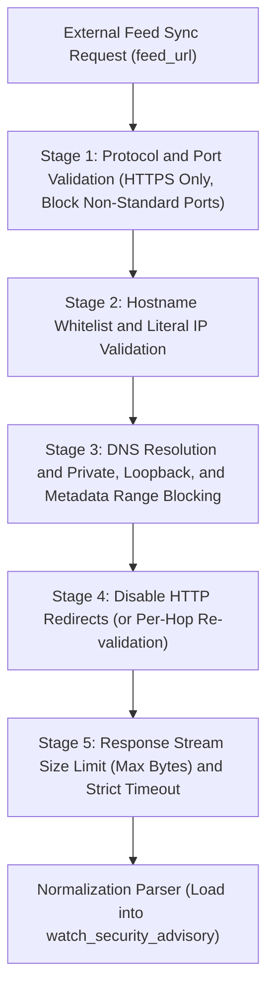

# SyncWatch System Architecture and Dual Rule Compiler

`SyncWatch` consists of a **multi-channel normalizer for 8 global threat feeds**, a **5-stage SSRF guard**, the **`WatchRuleCompilerService` dual compiler**, and a **self-sandbox verifier** to safely ingest external threat intelligence and convert it into high-confidence audit and defense rules with zero false positives.

---

## 1. Six Threat Collection Channels and Normalization of Eight Global Threat Feeds

`SyncWatch` normalizes security intelligence from **8 global threat feeds (OSV.dev, GitHub GHSA, NVD CVE, CISA KEV, Nuclei, OWASP CRS, MITRE ATT&CK, KISA)** across multiple formats (`REST_JSON`, `STIX_TAXII`, `YAML_NUCLEI`, `CRS_CONF`, `RSS_XML`, `DOCUMENT_UPLOAD`) into a single standard ledger (`watch_security_advisory`).

| Collection Channel (`source_channel`) | Eight Core Providers (`provider_code`) | Ingestion Format | Key Normalized Extracted Fields |
| :--- | :--- | :--- | :--- |
| **1. Open-Source Ecosystem Advisories** | `OSV_DEV_FEED` (OSV.dev), `GITHUB_GHSA` (GitHub GHSA) | `REST_JSON` | Vulnerable version ranges and patched versions per package across `MAVEN`, `NPM`, `PYPI`, `GO`, and `DOCKER` |
| **2. Global CVE Database** | `NVD_CVE_FEED` (NIST NVD CVE) | `REST_JSON` | CVE ID, CVSS v3.1 score, CWE code, and affected CPE/package version ranges |
| **3. Actively Exploited Vulnerabilities** | `CISA_KEV_CATALOG` (CISA KEV) | `REST_JSON` | Vulnerabilities under active exploitation (`ACTIVE_EXPLOIT`), mandatory remediation deadlines, and mitigation guidance |
| **4. Penetration Testing & Vulnerability Scanner Templates** | `NUCLEI_TEMPLATES` (Nuclei) | `YAML_NUCLEI` | HTTP request methods and paths, attack payload probes, and matcher regular expressions |
| **5. WAF & Attack Tactics Matrix** | `OWASP_CRS_FEED` (OWASP CRS), `MITRE_ATTACK_STIX` (MITRE ATT&CK) | `CRS_CONF` / `STIX_TAXII` | SQLi/XSS/RCE/LFI detection regexes, target locations (`HEADER`, `URI`, `QUERY`, `BODY`), grammar fingerprints, and MITRE tactic codes (such as `T1190`) |
| **6. Domestic Security Advisories & Diagnostic Documents** | `KISA_BOHO_NOTICE` (KISA Boho), Internal Diagnostic Uploads | `RSS_XML` / `DOC` | KISA security notices and parsing/normalization of external penetration test reports (PDF/Markdown) |

---

## 2. 5-Stage SSRF Defense Guard

To prevent external feed URL synchronization or webhook-based advisory ingestion from being exploited for Server-Side Request Forgery (SSRF) against internal networks, every outbound collection request from `SyncWatch` must pass the **5-Stage SSRF Defense Guard**.

1. **Stage 1 — Scheme and Port Enforcement**: Only the `https://` scheme (default port 443) is permitted; non-standard schemes such as `file://`, `gopher://`, `ftp://`, and `ldap://` are blocked immediately.
2. **Stage 2 — Registered Provider Domain Validation**: Verifies that the target domain is a registered and approved provider in `watch_feed_source`, and rejects embedded user credentials (`user:pass@host`) in URLs.
3. **Stage 3 — DNS Rebinding and Private Range Blocking**: Resolves DNS immediately prior to socket connection and rejects connections if the resolved IP falls within loopback (`127.0.0.0/8`, `::1`), private networks (`10.0.0.0/8`, `172.16.0.0/12`, `192.168.0.0/16`), link-local, or cloud metadata (`169.254.169.254`) ranges.
4. **Stage 4 — Redirect (`3xx`) Chain Control**: Disables automatic redirects—or re-executes Stages 1 through 3 on every target URL—to prevent internal network bypass via open redirects.
5. **Stage 5 — Payload Bomb Protection**: Enforces response `Content-Type` validation, a maximum received byte limit (e.g., 10 MB), and strict read timeouts to prevent Out-Of-Memory (OOM) exhaustion.

---

## 3. `WatchRuleCompilerService` Dual Rule Compilation and Self-Sandbox Verification

Once a normalized security advisory (`watch_security_advisory`) is stored, `WatchRuleCompilerService` analyzes it and simultaneously compiles it into two actionable types of security rules.

### 3.1 Dual Compilation Artifacts
* **Shift-Left Audit Rules (`watch_verse_audit_rule` → `VerseAuditPack`)**:
  - **SCA Dependency Rules (`SCA_DEPENDENCY`)**: Specifies ecosystem (`MAVEN`, `NPM`, etc.), package coordinates (`package_name`), vulnerable version range (`vulnerable_version_range`), and safe patched version (`patched_version`).
  - **SAST Static Code Rules (`SAST_CODE`)**: Includes regular expressions (`sast_pattern_regex`) to detect vulnerable API calls or unsafe deserialization and query construction in source code AST/lines, along with a remediation guide (`remediation_guide_md`).
  - **DAST Penetration Test Probes (`DAST_PENTEST`)**: Generates HTTP method (`dast_probe_method`), path (`dast_probe_path`), and payload (`dast_probe_payload`) to verify vulnerability reproducibility in an isolated staging environment.
* **Shift-Right Defense Rules (`watch_apim_defense_rule` → `ApimDefensePack`)**:
  - **Grammar Token Fingerprints (`grammar_fingerprint`)**: Maps SQLi/XSS lexical token sequence fingerprints extracted by `SqlXssLexicalTokenizer` (e.g., `s&1`, `sUE`, `;k`, `x_script`).
  - **Location-Specific Precision Regex (`detection_regex` & `target_locations`)**: Specifies the target inspection locations among `HEADER`, `URI`, `QUERY`, and `BODY` along with the endpoint path pattern (`target_path`).
  - **Restricted SpEL Defense Expressions (`defense_expression`)**: Evaluates composite conditions (combining headers, query parameters, and grammar fingerprints) inside a safe sandbox expression backed by `SimpleEvaluationContext`.

### 3.2 Self-Sandbox Verification
Every compiled `watch_apim_defense_rule` must pass the self-sandbox verifier before enterprise-wide dispatch:
1. **Positive Samples Verification (`positive_samples_json`)**: Injects actual attack vector samples to verify 100% detection (`tp_rate = 100.00`).
2. **Negative Samples Verification (`negative_samples_json`)**: Injects legitimate business API request samples to verify zero false positives (`fp_rate = 0.00`).
3. **ReDoS Timeout Verification**: Measures whether regex and SpEL evaluation completes within `0.5ms` per item; only rules that pass all checks are promoted to `sandbox_verified = true` and `dispatch_status = 'READY'`.
