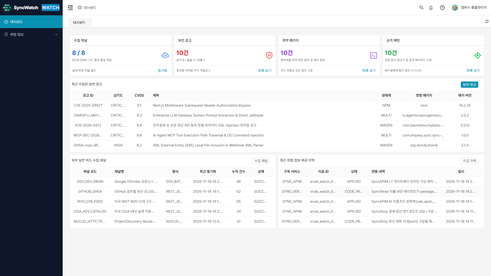
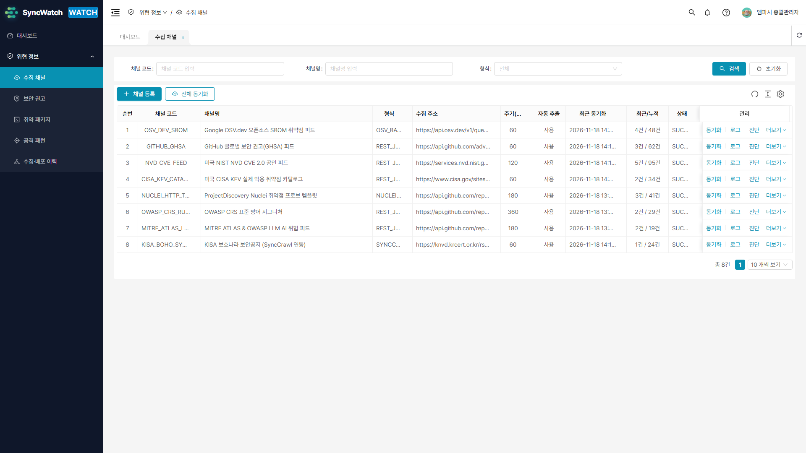
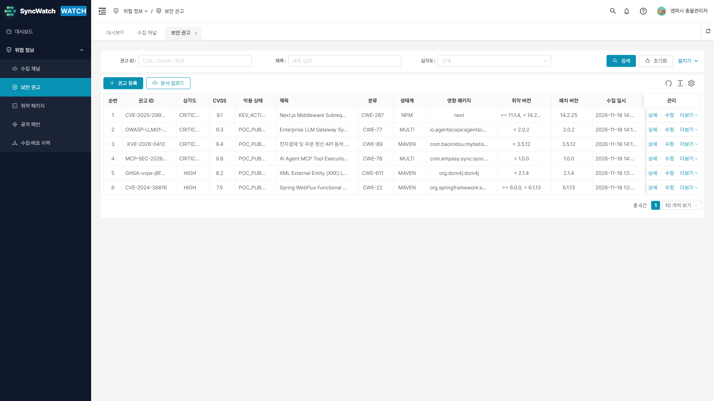
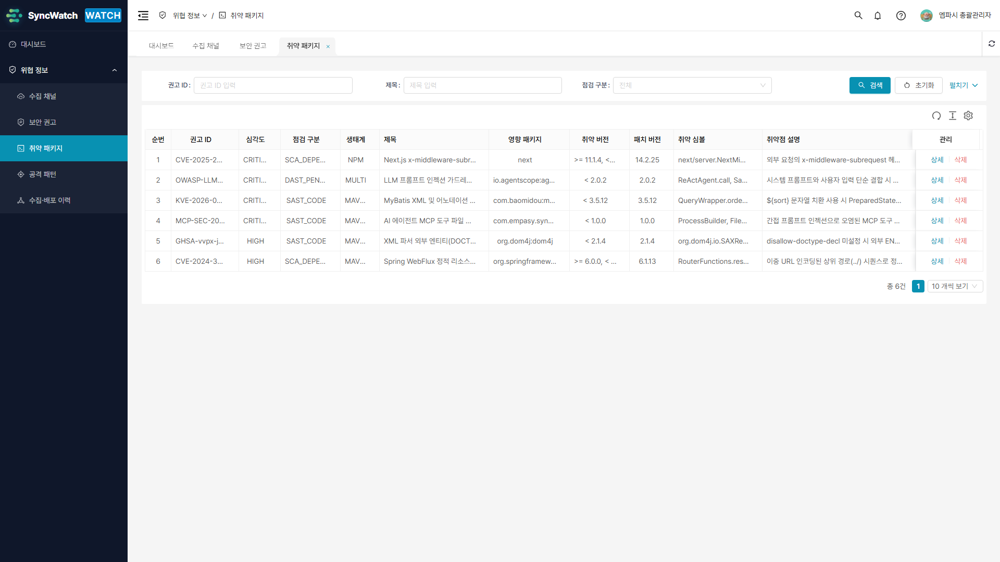
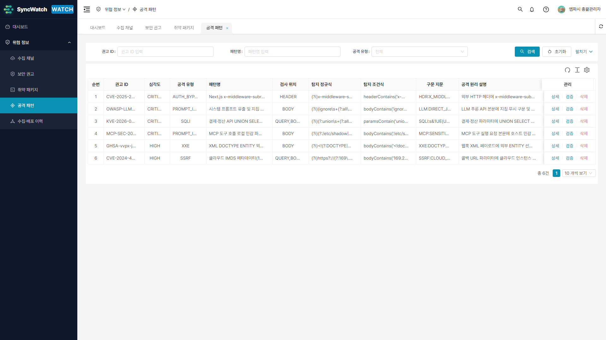
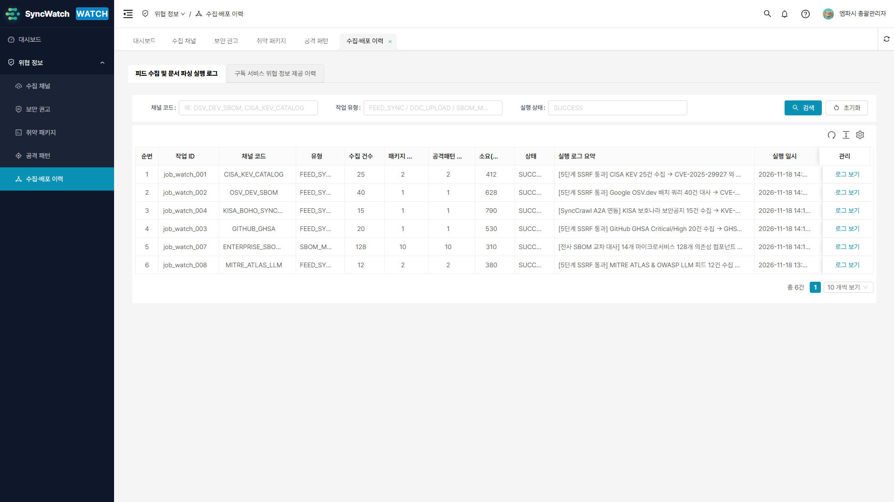

# SyncWatch Overview (AI Security Threat Intelligence & Rule Compiler Agent)

> **For Non-Developers & Evaluation Teams**: Visit the [SyncWatch Product Homepage (empasy.io)](https://empasy.io/en/solutions/sync-watch.html){target="_blank" rel="noopener"} for an accessible product overview, try the zero-install UI experience in the [Unified Demo Portal](https://demo.empasy.io/en/products/sync-watch/#demo){target="_blank" rel="noopener"}, or download product brochures and proposals from the [Proposals Repository](/en/proposals/).

**SyncWatch (`SYNC_WATCH`, `com.empasy.sync.watch`)** is an **Enterprise Security Threat Observatory & Dual Rule Compiler** that ingests and normalizes **8 major global threat feeds (OSV.dev, GitHub GHSA, NVD CVE, CISA KEV, Nuclei, OWASP CRS, MITRE ATT&CK, KISA)** alongside internal enterprise security diagnostic documents into a single hub, compiling and distributing code, dependency, and penetration-testing audit packs (**`VerseAuditPack`**) to **SyncVerse** and runtime attack-pattern defense packs (**`ApimDefensePack`**) to **SyncAPIM** in real time.

---

## 1. Core Specifications and Connection Endpoints

| Item | Standard Specification |
| :--- | :--- |
| **Agent Identifier Code** | `SYNC_WATCH` (`sync-watch`) |
| **Maven Coordinates** | `com.empasy.sync.watch:sync-watch-server` (Spring Boot 4.0.x, JDK 25) |
| **Standard API Prefix** | `/api/v1/watch/*` (Permission API: `/api/v1/watch/sys/permission/getUserPermissionByToken`) |
| **Admin Management Console** | Local: `http://localhost:3107` / Cloud: `https://watch-admin.empasy.io` |
| **Backend API & Homepage** | Local: `http://localhost:18087/api/v1/watch` / Cloud: `https://empasy.io/en/solutions/sync-watch.html` |
| **Database** | PostgreSQL 18.6 (`sync_watch`, 6 core domain tables `watch_*`) |

---

## 2. Triad Autonomous DevSecOps Security Architecture

When a new zero-day vulnerability or security advisory is published, SyncSeries operates a triad autonomous DevSecOps loop spanning **SyncWatch → SyncVerse → SyncAPIM** to eliminate the window of exposure caused by manual security analyst triage and regex authoring.

```mermaid
flowchart LR
    subgraph Feeds["8 Global Threat Feeds & Diagnostic Reports"]
        F1["OSV.dev / GitHub GHSA"]
        F2["NVD CVE / CISA KEV"]
        F3["Nuclei / OWASP CRS / MITRE ATT&CK / KISA"]
        F4["Security Diagnostic Reports (PDF/MD)"]
    end

    subgraph Watch["1. SyncWatch (Ingestion · Normalization · Dual Compilation)"]
        W1["5-Stage SSRF Guard Collector"]
        W2["Normalized Security Ledger (watch_security_advisory)"]
        W3["WatchRuleCompilerService & Built-in Sandbox Verification"]
    end

    subgraph Verse["2. SyncVerse (Shift-Left Code Security Audit)"]
        V1["Receive VerseAuditPack (SCA / SAST / DAST)"]
        V2["Enterprise Git Repository Vulnerability Scan"]
        V3["Auto-Generated Security Patch PR & HITL Approval"]
    end

    subgraph Apim["3. SyncAPIM (Shift-Right Runtime Virtual Patching)"]
        A1["Receive ApimDefensePack (Lexical Fingerprint / SpEL)"]
        A2["SqlXssLexicalTokenizer & SandboxedDefenseEvaluator"]
        A3["Zero-Downtime Pinpoint Virtual Patch & Kernel eBPF Blocking"]
    end

    Feeds --> W1 --> W2 --> W3
    W3 -->|"Distribute VerseAuditPack"| V1 --> V2 --> V3
    W3 -->|"Distribute ApimDefensePack"| A1 --> A2 --> A3
    V3 -.->|"Remediation Feedback"| W3
    A3 -.->|"Blocking Feedback"| W3
```

1. **SyncWatch (Threat Ingestion & Dual Rule Compilation)**:
   - Collects external threat feeds and security diagnostic documents, normalizing them against CWE, MITRE ATT&CK, and package ecosystems (`MAVEN`, `NPM`, `PYPI`, `DOCKER`, etc.).
   - Simultaneously compiles both `VerseAuditPack` (for development-stage inspection) and `ApimDefensePack` (for production gateway defense) from a single security issue ledger, then cross-verifies them against positive attack samples and negative benign samples in an isolated sandbox.
2. **SyncVerse (Shift-Left Code Security Audit & Auto-Patch PR)**:
   - Uses the received `VerseAuditPack` to automatically scan dependency versions (`SCA_DEPENDENCY`), source code vulnerability patterns (`SAST_CODE`), and sandbox endpoint penetration tests (`DAST_PENTEST`) across enterprise microservice repositories, generating patch Pull Requests.
3. **SyncAPIM (Shift-Right Runtime Defense & Pinpoint Virtual Patching)**:
   - Even before code patches are deployed to production, hot-swaps the received `ApimDefensePack` with zero downtime into `SqlXssLexicalTokenizer` (lexical token fingerprint analyzer) and `SandboxedDefenseEvaluator` (pinpoint virtual patch evaluator), immediately blocking attack sources via kernel eBPF.

---

## Live Console Screens and Core Workflows

### 1. Global Security Threat Intelligence Ingestion & Observation Dashboard
Provides unified observability into real-time ingestion status and severity distributions across the 8 global threat feeds: OSV.dev, GitHub GHSA, NVD CVE, CISA KEV, Nuclei, OWASP CRS, MITRE ATT&CK, and KISA.

### 2. 8 Official Security Feed Ingestion Channels & Connection Diagnostics
Manages polling schedules for external security feed ingestion channels, 5-stage SSRF guard connection diagnostics, on-demand synchronization, and ingestion batch execution status.

### 3. Normalized Security Advisory Ledger & Enterprise SBOM Matching Analysis
Normalizes external security advisories and diagnostic reports from diverse formats into a single standard schema, analyzing affected package ecosystems and enterprise SBOM impact.

### 4. Ecosystem-Specific Vulnerable Packages & Code Security Audit Criteria
Manages dependency version ranges (SCA), static code patterns (SAST), dynamic runtime probes (DAST), and vulnerable symbol specifications supplied to the development control plane.

### 5. Runtime Attack Patterns & Sandbox True/False Positive Verification
Manages HTTP inspection targets, detection regexes, defense condition expressions, and zero-false-positive sandbox verification results (TP 100%, FP 0%) supplied to the API security gateway.

### 6. Feed Ingestion/Parsing Execution Logs & Enterprise Distribution History
Transparently tracks ingestion, compilation, and sandbox verification batch execution logs along with threat intelligence broadcast delivery history to subscribed services.

---

## 3. Documentation Structure

* **[Architecture & Dual Rule Compiler](./architecture)**: Explains the 8 global threat feed ingestion channels, the 5-stage SSRF defense guard, `WatchRuleCompilerService` dual rule compilation, and the built-in sandbox verification mechanism.
* **[SyncVerse & SyncAPIM Integration Protocol](./devsecops-protocol)**: Covers the `VerseAuditPack` and `ApimDefensePack` data contracts as well as real-time broadcast and feedback protocols.
* **[DB Schema & REST/MCP API Reference](./api-and-schema)**: Details the DDL specifications for the 6 `watch_*` tables, `/api/v1/watch/*` REST APIs, and MCP tools.
