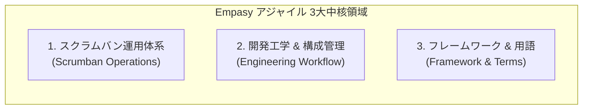
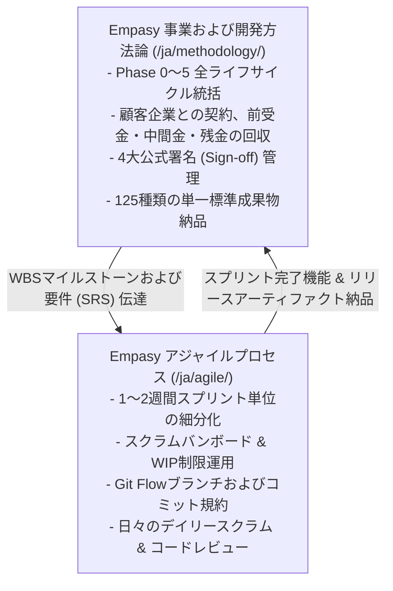

# Empasy アジャイルプロセスおよびエンジニアリングポータル

**Empasy アジャイルプロセスおよびエンジニアリング (Empasy Agile & Engineering Process)** は、プロジェクト現場において開発チームが日々コミュニケーションを取り、コードを記述し、構成を管理し、Issueを追跡するための **日常的な開発工学標準およびコラボレーション文化のガイドライン** です。

本ポータルは、マクロな事業管理および納品体系 ([Empasy 事業および開発方法論](/ja/methodology/)) で策定されたWBSマイルストーンを実務開発チームの1〜2週間スプリントへと細分化し、**ボトルネックのない作業フロー (Flow)** と **厳格なコード品質 (Quality Gate)** を達成できるよう支援します。

---

## 1. Empasy アジャイル工学の3大中核体系

### 1) スクラムバン (Scrumban) 運用体系
スプリントの計画性 (役割、バックログ、振り返り) とカンバンの柔軟性 (WIP制限、プルシステム) を組み合わせることで、緊急の運用作業と新規機能開発が混在するエンタープライズ環境におけるボトルネックを最小化します。
* **[スクラムバン・ハイブリッド運用概要](./scrumban.md)**: スクラムとカンバンの違い、プル (Pull) ベースの作業方式、ボードレイアウト
* **[スクラムバン実務ガイド](./guide.md)**: ボードカラム設定、WIP (進行中作業) 上限の設定基準
* **[定期アクティビティおよびセレモニー](./activity.md)**: スプリントプランニング、バックログ補充、スプリントレビューおよび振り返り
* **[デイリースクラムガイド](./dailyScrum.md)**: 15分スタンドアップミーティングの運営要領、3大標準質問
* **[ストーリーポイント見積りガイド](./storyPointGuide.md)**: フィボナッチ数列に基づく工数見積りおよびプランニングポーカー
* **[スプリント運用チェックリスト](./checklistAndProcedure.md)**: スプリント開始前・終了後の必須点検表

---

### 2) 開発工学 & 構成管理ワークフロー
すべてのエンジニアが統一されたブランチ戦略、コミットルール、Issueライフサイクルを遵守することで、コードの履歴追跡性と保守性を最大化します。
* **[Git Flowブランチ戦略](./gitFlow.md)**: `main`, `develop`, `feature/*`, `release/*`, `hotfix/*` 標準運用ルール
* **[Gitコミットログ規約](./gitCommitLog.md)**: `feat:`, `fix:`, `docs:`, `refactor:`, `test:`, `chore:` プレフィックスおよびコミットメッセージ本文の作成標準
* **[Issue作成ルールおよびテンプレート](./createIssue.md)**: バグレポート、新機能、作業タスクテンプレートおよびラベルルール
* **[Issueライフサイクル管理原則](./PrinciplesForIssueUsage.md)**: Todo -> In Progress -> Review -> Done のステータス遷移ルール

---

### 3) フレームワーク比較および標準用語集
* **[手法比較分析 (XP vs Scrum vs Kanban)](./xp_scrum_kanban.md)**: エクストリームプログラミング、スクラム、カンバン、スクラムバンの詳細比較および適したプロジェクト類型の分析
* **[アジャイルおよび工学用語集](./glossaryOfTerms.md)**: バーンダウンチャート、WIP、ベロシティ、DoR (準備完了の定義)、DoD (完了の定義) などの必須用語集

---

## 2. マクロな事業方法論との相互連携

株式会社エムパシーのソフトウェアエコシステムは、**マクロな事業管理**と**ミクロなアジャイル実行**が緊密に噛み合って稼働します。

* **受注および契約、4大署名、125種類の公式成果物およびAI-SDLC**: **[Empasy 事業および開発方法論 総合ポータル](/ja/methodology/)** をご確認ください。
* **日常の開発チームコラボレーション、コード構成管理およびスプリント運用**: 本 **アジャイルプロセス** ガイドを遵守してください。
