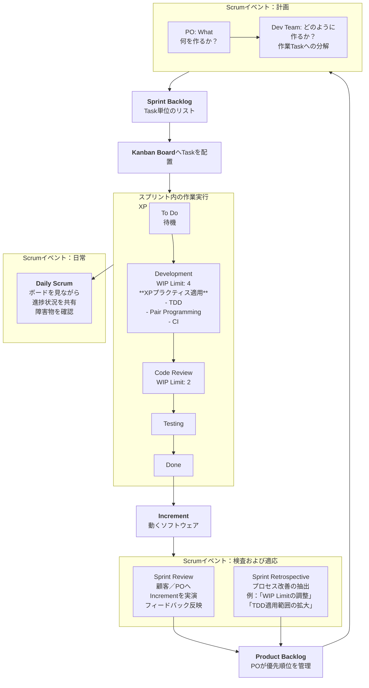

## XP・Scrum・Kanban統合ガイド：アジャイル開発手法の比較と実務適用戦略

### はじめに：アジャイルの本質と進化

アジャイル（Agile）は「俊敏な」という意味の通り、変化する要件に迅速に対応し、継続的に価値を提供するためのソフトウェア開発哲学およびフレームワークの集合体です。2001年に発表された「アジャイルソフトウェア開発宣言」では、プロセスやツールよりも**個人と対話**を、包括的なドキュメントよりも**動くソフトウェア**を、契約交渉よりも**顧客との協調**を、計画に従うことよりも**変化への対応**に価値を置いています。

本ガイドでは、アジャイルを実現する代表的な3つの手法であるeXtreme Programming（XP）、Scrum、Kanbanを比較分析し、それらの相互関係を説明した上で、これらを統合的に活用するための手法を提示します。

---

### 1. XP、Scrum、Kanbanの比較

#### **1.1 eXtreme Programming (XP) - エンジニアリング実践手法**

XPは、ソフトウェアの品質を高め、開発チームの生産性と対応力を最大化することに焦点を当てた**開発フレームワーク**です。顧客の急速に変化する要件に対応することを中核目標としています。

- **哲学：**「良いものであるならば、極限まで実践した方がさらに良いだろう。」
- **適用範囲：** 主にソフトウェアの**コード開発フェーズ**に深く関与します。
- **周期：** **Iteration（イテレーション）**と呼ばれる短い周期（通常1〜2週間）で開発を進めます。
- **主なプラクティス（Practices）：**
- **ペアプログラミング（Pair Programming）：** 2人の開発者が1台のコンピュータで作業し、コードをリアルタイムにレビューして知識を共有します。
- **テスト駆動開発（TDD - Test Driven Development）：** 実装するコードに対して**失敗するテストコードを先に作成**し、その後、そのテストを通過する最小限のコードを記述します。これを繰り返すことでコードの信頼性を高めます。
- **継続的インテグレーション（CI - Continuous Integration）：** 1日に何度もコードをメインリポジトリに統合し、自動化されたテストを実行して問題を早期に発見します。
- **リファクタリング（Refactoring）：** 機能を変更せずにコードの内部構造を改善し、可読性と保守性を高めます。
- **シンプルな設計（Simple Design）：** 現在の要件を満たす最もシンプルなシステムを設計します。
- **コードの共同所有（Collective Code Ownership）：** 誰もがシステムのどの部分でも修正できます。
- **オンサイト顧客（On-Site Customer）：** 開発現場に顧客が常駐するか、極めて容易に連絡を取れる状態を維持します。

- **メリット：** 高いコード品質、バグの減少、技術的負債の最小化、変更に対する心理的ハードルの低下。
- **デメリット：** プラクティス導入における高い学習曲線と集中力の要求、ペアプログラミングへの抵抗感、オンサイト顧客の確保の難しさ。

#### **1.2 Scrum - プロジェクト管理フレームワーク**

Scrumは、複雑な製品を開発・管理するための**プロジェクト管理フレームワーク**です。誰が、何を、いつ行うかに関する役割、意思決定構造、イベントを明確に定義します。

- **哲学：** 経験主義（Empiricism）に基づき、**透明性・検査・適応**のサイクルを通じて複雑な問題を解決します。
- **適用範囲：** プロジェクトの**管理および協業プロセス**全般に適用されます。
- **周期：** **Sprint（スプリント）**と呼ばれる固定された長さ（通常2〜4週間）のタイムボックス（Time-box）で作業を進めます。
- **主な役割（Roles）：**
  - **Product Owner（PO - プロダクトオーナー）：** 製品の価値を最大化する責任を負い、要件を**プロダクトバックログ（Product Backlog）**として管理し、優先順位を決定します。
  - **Scrum Master（SM - スクラムマスター）：** チームがScrumを効果的に実践できるようコーチングし、障害を取り除きます。管理者ではなく**サーバントリーダー**の役割を担います。
  - **Development Team（開発チーム）：** 実際に製品を構築するクロスファンクショナル（cross-functional）かつ自己組織化（self-organizing）されたチームです。
- **主な作成物（Artifacts）：**
  - **Product Backlog：** 製品に必要なすべての機能、改善事項、修正事項の優先順位付きリスト。
  - **Sprint Backlog：** 現在のスプリントで実施すると決定したProduct Backlog項目と、それを完了するための計画。
  - **Increment（インクリメント）：** スプリント終了時点で完成した「動く製品」の成果物。
- **主なイベント（Events）：**（すべてTime-boxed）

  - **Sprint Planning（スプリントプランニング）：** 何を、どのように実施するかを計画します。
  - **Daily Scrum（デイリースクラム）：** 15分間で進捗状況を共有し、障害物を確認します。
  - **Sprint Review（スプリントレビュー）：** 成果物を顧客やステークホルダーに提示し、フィードバックを得ます。
  - **Sprint Retrospective（スプリントレトロスペクティブ）：** チームのプロセスを振り返り、改善点を抽出します。

- **メリット：** 明確な役割と責任、定期的なフィードバックと適応、透明性の高い進捗状況、チームの自己組織化の促進。
- **デメリット：** エンジニアリングプラクティスに関する直接的な指針がない（品質はチームに依存）、スプリント期間中の変更禁止による硬直性（変更は次のスプリントまで待機）。

#### **1.3 Kanban - 継続的なフロー改善システム**

Kanbanは、**作業の流れ（Flow）**を可視化し、仕掛中作業（WIP - Work In Progress）を制限することで効率性を最大化する**連続的なフロー（Continuous Flow）システム**です。段階的なプロセス改善に焦点を当てています。

- **哲学：**「現在のプロセスを出発点として認め、漸進的な変化を通じて継続的な改善を追求する。」
- **適用範囲：** **あらゆるプロセスに適用可能**です。（開発、保守、マーケティング、人事など）
- **周期：** **連続的（Continuous）**です。タイムボックスの概念はなく、作業が完了すれば直ちに次の作業に着手します。
- **主なプラクティス（Practices）：**

  - **可視化（Visualize）：** **Kanban Board**を使用し、作業の流れと状態（例：To Do、In Progress、Done）を一目で把握できるようにします。
  - **仕掛中作業の制限（WIP Limit）：** 各段階（特に「In Progress」）で同時に進行できる作業の最大数を制限します。これによりボトルネックを特定・解消し、チームの集中力を高めます。
  - **フローの管理（Manage Flow）：** ボード上での作業の推移を観察し、待機、遅延、ボトルネックを計測して継続的に流れを円滑にします。
  - **プロセスポリシーの明文化（Explicit Policies）：** 各作業段階の定義と完了の定義（DoD - Definition of Done）の基準を明確にします。
  - **フィードバックループ（Feedback Loops）：** 運用会議やデリバリー会議などを定期的に開催し、フローと品質を検証します。

- **メリット：** 極めて柔軟で変更に即座に対応可能、導入障壁が低い、ボトルネックの把握およびリードタイム・サイクルタイム（Cycle Time）の短縮に優れる。
- **デメリット：** 役割や期限が明確でないため、チームの規律なしには運用が困難、長期計画の策定が難しい、変化のスピードが緩やかになる場合がある。

#### **1.4 比較サマリー表**

| 特徴 | **eXtreme Programming (XP)** | **Scrum** | **Kanban** |
| :--- | :--- | :--- | :--- |
| **本質** | **エンジニアリング実践手法の集合** | **プロジェクト管理フレームワーク** | **継続的フロー改善システム** |
| **焦点** | コード品質、技術的卓越性 | チーム協業、価値提供、適応 | 作業フローの効率化、待機時間の短縮 |
| **周期** | Iteration（1〜2週間） | Sprint（2〜4週間、固定） | 連続的（Time-boxなし） |
| **変化への対応** | Iteration内でも可能 | Sprint期間中の変更は原則禁止 | いつでも可能（極めて柔軟） |
| **役割** | コーチ、顧客、開発者 | PO、SM、開発チーム | 特定の役割を強制しない |
| **主要ツール** | TDD、Pair Programming、CI | Sprint Backlog、Burndown Chart | **Kanban Board、WIP Limit** |
| **測定指標** | 単体テストカバレッジなど | スプリントベロシティ（Velocity） | **Cycle Time、スループット（Throughput）** |
| **適した状況** | 要件の変更が極めて頻繁、高い品質が要求される場合 | 明確な目標と迅速な成果の提供が必要な場合 | 保守運用、不規則な業務量、漸進的な改善 |

---

### 2. 3つの手法の関係：相互補完的かつ進化的な関係

XP、Scrum、Kanbanは互いに競合する手法ではありません。これらは異なる課題を解決するものであり、**相互補完的**かつ**進化的な関係**にあります。

1.  **Scrum + XP：最も一般的で強力な組み合わせ**

- Scrumは**「何を行うか（What）」**と**「いつ行うか（When）」**に関する管理フレームワークを提供します。
- XPは**「どのようにうまく行うか（How）」**に関するエンジニアリングプラクティスを提供します。
- すなわち、Scrumチームがスプリントで約束したIncrementを**高品質**かつ**持続可能な**ペースで生み出すために、XPのプラクティス（TDD、CI、リファクタリング）を導入することは非常に自然な選択です。Scrumが骨格となり、XPが肉付けを行う関係といえます。

2.  **Kanban -> Scrum：段階的なアジャイル導入への道**

- Kanbanは既存のプロセスを破壊せず、可視化とWIP制限から始めて段階的に改善を進めます。
- したがって、アジャイルやScrumを初めて導入する組織は、Kanbanによって現状を可視化しフローを改善した上で、徐々にScrumの役割（Roles）、イベント（Events）、作成物（Artifacts）を取り入れるという**進化的なアプローチ**をとることができます。

3.  **Scrum -> Kanban：Scrumの柔軟性拡張（Scrumban）**

- Scrumチームがスプリントの境界にとらわれない柔軟な作業フローを必要とする場合（例：保守運用チーム）、Kanbanのフロー中心のアプローチを融合させます。
- これは**Scrumban**と呼ばれ、スプリントプランニング・レビュー・レトロスペクティブといったScrumの規律は維持しつつ、デイリースクラムと作業の実行にはKanbanボードとWIP制限を用いて連続的なフローで進める方式です。

---

### 3. Scrum、XP、Kanbanの実践的統合

理想的なチームは、3つの手法の強みを調和させて組み合わせます。以下に、体系的に適用するための方法を示します。

#### **3.1 統合原則**

1.  **Scrumを基本骨格（Backbone）として採用：** プロジェクト管理と協業の枠組みはScrumの役割、イベント、作成物に従います。
2.  **XPのプラクティスにより品質（Quality）を担保：** 開発フェーズにおけるコード品質と持続可能な開発速度を確保するため、XPプラクティスを積極的に導入します。
3.  **Kanbanのフロー（Flow）によりプロセスを改善：** スプリント内部の作業の流れを管理し、ボトルネックを特定するためにKanbanボードとWIP制限を活用します。

#### **3.2 段階別チェックリスト（統合適用ロードマップ）**

**Phase 1：準備および導入（1〜2ヶ月）**

- [ ] **関係者の教育：** すべてのメンバー（開発者、管理者、顧客）がScrum、XP、Kanbanの基本概念と統合の目的を理解できるようにします。
- [ ] **Scrumの枠組み構築：**
- [ ] **Product Owner**を指名し、**Product Backlog**の初期版を作成します。
- [ ] **Scrum Master**を指名します。
- [ ] **開発チーム**を編成します（可能な限りクロスファンクショナルに構成）。
- [ ] **スプリント周期**（例：2週間）を決定します。
- [ ] **ツール設定：** Jira、Trello、Azure Boardsなど、**Kanban Board**機能を備えた協業ツールを設定します。（物理ボードも可）

**Phase 2：初回スプリントの実行およびXPプラクティスの導入（3〜6ヶ月）**

- [ ] **Scrumイベントの実施：**
- [ ] **Sprint Planning：** POとともにSprint Backlogを策定します。
- [ ] **Daily Scrum：** Kanban Boardを見ながら進捗状況を共有します。（「ボードに向かって話す」）
- [ ] **Sprint Review & Retrospective：** 初回スプリントの成果をレビューし、改善点を議論します。
- [ ] **Kanban Boardの活用：**
- [ ] Sprint Backlogの項目をKanban Boardの「To Do」に配置します。
- [ ] カンバンボードのステップをチームの状況に合わせて設定します。（例：`To Do` -> `Development` -> `Code Review` -> `Testing` -> `Done`）
- [ ] **WIP Limitを「Development」ステップから適用開始**します。（例：開発者数 × 1.5）
- [ ] **XPプラクティスの導入（1つずつ段階的に）：**
- [ ] **CI（継続的インテグレーション）の導入：** 自動化されたビルド／テスト環境を構築します。（**最優先**）
- [ ] **TDDの導入：** コアモジュールから開始し、テストケースを先に作成する文化を定着させます。
- [ ] **リファクタリング時間の確保：** スプリント計画時にリファクタリング作業をTaskとして明示的に含めます。

**Phase 3：成熟および高度化（6ヶ月以上）**

- [ ] **プロセスの定量化および改善：**
- [ ] **Cycle Time／Throughputの計測：** Kanbanの指標を通じてチームの平均処理速度を計測します。
- [ ] **Velocityの計測：** Scrumのベロシティ（Velocity）を計測し、予測精度を高めます。
- [ ] **WIP Limitの調整：** データとチームの実感をもとにWIP Limitを最適化します。
- [ ] **XPプラクティスの深化：**
- [ ] **ペアプログラミングの試行：** 難易度の高いバグ修正や新入社員のオンボーディングで試行します。
- [ ] **シンプルな設計：** レトロスペクティブで設計の複雑性を定期的に議論します。
- [ ] **文化の定着：**
- [ ] **失敗への恐怖心の払拭：** TDDとレトロスペクティブを通じて、ミスを学びの機会とする文化を定着させます。
- [ ] **チームの自己組織化の奨励：** Scrum Masterは命令ではなくコーチングによって、チームが自律的に課題を解決するよう促します。

#### **3.3 統合運用ダイアグラム：「1スプリントの流れ」**

---

### まとめ：状況に応じた最適な組み合わせを見出す

「万能の解決策」となる単一の手法は存在しません。XP、Scrum、Kanbanはそれぞれ明確な強みと焦点を持つツールです。

- **新しい製品を迅速に開発する必要があるチーム**には、**Scrum**の構造を骨格とし、**XP**のプラクティスで品質を担保し、**Kanban**ボードでスプリント内の作業フローを円滑にする「統合アプローチ」が極めて効果的です。
- **主に保守運用を担当するチーム**は、**Kanban**を主力として用いながら、定期的な**レトロスペクティブ（Scrum）**によって改善を重ね、重要なバグ修正には**TDD（XP）**を適用することができます。

最も重要なのは、チーム自身が自らの状況と課題を認識し、これらの手法の原理と価値を理解した上で、**継続的に実験と改善を重ねていくこと**です。本ガイドがその旅路を始めるための出発点となれば幸いです。

---

## AI導入に伴うソフトウェアエンジニアリングの速度と開発パラダイムの限界

- 出典：[AI時代にエクストリーム・プログラミング（XP）を改めて見直すべきか？](https://news.hada.io/topic?id=23013)

* AIツールやプラットフォームの革新によってコード生成速度は飛躍的に向上したものの、プロジェクトの成功率は依然として低く、失敗率は高いままです。
* 課題は速度ではなく検証とアラインメント（方向性の整合）の欠如であり、XPは意図的な制約を通じて学習、アラインメント、品質向上を促します。

---

## XPの役割：速度に対するカウンターウェイト

- 無制限の加速は、学習、ミスの発見、軌道修正の機会を奪うという問題を引き起こします。
- XPは意図的な摩擦や制約を導入し、チームが正しい方向へ進むように設計されています。
- 代表的なプラクティスであるペアプログラミングは、意図的に産出量を半分に抑えます。
- ペアプログラミングによってアウトプット量は半分になる場合もありますが、共有理解、信頼、品質、チーム内のスキル向上といったポジティブな効果は2倍になります。

---

## AIによってさらに深刻化するXPの課題認識

- AIがコード生成を労力ゼロで可能にするにつれ、十分に検証されていないソフトウェアが大量生産されるリスクが高まっています。
- 制約のない自動化システムが未検証のロジックを多層的に積み上げ、複雑性と脆弱性を悪化させます。
- 近年の研究では、LLMのコンテキストウィンドウが長くなるほど精度が低下することが実証されています。
- その結果、保守コストが高く壊れやすいコードにつながり、XPはまさにこのような無秩序なエントロピーを防ぐために生まれました。

---

## ソフトウェアは依然として人間の領域

- AIが発展しても、ソフトウェアは人が人のために、組織内のコミュニケーションと文化の中で作り上げるという本質は変わりません。
- デリバリーにおける主な阻害要因は自動化の度合いではなく、アラインメント、共有された文脈、明確な成果、ユーザー検証といった人間ベースの要素です。
- XPの核となる価値観：Simplicity（シンプルさ）、Communication（コミュニケーション）、Feedback（フィードバック）、Respect（尊重）、Courage（勇気）。

---

## フィーチャーファクトリー（Feature Factory）から真の価値提供へ

- 成功するチームは、速度そのものよりもフロー（Flow）とフィードバックを優先します。
- XPの小さなバッチサイズ、継続的インテグレーション、自動テスト、共同所有などのプラクティスが、適応性とユーザー中心性に寄与します。
- 今後コード生産がさらに高速化するほど、これらの手法は品質、リスク、意図の管理において不可欠となります。

---

## 過去の教訓

- CHAOSレポートの統計：

  - 1994年：予定通りかつ予算内で成功したプロジェクトは16%。
  - 2012年：37%に改善。
  - 2020年：再び31%に低下。

- 20年以上にわたる革新と変化（Agile、DevOps、クラウドネイティブ、AIなど）を経ても、全体的な信頼度はわずか14ポイントの上昇にとどまっています。
- ツールチェーンだけでは問題を解決できません。
- 正しい手法の重要性を改めて確認する必要があります。

---

## 今後何が求められるのか

1. 出力はもはや制約ではない：コードの生産力は検証およびアラインメントの速度を上回っています。
2. 成果中心の能力強化：フィードバック、明確なプロダクトの方向性、強固な協業、優れた設計などが不可欠です。
3. より人間中心のプロセスが必要：AIが発展しても、継続的なデリバリーは協業に依存します。

- 実際に効果的なProduct Operating Modelは、人（協業、明確性、フロー）を中心とした運用から生まれることが強調されています。
- 技術的な革新（プラットフォーム）以上に、チーム戦略、運用リズム、エンジニアリングプラクティスを隙間なく整合させたとき、AI時代における持続可能なソフトウェア提供環境を構築できます。

---

## 結論：AI時代においてXPは必要か？

- 必要です。
- より強力になるツールの中で、人間中心のプラクティスを定着させるためのフレームワークが求められています。
- XPは、チーム中心性、共感力、共有理解、正しい目標志向を同時に提供します。
- 単なる出力速度ではなく、意味のある方向性とチーム内のアラインメントに焦点を当てます。
- AIによる加速と無制限な生産の時代において、XPはソフトウェア開発が人間の営みであることを想起させてくれる希少な手法です。
