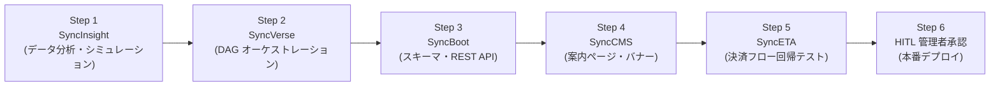

# エンドツーエンド自律連携シナリオ

## 1. シナリオ概要

本ドキュメントでは、**「新規 VIP メンバーシップ制度の新設およびオンライン決済連携」** というエンタープライズビジネス要件が受け付けられた際、SyncSeries エコシステムの 7大エージェントが自律的に協調し、本番デプロイを完結させるまでのエンドツーエンドの実務フローを説明します。

---

## 2. ステップ別実行パイプライン

### Step 1: データ分析および What-If シミュレーション (SyncInsight)
- **作業内容**:
  - 既存顧客の購買履歴 (社内 DB) と競合他社のメンバーシップ特典 (SyncCrawl 収集データ) を総合分析。
  - ラウンドテーブルエージェントによる討論を通じて、「年間決済額 1,000万ウォン以上の顧客に 5% の追加割引を提供した場合、想定売上増加効果 +18.5%、利益率防衛 94%」を導出。
- **成果物**: `ActionPlan_VIP_Membership.json`

### Step 2: タスク分解および DAG 構成 (SyncVerse)
- **作業内容**:
  - SyncInsight が導出したアクションプランに基づき、実行 DAG (Directed Acyclic Graph) を生成。
  - ドメインエージェント間の依存関係 (Dependency) マッピング:
    1. SyncBoot: DB マイグレーションおよびメンバーシップ割引計算 API の追加
    2. SyncCMS: VIP メンバーシップ案内ページおよび特典紹介バナーの登録
    3. SyncETA: 決済ページにおける割引率適用の E2E シナリオ生成および実行
- **成果物**: `ExecutionGraph_Task_88291.json`

### Step 3: バックエンドスキーマおよび API 自動生成 (SyncBoot)
- **作業内容**:
  - `tb_vip_membership`、`tb_vip_benefit_log` テーブルの DDL を自動生成。
  - DDD 原則に基づく Entity、Repository、Service、Controller コードのコンパイルおよび単体テスト実行。
  - エージェント独自の静的検証 (`verify-zero-mock.ps1`) を実行。
- **成果物**: Spring Boot マイクロサービス JAR ビルドアーティファクト

### Step 4: コンテンツおよびマーケティングアセット登録 (SyncCMS)
- **作業内容**:
  - VIP 特典紹介ランディングページおよびお知らせのドラフトを AI 生成。
  - PII 個人情報フィルタリングおよびブランドガイドライン遵守チェックに合格。
  - ステージング環境へのリアルタイム・ヘッドレスパブリッシング。
- **成果物**: CMS コンテンツアーティファクト `content-vip-membership-kr`

### Step 5: 無人 E2E 回帰テスト検証 (SyncETA)
- **作業内容**:
  - ステージング環境を対象とした新規決済シナリオの自動生成:
    1. VIP アカウントでログイン
    2. 10万ウォンの商品をカートに追加
    3. 注文フォーム入力画面へ遷移
    4. 5% VIP 追加割引 (5,000ウォン) の正常な減額を検証
    5. 決済承認 API 呼び出し結果 200 OK を確認
  - Vision AI ベースの UI コンポーネント異常有無の交差点検。
- **成果物**: `TestRunReport_Run9941.json` (Pass Rate: 100%、回帰障害 0件)

### Step 6: Human-in-the-Loop 管理者最終承認
- **作業内容**:
  - SyncVerse 管制ダッシュボードに本番デプロイチケットを発行。
  - システム管理者に対し、Before/After Git Diff、DDL スクリプト、テスト合格レポートを一括提供。
  - 管理者のワンクリック承認後、本番環境の Blue-Green ゼロダウンタイムロールアウトを実行。
- **成果物**: WORM 監査台帳署名記録 `audit-tx-prod-9941`
