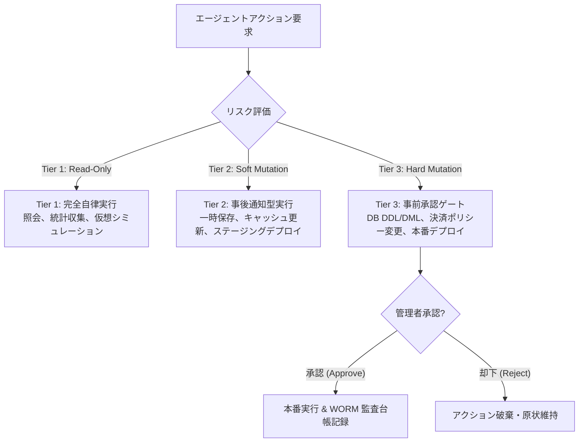
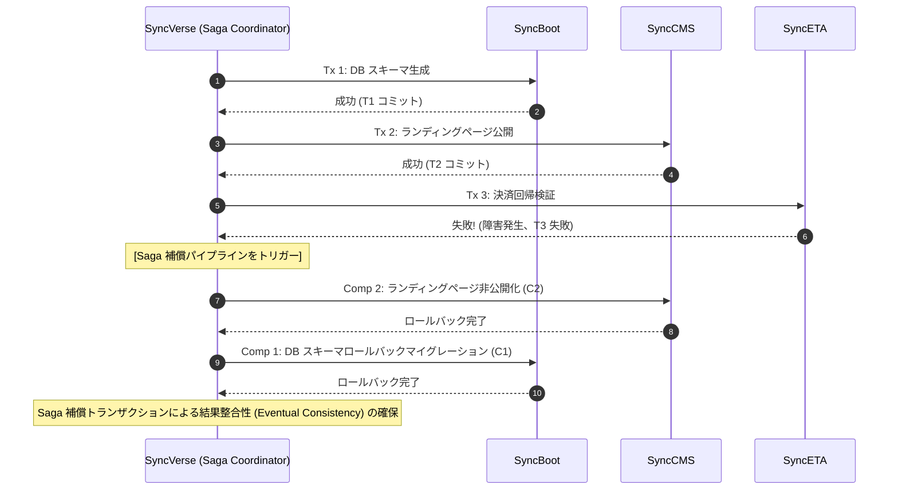

# HITL ガバナンス & Saga 分散トランザクション

## 1. エンタープライズ安全原則

自律運用 AI エコシステムにおいて最も警戒すべきリスクは、**予期せぬ副作用 (Side Effect) とデータ汚染** です。  
SyncSeries は自律性を最大化しつつリスクを体系的に統制するため、**3段階 HITL 安全ランク (Safety Tiers)** と **Saga 補償トランザクションパターン** を全社標準として運用しています。

---

## 2. 3段階 HITL 安全承認ランク (Safety Tiers)

すべての MCP ツール呼び出しは、リスク度合いに応じて 3つのランクへ自動的に分類されます。

| ランク | リスクレベル | 対象作業の例 | 承認ポリシー |
|:---|:---|:---|:---|
| **Tier 1 (Safe)** | 無害 (Read-Only) | 統計照会、ログ検索、What-If シミュレーション、RAG ドキュメント探索 | **待機なしの即時自律実行 (Zero-Wait)** |
| **Tier 2 (Low Risk)** | 軽微 (Soft Mutation) | ステージングコンテンツ登録、開発サーバーブランチ作成、一時ファイル整理 | **事後通知** (Slack/通知センター) |
| **Tier 3 (High Risk)** | 破壊的 (Hard Mutation) | DB DDL マイグレーション、会員権限昇格、決済/割引ポリシー変更 | **事前管理者承認必須** (HITL Gate) |

---

## 3. Saga パターン分散トランザクションおよび補償 (Compensation) 復旧

マイクロサービス環境において複数のドメインエージェントにまたがる複合処理の途中で一部ステップが失敗した場合、システムを正常な状態へ安全にロールバックするために **Orchestrated Saga パターン** を適用します。

### 3.1 冪等性 (Idempotency) の保証
- すべての補償アクションは **Idempotency Key** を含んでおり、ネットワークリトライや重複呼び出しが発生してもシステム状態に不整合が生じないよう設計されています。
- 失敗原因と補償トランザクションの実行結果は、`RFC 7807 Problem Details` 標準規格で管制ログに透明性をもって記録されます。
