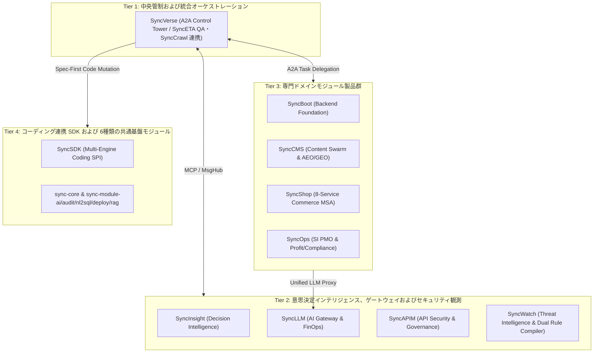
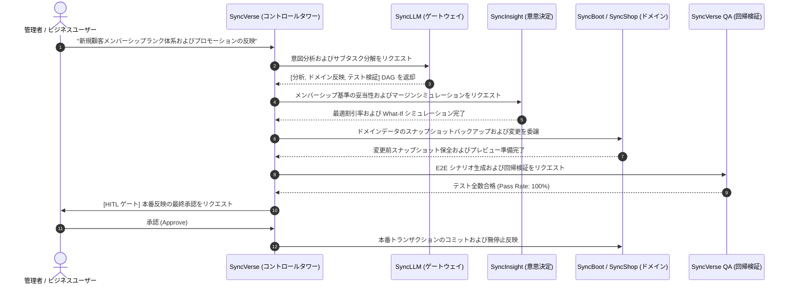

# SyncSeries 統合アーキテクチャおよびモジュール連携構造

> **読者ガイド**: 本ドキュメントは、開発者およびシステムアーキテクト向けの技術概要です。非開発者向けのサービス紹介は[株式会社エムパシー公式サイト (empasy.io)](https://empasy.io/ja/pages/index.html)、インストール不要の体験は[統合デモポータル (sync.empasy.io)](https://sync.empasy.io/ja/)、導入提案書PDFは[提案書資料室 (/ja/proposals/)](/ja/proposals/)、コア技術用語の定義は[全社技術用語集 (/ja/glossary/)](/ja/glossary/)でご確認いただけます。

## 1. アーキテクチャ概要および設計原則

**SyncSeries**は、個別ソフトウェアがサイロ状に分離して運用されていた従来のIT構造を整備し、共通のバックオフィス・認証・監査基盤の上で各ドメインモジュールが標準プロトコルを通じて相互通信・協調する**モジュール型 A2A (Agent-to-Agent) 運用アーキテクチャ**です。

全社のコアサービスおよび共通モジュールは、**Java 25**、**Spring Boot 4.0**、**AgentScope Java (`io.agentscope:agentscope-harness:2.0.2`)**、**PostgreSQL 18.6 (`pgvector`)** の単一標準技術スタック上で稼働し、以下の3つの設計原則に従います。

1. **中央制御に基づくオーケストレーション**: 中央管制モジュールである **SyncVerse** がビジネスリクエストを分析し、サブタスク単位に分解して適切なドメインモジュールへ委譲します。
2. **標準インターフェースの相互運用性**: すべてのモジュールは、**[Model Context Protocol (MCP)](/ja/glossary/#mcp)** および全社単一の **[Canonical URL](/ja/glossary/#canonical-url)** (`/api/v1/{product}/...`) 規格によってツールとAPIを公開・呼び出します。
3. **事前承認および復旧の安全性**: データ変更、スキーマ修正、コードデプロイなどの高リスク操作は、**[多者間 HITL (Human-in-the-Loop)](/ja/glossary/#hitl)** 承認ゲートおよび**スナップショットベースの補償トランザクション**を経由することで、データ整合性とロールバック可用性を確保します。

---

## 2. 4-Tier 全社アーキテクチャおよびコアモジュール構成

SyncSeriesは、役割と責任に応じて4つの階層からなる11種類のエンタープライズモジュール（`SyncVerse`、`SyncInsight`、`SyncLLM`、`SyncAPIM`、`SyncWatch`、`SyncBoot`、`SyncCMS`、`SyncShop`、`SyncOps`、`SyncETA`、`SyncCrawl`）、コーディングエンジン連携SDK（`SyncSDK`）、および6種類の共通基盤モジュール（`sync-core`、`sync-module-ai`、`sync-module-nl2sql`、`sync-module-audit`、`sync-module-deploy`、`sync-module-rag`）で構成されています。

### Tier 1: 中央管制および統合オーケストレーション層
- **SyncVerse (`sync-verse`)**: エコシステムの中央オーケストレーション層です。5-Step Spec Studioベースの仕様・タスク追跡、マルチコーディングエンジンSPIルーティング（`CodingAgentRoutingProxy`）、多者間HITL決済・承認、およびWeb/モバイルQA（`SyncETA`）とWeb収集（`SyncCrawl`）の連携を統合管制します。

### Tier 2: 意思決定インテリジェンス、AIゲートウェイおよびセキュリティ観測層
- **SyncInsight (`sync-insight`)**: 内外部の異種データを収集・分析し、2-Phase Deep ResearchとApache Calciteベースの読み取り専用Safe [NL2SQL](/ja/glossary/#nl2sql)を通じて、根拠に基づくレポートと実行提案を生成します。
- **SyncLLM (`sync-llm`)**: マルチLLMティアルーティング、リアルタイムPII個人情報マスキング、Redis[セマンティックキャッシュ](/ja/glossary/#semantic-cache)、および部門別[FinOps](/ja/glossary/#finops)予算ガードレールを専任で担います。
- **SyncAPIM (`sync-apim`)**: 4つの独立JVM（`admin`、`receiver`、`detector`、`gateway`）構成により、未登録シャドーAPIの特定、OpenAPI 3.0.1仕様ドリフトの診断、6大Web・API攻撃の検知（[WAF](/ja/glossary/#waf) / [eBPF](/ja/glossary/#ebpf)）、および8大機密情報の動的マスキングを実行します。
- **SyncWatch (`sync-watch`)**: 8大グローバルセキュリティ脅威フィード（OSV.dev、GitHub GHSA、NVD CVE、CISA KEV、Nuclei、OWASP CRS、MITRE ATT&CK、KISA）および診断ドキュメントを収集・正規化（[CVSS/CVE/STIX](/ja/glossary/#cvss-cve-stix)）し、`SyncVerse`（`VerseAuditPack`）と`SyncAPIM`（`ApimDefensePack`）へセキュリティ点検・防御ルールを配信します。

### Tier 3: 専門ドメイン実行層
- **SyncBoot (`sync-boot`)**: DB単一ソース（SSOT）動的ルーティング（`sys_permission`、[RBAC](/ja/glossary/#rbac)）、無停止環境設定ホットスワップ（`sys_config`）、リモートソケット診断機能を提供する全社バックオフィス標準基盤です。
- **SyncCMS (`sync-cms`)**: Nuxt 3 SSR、Copywriter-SEO-Publisherの3段階コンテンツワークフロー、およびSEO/AEO/GEO Web品質点検ツールを備えたハイブリッドヘッドレスCMSです。
- **SyncShop (`sync-shop`)**: Gateway、Auth、Admin、Portal、Search、Monitor、MBG、MCP Serverの8つの独立マイクロサービス（[MSA](/ja/glossary/#msa)）とストアフロント（`SYNC SELECT`）で構成されたEコマースプラットフォームです。
- **SyncOps (`sync-ops`)**: SIプロジェクトの契約単価に対する実投入原価の損益、KOSA等級人材マトリックス、4大履行保証保険の満期、下請け支払期日の監視、および租税特例制限法準拠のSHA-256電子研究ノートを統合管理します。

### Tier 4: コーディング連携 SDK および 6種類の共通基盤モジュール
- **SyncSDK (`sync-sdk`)**: `ICodingAgentClient`標準SPIを通じて社内ポリシーに適したCLI/コーディングエージェントアダプターをプラグイン方式で差し替え、4-Cycleビルド検証・復旧パイプラインと連携する開発SDKです。
- **6種類の共通モジュール**: `sync-core`、`sync-module-ai`、`sync-module-nl2sql`、`sync-module-audit`、`sync-module-deploy`、`sync-module-rag`。

---

## 3. エージェント協調ライフサイクル

---

## 4. アーキテクチャ観点での比較 (個別構築 vs SyncSeries 統合構造)

| 領域 | 個別システム分散運用方式 | SyncSeries 共通基盤統合構造 |
|:---|:---|:---|
| **新機能およびAPI拡張** | 認証・権限・ロギング・監査基盤をプロジェクトごとに重複実装 | `SyncBoot`共通基盤、Canonical URL（`/api/v1/{product}/*`）、6種類の共有モジュールを再利用 |
| **変更反映および復旧** | 手動DBバックアップおよび障害発生時のログ手動追跡・復旧 | 変更前スナップショット保全、多者間HITL承認ゲート、補償トランザクションベースのロールバック |
| **LLMコストおよびモデル管理** | チーム別の個別APIキー発行により重複呼び出しが発生し、予算追跡が不可 | `SyncLLM`単一ゲートウェイ経由、セマンティックキャッシュおよび部門別FinOps上限ポリシーを適用 |
| **回帰検証の自動化** | デプロイ前の手動点検漏れおよびUI変更時のスクリプト破損 | `SyncETA`シナリオベースの自動実行およびセマンティックDOM・ビジョン自己修復補正 |
| **セキュリティおよび監査証跡** | 手動コードレビュー中心、APIインベントリおよび機密情報漏洩の把握遅延 | `SyncAPIM`・`SyncWatch`連携による脅威ルール配信、PIIマスキングおよび監査台帳の全件記録 |

---

## 5. 次のステップ

- **[全社技術用語集 (Glossary)](/ja/glossary/)**: SyncSeriesコア技術用語の公式定義（SSOT）
- **[標準 MCP プロトコル仕様](/ja/ecosystem/mcp-protocol)**: エージェント間のツール呼び出しおよびメッセージング規格
- **[AgentScope Java 標準ガイド](/ja/ecosystem/agentscope-guide)**: Spring Boot 4.0 & Java 25バックエンドエージェント開発標準
- **[共有モジュール & SDK アーキテクチャ](/ja/ecosystem/shared-modules-and-sdk)**: 6種類の共通モジュール（`sync-core`、`sync-module-*`）および`SyncSDK`構造
- **[エンドツーエンドワークフロー実務](/ja/ecosystem/e2e-workflow)**: 実シナリオに基づくモジュール間連携手順
- **[HITL ガバナンス & Saga](/ja/ecosystem/hitl-governance)**: 管理者の安全承認および分散ロールバックメカニズム
- **[セキュリティホワイトペーパーおよびコンプライアンス](/ja/ecosystem/security-and-compliance)**: ゼロデータ保持およびネットワーク分離セキュリティ
- **[製品紹介書・提案書 PDF 一覧](/ja/proposals/)**: 導入検討および提案用ドキュメント資料室
