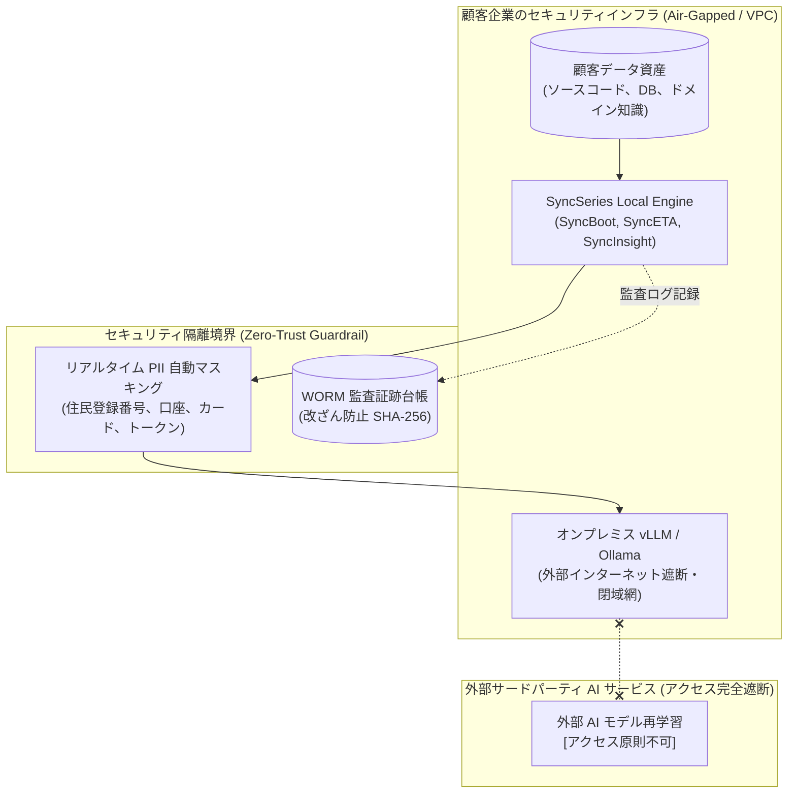

# エンタープライズ・セキュリティホワイトペーパーおよびコンプライアンスガイド

株式会社エムパシー（Empasy Inc.）は、金融、公共、製造、大規模プラットフォームなど厳格な情報セキュリティと規制遵守が求められるエンタープライズ環境に向けて、**SyncSeries AI自律運用エコシステム**全般にわたり最高水準のデータ保護およびセキュリティガバナンスアーキテクチャを適用しています。

---

## 1. コアデータ保護原則 (Data Privacy Pillars)



### 1.1 Zero Data Retention (データ非学習保証)
* **原則**: お客様のソースコード、プロンプト、APIトランザクションペイロード、ビジネスルール、DBスキーマは、**当社の共用AIモデルのファインチューニングや外部サードパーティモデルの学習に一切使用されません。**
* **インライン揮発性処理**: すべてのLLM推論リクエストおよびツール呼び出しデータはインメモリ（RAM）セッション内でのみ一時的に処理され、レスポンス返却と同時にメモリバッファから安全に上書き・破棄されます。
* **データ分離の保証**: マルチテナント環境においても、顧客企業ごとの暗号化テナントID（`tenant_id`）に基づく論理的・物理的分離を適用し、他組織とのデータ混在を根本から防止します。

### 1.2 オンプレミス・ネットワーク分離 (Air-Gapped) 対応
* **完全閉域網デプロイ**: 金融網や公共網のように外部インターネット接続が物理的に遮断された環境において、安全かつ独立して稼働します。
* **ローカルLLMランタイム互換**: vLLM、Ollama、TensorRT-LLMベースのオープンソースファウンデーションモデル（Llama 3、Llama 3.3、OpenAI o3-miniなど）とオンプレミスサーバー（NVIDIA H100/A100、RTX 6000など）上で100%ローカルのオフライン推論を実行します。
* **独自埋め込み & ベクターストア**: 社内のMilvus、Qdrant、OpenSearchクラスター上に完全オンプレミスのRAGナレッジベースを構築し、データの外部流出を未然に防止します。

---

## 2. 暗号化およびネットワーク伝送規格 (Cryptographic Standards)

| 領域 | 適用技術標準 | 詳細運用ポリシー |
|:---|:---|:---|
| **伝送区間の暗号化** | TLS 1.3 (RFC 8446) | 脆弱な暗号スイート（DES、3DES、RC4）を全面無効化し、Perfect Forward Secrecy (PFS) を強制 |
| **保存データの暗号化** | AES-256-GCM | DBボリュームおよびファイルストレージを全面暗号化し、顧客保有鍵（BYOK / KMS）連携に対応 |
| **トークンおよび秘密鍵の保管** | HashiCorp Vault / AWS KMS | 設定ファイル内への平文ハードコーディングを禁止し、動的なワンタイムトークンと90日周期の自動ローテーションを適用 |
| **監査ログの完全性** | HMAC-SHA256 & WORM | 変更・削除が不可能なWrite-Once-Read-Manyストレージへの保管とログチェーン検証を実施 |

---

## 3. 多層アクセス制御 (Identity & Access Governance)

### 3.1 細分化された RBAC & ABAC
* **RBAC (ロールベース制御)**: システム管理者（`ROLE_ADMIN`）、セキュリティ監査官（`ROLE_AUDITOR`）、ソリューション運用者（`ROLE_OPERATOR`）、APIサービスアカウント（`ROLE_SERVICE`）ごとに権限を分離します。
* **ABAC (属性ベース制御)**: IP帯域、部門コード、作業時間帯、リクエストのリスク度に応じた動的ポリシー評価により、未認可のアクセスをリアルタイムで遮断します。

### 3.2 個人情報 (PII) リアルタイム自動マスキングエンジン
SyncSeriesインラインプロキシおよびSyncLLMゲートウェイは、リクエスト/レスポンスペイロード内の機密情報パターンを正規表現およびNamed Entity Recognition (NER) に基づいてリアルタイムで検知し、自動で難読化処理を行います。
* **住民登録番号 / 外国人登録番号**: `700101-1******`
* **クレジットカード番号**: `5424-****-****-1234`
* **銀行口座番号**: 末尾4桁を除く全領域をマスキング
* **秘密鍵およびトークンパターン**: `eyJhbGci... [REDACTED_JWT]`、`sk-proj-... [REDACTED_API_KEY]`

---

## 4. コンプライアンス準拠およびセキュリティ認証フレームワーク

```
┌────────────────────────────────────────────────────────────────────────────┐
│                   SyncSeries セキュリティガバナンスフレームワーク             │
├──────────────────────┬──────────────────────────┬──────────────────────────┤
│    ISMS-P (KISA)     │      ISO/IEC 27001       │ 金融セキュリティ院 AI指針 │
├──────────────────────┼──────────────────────────┼──────────────────────────┤
│ • 102項目の統制項目  │ • 情報セキュリティ管理体制│ • AI生成物バイアス・誤り統制│
│ • 個人情報ライフサイクル│ • リスク評価および対処   │ • モデル説明可能性 (XAI)  │
│ • アクセス記録2年保存 │ • 事業継続性 (BCP)       │ • 分散Saga補償トランザクション│
└──────────────────────┴──────────────────────────┴──────────────────────────┘
```

1. **監査証跡 (Audit Trail) の保存**: すべてのA2A（Agent-to-Agent）呼び出し、MCPツール実行履歴、管理者承認履歴をRFC 5424規格の構造化ログ（JSON）として最低2年間永続保存します。
2. **ソフトウェアサプライチェーンセキュリティ (SBOM) および3極自律 DevSecOps (`SyncWatch` → `SyncVerse` → `SyncAPIM`)**: すべてのデプロイイメージおよびアーティファクトはCycloneDX / SPDX規格のSBOMを提供し、[`SyncWatch`](/ja/syncwatch/)が収集・コンパイルした`VerseAuditPack`（SCA/SAST/DASTコード点検）および`ApimDefensePack`（`SqlXssLexicalTokenizer`構文トークンフィンガープリント + `SandboxedDefenseEvaluator`ピンポイント仮想パッチ + カーネルeBPF遮断）を通じて、コードとランタイムの両端からゼロデイ脅威をリアルタイムで防御します。
3. **秘密保持契約 (NDA) の事前締結プロセス**: 顧客企業の技術審査およびPoC着手に先立ち、両社間で標準のエンタープライズ相互秘密保持契約を先行締結し、技術資産とビジネス情報を保護します。
