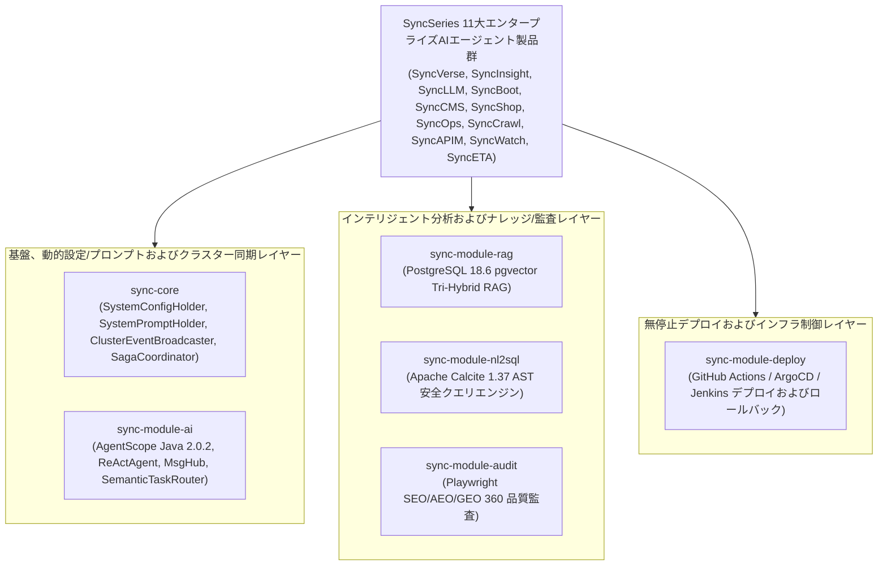
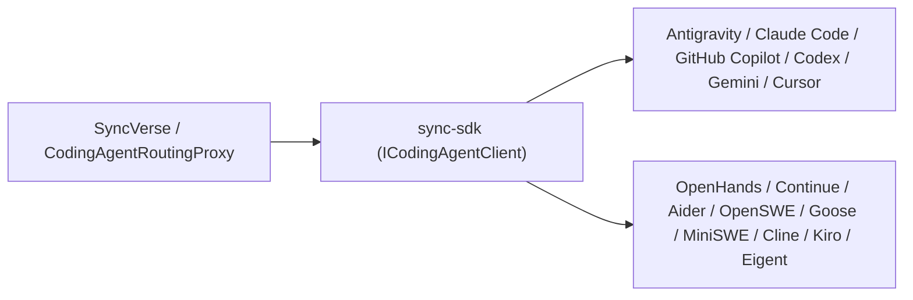

# 全社共有モジュールおよびAIコーディングSDKアーキテクチャ

SyncSeriesは、ルート `pom.xml` のマルチモジュール体系のもとで個別ドメインサービスとエージェント間の重複コードを排除し、全社で一貫したアーキテクチャ原則（Java 25、Spring Boot 4.0、AgentScope Java 2.0.2、PostgreSQL 18.6）を適用するため、**6大共通基盤モジュール（`sync-core`、`sync-module-*`）**と**15大AIコーディングエンジニアリングSDK（`sync-sdk`）**を標準化して運用しています。

---

## 1. 全社6大共有モジュールの構成体系

### 1.1 基盤およびAIエージェントランタイムモジュール
* **`sync-core` (`com.empasy.sync:sync-core`)**:
  * 全社ドメインエンティティ共通規格（`BaseEntity`）、標準APIレスポンスラッパー（`Result<T>`）、グローバル例外処理およびAES-256暗号化ユーティリティを提供します。
  * **DBベースの無停止動的環境設定（`SystemConfigHolder`、`sys_config`）および動的プロンプト（`SystemPromptHolder`、`sys_prompt_template`、`sys_prompt_history`）**: ソースコード内の定数やプロンプトのハードコーディングを排除し、DBからのリアルタイム参照およびバージョンロールバックに対応します。
  * **マルチインスタンス・クラスター同期（`com.empasy.sync.core.cluster.*`）**: `ClusterEventBroadcaster`、`RedisClusterStateBackingStore`、`SharedMemoryClusterStateBackingStore`、`DistributedLockExecutor`、`DistributedStateCoalescer` により、複数インスタンス間で設定・プロンプト・サーキットブレーカーの状態をリアルタイム同期します。
  * **Java 25** の仮想スレッド（Virtual Threads）環境においてOSスレッドの占有（Carrier Pinning）を防止するため、`ReentrantLock` ベースの高性能な並行性制御を提供します。
* **`sync-module-ai` (`com.empasy.sync:sync-module-ai`)**:
  * 全社唯一の標準AIフレームワークである **`AgentScope Java`（`io.agentscope:agentscope-harness:2.0.2`）** を統合しています（`ReActAgent`、`MsgHub`、`@Tool` 自動ディスカバリー）。
  * `AgentSelfRegistrationClient`: バックエンド起動時にSyncVerse中央管制塔（`/api/v1/verse/agent/register-manifest`）へのエージェント自己登録を非同期で処理します。

### 1.2 インテリジェント分析およびナレッジ/監査モジュール
* **`sync-module-rag` (`com.empasy.sync:sync-module-rag`)**:
  * **Tri-Hybrid RAGエンジン**: PostgreSQL 18.6 `pgvector` のHNSW Denseベクトル検索 + `pg_trgm` キーワード検索 + ナレッジグラフの組み合わせにより、ドメイン知識の検索精度を最大化します。
  * `ContextAwareMarkdownSplitter`: Markdownヘッダーの階層構造とコードブロックのコンテキストを完全に保持するインテリジェントなチャンキングエンジンです。
  * `IncidentRunbookService`: システム障害発生時に過去のインシデント解決手順をリアルタイムで自動マッピングします。
* **`sync-module-nl2sql` (`com.empasy.sync:sync-module-nl2sql`)**:
  * **Apache Calcite 1.37.0** および **JSqlParser 4.9** に基づく関係代数AST最適化と、多層SQLセキュリティガードレール（`SELECT` 専用強制、テナント分離条件の自動注入、`LIMIT` 強制）を提供します。
* **`sync-module-audit` (`com.empasy.sync:sync-module-audit`)**:
  * `AuditOrchestratorService`: Playwrightヘッドレスレンダリングと静的AST解析を組み合わせ、SEO/AEO/GEOの3大Web品質を100点満点で定量評価し、AIパッチを提案します。

### 1.3 無停止デプロイおよびインフラ制御モジュール
* **`sync-module-deploy` (`com.empasy.sync:sync-module-deploy`)**:
  * マルチCI/CDパイプラインアダプター（`JenkinsPipelineAdapter`、`GitHubActionsAdapter`、`ArgoCdPipelineAdapter`）を提供します。
  * コンテナおよびK8s Podのリアルタイムヘルスチェックと自動ロールバックのオーケストレーションを実行します。

---

## 2. SyncSDK (`com.empasy.sync.sdk:sync-sdk-parent`)

`sync-sdk` は、5-Step Spec Studioおよび**15大エンタープライズコーディングエージェント（`CodingAgentType`）**とのプログラム連携を実現するための全社標準SDKモジュールです。

* **15大マルチコーディングエンジン・ホットスワップSPI（`ICodingAgentClient` & `CodingAgentType`）**: ランタイム時に `ANTIGRAVITY`、`CLAUDE_CODE`、`GITHUB_COPILOT`、`CODEX_CLI`、`GEMINI_CLI`、`CURSOR_CLI`、`OPENHANDS`、`CONTINUE`、`AIDER`、`OPENSWE`、`GOOSE`、`MINI_SWE`、`CLINE`、`KIRO`、`EIGENT` の15大エンジンを無停止で切り替え、エンジンごとのデフォルトモデルは `SystemConfigHolder.getValue("sync.sdk.agent.default-model.<code_lower>", defaultModel)` によりDB `sys_config` から動的に取得します。
* **4-Cycleビルド自己修復**: コードパッチ適用後に `mvn test-compile` および `vue-tsc` 検証を実行し、コンパイルエラーが発生した場合はエラーログを再注入して自律的に修正します。
* **Zero-Mock本番保証**: 本番ランタイムクラス内でのハードコーディングされたダミー応答を全面的に排除し、実際のGitワークスペース（`GitWorkspaceManager`）およびアトミックパッチエンジン（`AtomicDiffPatchEngine`）とバインディングされます。
