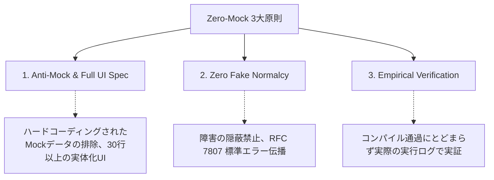
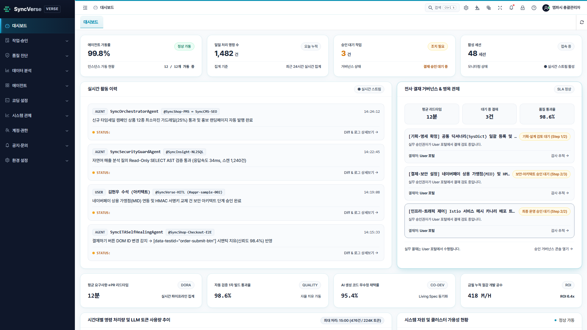
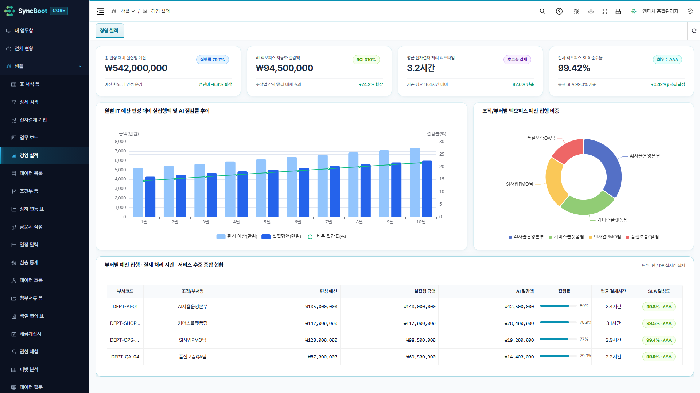
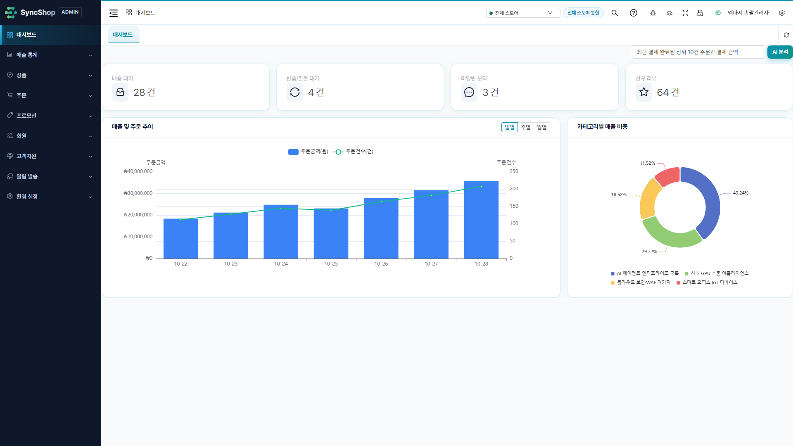
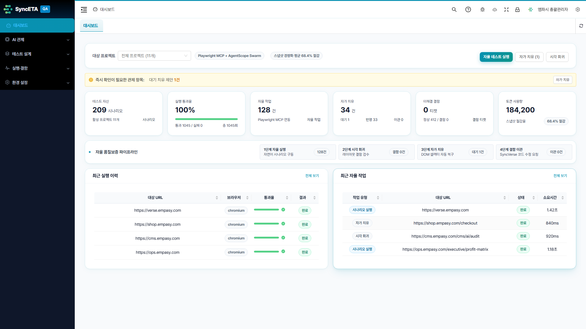

# Zero-Mock エンタープライズ品質ハーネスおよび検証プロトコル

::: tip 実環境における実装例のご案内
Testcontainersに基づく実際のSpring BootおよびPostgreSQLのテストコード作成方法については、[実環境ベースのテストガイド](/ja/sdk/zero-mock-testing)をご参照ください。
:::

SyncSeriesは、商用ソフトウェアとしての信頼性を確保するため、ハードコーディングされた偽の応答を排除し、実際のDBおよびネットワーク連携環境で検証を行う**Zero-Mock原則**と**4-Cycle品質検証プロトコル**を基本方針として適用しています。

---

## 1. Zero-Mockおよび商用品質の3大原則

### 1.1 Anti-Mock & Full UI Spec Mandate
* 明示的な単体テストの分離目的を除き、バックエンドおよびフロントエンドの実ロジック内にハードコーディングされたMockオブジェクト、ダミーラッパー、空リターンメソッドを作成することを厳格に禁止しています。
* すべてのREST APIとフロントエンドコンポーネントは、実際のデータベースクエリおよびサービスインターフェースと100%連携している必要があります。
* すべての画面コンポーネントは30行以上の実体化されたUI要素（テーブル、フォーム、フィルターなど）を備える必要があり、空の枠組みや仮テキストの作成は禁止されています。

### 1.2 Zero Fake Normalcy（偽装正常化の禁止）
* ネットワーク障害、HTTP呼び出し失敗、DBクエリエラーの発生時に、`catch` ブロックで例外を握りつぶしたり、任意の偽の成功ステータス（`status: SUCCESS`）を生成して正常動作のように偽装したりする行為を遮断します。
* すべての例外はRFC 7807 Problem Details標準に従い、正確なHTTPステータスコードと構造化された診断フィールドを含めてクライアントおよび上位管制システムへ伝播する必要があります。

### 1.3 Empirical Verification（実行検証の必須化）
* 単なるソースコードの修正やコンパイル成功にとどまらず、実際のDB実行ログ、REST API呼び出しレスポンス、フロントエンドビルドの実行結果をコンソールに出力して実証する必要があります。

---

## 2. 4-Cycle品質検証プロトコル

コード変更が発生した後は、以下の4段階の回帰検証プロセスを反復してビルドの整合性を確定します。

| 検証段階 | 主な検証項目 | ツールおよびコマンド | 合格基準 |
|:---|:---|:---|:---|
| **[Cycle 1] 全体ビルドおよび1次検証** | 全社モジュールのコンパイルおよび型検証 | `mvn compile`, `pnpm build` | 全ビルド成功（BUILD SUCCESS） |
| **[Cycle 2] 修正および2次クロス検証** | インターフェース/型の整合性確認 | `mvn test-compile` | モジュール間の依存性/型エラー0件 |
| **[Cycle 3] 回帰テストおよび3次検証** | 単体/統合テストおよび静的監査 | `mvn test`, `verify-zero-mock.ps1` | 単体テスト合格、Mock違反0件 |
| **[Cycle 4] 最終回帰ビルドおよび監査** | クリーンビルドおよび独立QAクロス監査 | Subagent Audit (`QA_Auditor`) | 最終承認判定（APPROVED） |

---

## 3. 全社自動化監査スクリプト体系

開発成果物の整合性を検証するため、全社コアエージェントおよび共通モジュールを対象として3種類の専用監査スクリプトを運用しています。

* **`verify-zero-mock.ps1`**:
  * Java、Vue、TypeScriptソースコード内のハードコーディングされたmock変数、任意のダミーコレクション返却、偽の分岐ロジックを静的パターン解析によって検出します。
* **`verify-security-leaks.ps1`**:
  * ソースコードおよび設定ファイル内の平文ハードコーディングされたAPI Key、パスワード、プライベート認証トークンの漏洩有無を全数スキャンします（10,000+ファイル検査）。
* **`verify-api-contracts.ps1`**:
  * バックエンドControllerエンドポイントとフロントエンドAPI呼び出し仕様の間で、URL、HTTPメソッド、パラメーターの1:1一致と整合性を監査します。

---

## 4. 全社1,045テストケース(TC)およびPlaywright E2E UI検証状況 (100% PASSED)

SyncSeries全製品群（13パート・209利用シナリオ × 5大次元 `HAPPY_PATH` / `VALIDATION` / `BOUNDARY` / `STATE` / `PERMISSION`）に対し、合計**1,045個のテストケース（`L1`〜`L5`）**およびPlaywrightヘッドレスブラウザに基づく高解像度（`1920×1080`）画面レンダリング・アノテーション検証を常時実施しています。

| 検証項目 | 検証対象 | 合格率 / 結果 |
|:---|:---|:---|
| **全機能テストケース (`L1`~`L5`)** | 13パート・209シナリオ・1,045 TC | **`1,045 / 1,045 PASSED (100.0%)`** |
| **DB 6段階標準スクリプト (`00`~`05_*.sql`)** | 9大コアエージェントDB（計54本のSQLファイル） | **`0` 違反（`ON CONFLICT` 0件、`migrations/` 0件）** |
| **Zero-Mock 静的品質監査** | 18プロジェクトおよびマイクロサービスモジュール | **`18 / 18 PASSED (0 Violations)`** |
| **API契約 & シークレット漏洩監査** | 全社Canonical URL (`/api/v1/{product}/...`) およびシークレットスキャン | **`11 / 11 PASSED (0 Leaks)`** |
| **Playwright E2E UI & 高解像度キャプチャ** | 全製品群の代表画面 `1920×1080` 元画像42種 + コールアウトアノテーション40種 | **`ConsoleErrors=0`、`PageErrors=0`（計82種）** |

### 代表製品群の検証画面キャプチャ

