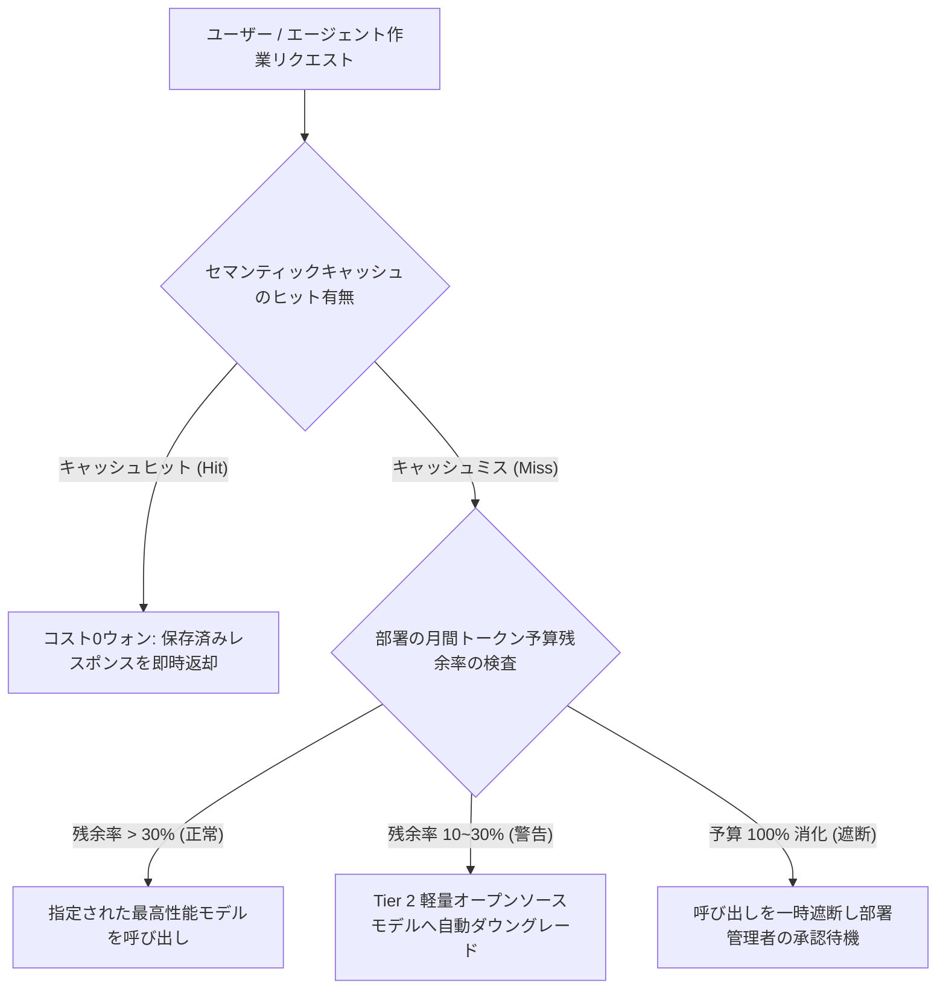

# 部署別トークン予算管理およびコスト最適化ガイド

## 1. 概要および FinOps 管理の目的

生成AIモデルおよび自律型エージェントの活用が拡大するにつれ、特定部署の過剰なプロンプト呼び出しや無限ループによって予期せぬクラウドAPI請求コストが発生するリスクを統制する必要があります。

SyncSeries の FinOps モジュールは、**組織 (部署/プロジェクト) 単位のきめ細かなトークン支出クォータ管理**と**インテリジェントな多層モデルルーティング**により、AI運用コストを事前に予測し、計画された予算範囲内に統制できるよう支援します。

---

## 2. 3段階の予算しきい値通知および制御ポリシー

部署ごとに設定された月間予算 (例: 月額200万ウォンまたは月間5,000万トークン) の消化率に応じて、以下のような自動化されたガバナンスルールが動作します。

| 消化率ステージ | システム措置および制御ポリシー | ユーザー/管理者通知 |
| :---: | :--- | :--- |
| **ステージ 1: 正常 (0 ~ 70%)** | すべてのリクエストに対してデフォルト設定の上位モデル (Tier 3~4) を通常提供 | 通知なし (ダッシュボードでリアルタイム集計) |
| **ステージ 2: 注意 (70 ~ 90%)** | 単純な分類や情報抽出作業は社内軽量モデル (Tier 1) へ優先切り替え | 部署担当者へメール/Slack案内通知を送信 |
| **ステージ 3: 警告 (90 ~ 100%)** | 大規模バッチ作業を一時保留、高コストなフロンティアモデルの呼び出しを制限 | 部門長および財務担当者へ緊急警告を送信 |
| **ステージ 4: 超過 (100% 到達)** | 一般クエリを遮断、社内閉域網オンプレミスモデルへ強制フォールバック | 予算増額承認申請書を自動発行 |

---

## 3. コスト最適化のための2大コアエンジン

### 1) 能力ベースの4段階モデルティアリング (Model Tiering)
すべての作業を高コストな商用モデルで処理するのではなく、作業の複雑度に応じて最適な単価のモデルへ自動的に分岐します:

- **Tier 1 (超軽量 / 社内デプロイ)**: 単純な意図分類、正規表現検証、固有表現抽出 -> *呼び出しコスト0ウォン (社内GPUを活用)*。
- **Tier 2 (中型 / オープンソース)**: 一般的なQ&A、ドキュメント要約、単純なSQLクエリ -> *Llama-3.1-8B, Llama-3.1-8B*。
- **Tier 3 (大型 / 高性能)**: 複雑なビジネス企画、アーキテクチャ仕様の導出 -> *Llama-3.3-70B, Claude 3.5 Haiku*。
- **Tier 4 (最上位推論)**: 複雑なアルゴリズム設計、マルチエージェント討論による合意形成 -> *Claude 3.5 Sonnet, OpenAI-o3*。

### 2) セマンティックキャッシュ (Semantic Cache) の活用
- 完全に一致するテキストだけでなく、意味的類似度 (Cosine Similarity 0.95以上) が高い類似クエリに対して、データベースにキャッシュされた検証済みレスポンスを即時返却します。
- 社内からの問い合わせやよくある質問 (FAQ) の場合、重複するAPI呼び出しを削減してトークン消費量を実質的に節約できます。

---

## 4. 月次コスト精算およびレポートの確認

- 管理コンソールの **[FinOps > 部署別統計]** メニューから、部署別・プロジェクト別・エージェント別の日次/月次トークン消費推移グラフを照会できます。
- CSV および PDF レポートのダウンロードに対応しており、社内ITコストの精算や会計伝票処理にそのまま活用できます。
