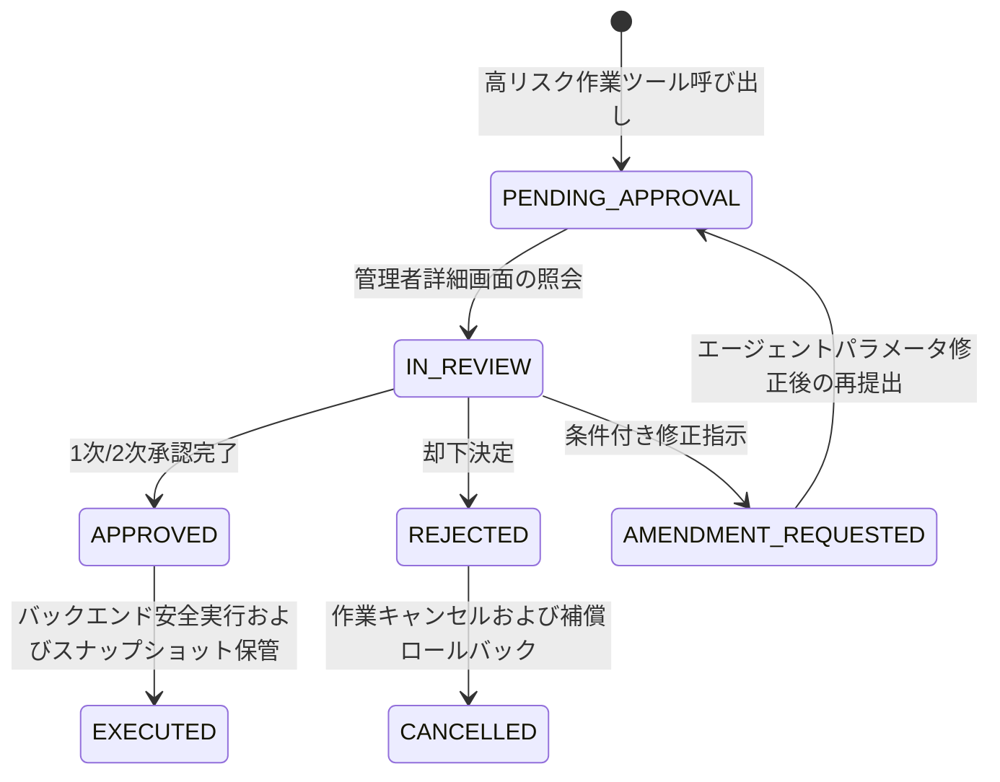

# 高リスク作業の多段階承認および監査証跡ガイド

## 1. 作業リスクレベル分類基準 (Risk Levels)

エージェントが呼び出すすべてのツール (Tool) およびビジネスアクションは、システムに与える影響度に応じて4段階のリスクレベルに事前分類されて管理されます。

| レベル | 作業種別 | 対象作業の例 | 承認ポリシー |
| :---: | :--- | :--- | :--- |
| **Level 1 (安全)** | 単純照会およびレポーティング | 注文状況の照会、ログ検索、RAG ドキュメント探索 | **無承認での自律実行** (実行履歴を自動記録) |
| **Level 2 (注意)** | 可逆的な設定変更 | クローリング周期の変更、キャッシュ有効期限設定、通知チャネル設定 | **単一担当者による承認** (1名承認) |
| **Level 3 (警告)** | データ変更および削除 | 会員情報の修正、商品価格の一括変更、DBレコード削除 | **2段階順次承認** (担当者 -> 部門長) |
| **Level 4 (危険)** | システム全体への影響 | 本番環境への新規バージョンデプロイ、DDL スキーマ変更、大量返金 | **3段階多者承認** (担当者 -> CISO -> 責任者) |

---

## 2. Webコンソール承認画面の操作手順

Level 2 以上の作業が検知されると、エージェントの実行が即座に一時停止 (PAUSED) され、管理ポータルの承認待ち一覧にカードが登録されます。

### 段階別の確認項目
1. **影響範囲 (Blast Radius) の確認**:
   - 変更対象のテーブル名、変更予定のレコード件数 (Row Count) を確認します。
   - 単一レコードではなく1,000件以上の大量変更案件である場合、理由が妥当であるかを精査します。
2. **変更前後の Diff 照合**:
   - 変更前 (Current State) と変更後 (Proposed State) の JSON/SQL データの差分が正確であることを確認します。
3. **ロールバックスナップショットの可用性検証**:
   - システム障害発生時に以前の状態へ戻せるスナップショットIDが正常に生成されているか、インジケータを点検します。

---

## 3. 管理者意思決定アクションガイド

- **承認 (Approve)**:
  - 確認の結果、作業内容に問題がない場合は「承認」ボタンをクリックします。
  - 多者承認案件の場合は次の承認権限者へ承認ルートが順次引き継がれ、最終承認時に実際のトランザクションがコミットされます。
- **却下 (Reject)**:
  - ビジネスポリシーに違反している場合やデータ汚染の懸念がある場合は、具体的な却下理由を入力して作業を拒否します。
  - エージェントは即座に作業を中断し、関連リソースを解放します。
- **修正指示 (Amend)**:
  - 方向性は妥当であるものの、パラメータ (例: 価格割引率、対象ユーザー範囲など) の微調整が必要な場合は、修正フィードバックを記述してエージェントに再作業を指示できます。

---

## 4. 監査ログの追跡および改ざん防止

すべての承認/却下の意思決定履歴は、内部監査台帳 (Audit Ledger) に永続保存されます:

- **記録項目**: リクエスト日時、実行エージェントID、承認者社員番号およびIPアドレス、リクエスト元のプロンプト、ツールパラメータのハッシュ値、最終実行結果。
- **完全性保証**: 監査ログはタイムスタンプに基づく暗号化ハッシュチェーン (SHA-256) で相互に結合されているため、データベース管理者であっても過去の履歴を任意に操作したり削除したりすることはできません。
