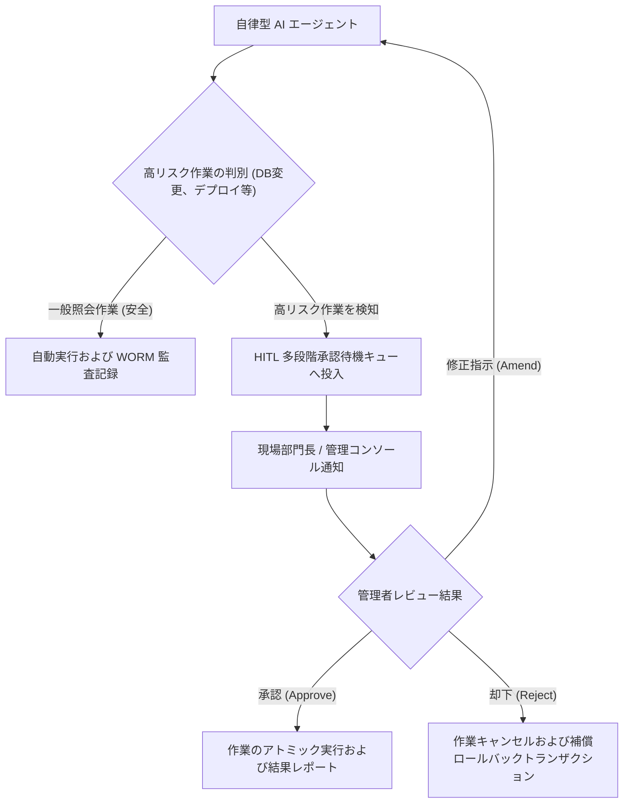

# 現場管理者向け実務ガバナンスガイド

## 1. 概要および対象読者

SyncSeries は、エンジニアリング開発者だけでなく、**実際のビジネス部門の管理者、企画担当者、セキュリティ審査担当者**が安全に AI エージェントを統制・運用できるよう、Webベースの管理コンソールとガバナンスツールを提供します。

本ガイドは、以下のような役割を担う実務者向けに作成されています:
- **部門長および承認権限者**: エージェントがリクエストした高リスク作業 (大量データの変更、本番デプロイなど) に対する承認/却下の意思決定。
- **FinOps および財務担当者**: 部署別・プロジェクト別の月間 AI モデル呼び出しコストの追跡および予算上限管理。
- **コンプライアンスおよび監査担当者**: 過去にエージェントが実行した作業履歴、判断根拠、プロンプトログに対する改ざん防止監査。

---

## 2. ガバナンスのコア原則

1. **最小権限の原則 (Least Privilege)**:
   - 各エージェントとユーザーは、付与されたロール (`sys_role`) にマッピングされたツールおよび画面権限のみを実行できます。
2. **多段階の人的介入 (Multi-Party HITL)**:
   - 破壊的な操作や一定金額以上の決済変更案件は、単一の管理者ではなく2名以上の多者順次承認を経て初めて最終執行されます。
3. **不可逆な監査証跡 (Tamper-Proof Audit)**:
   - すべての承認履歴とエージェントの実行ログは、タイムスタンプ暗号化ハッシュチェーンで封印されており、事後の任意修正や削除はできません。

---

## 3. 役割別の日次・週次運用チェックリスト

| 担当役割 | 周期 | 主な点検項目 | 管理コンソールメニューおよび参照マニュアル |
| :--- | :---: | :--- | :--- |
| **現場部門長 / 承認権限者** | 常時 | • Level 3~4 高リスク作業 (価格一括変更、スキーマ修正、デプロイ) の承認待機キュー確認 • 変更前後のデータ Diff およびロールバックスナップショットID生成有無の点検 | `SyncVerse > 作業承認 (/governance)` [HITL 承認マニュアル](./hitl-approval-operations) |
| **FinOps / IT企画チーム** | 週次 | • 部署・エージェント別の月間トークン予算消化率 (70% / 90% しきい値) のモニタリング • セマンティックキャッシュヒット率 (`>= 35%`) および軽量モデル (Tier 1~2) 自動切り替え比率の点検 | `SyncLLM > FinOps 台帳` [FinOps 予算マニュアル](./finops-budget-operations) |
| **情報セキュリティ / 監査チーム** | 月次 | • 外部 LLM 呼び出し時の PII (住民登録番号・口座・カード・連絡先) マスキング検知件数の監査 • SHA-256 ハッシュチェーン監査ログの完全性および未認可 API (`SyncAPIM`) 遮断履歴の検収 | `SyncAPIM > 脅威検知ログ` `SyncWatch > セキュリティパック配布台帳` |

---

## 4. 緊急時対応およびワンクリック (1-Click) ロールバック標準手順 (SOP)

エージェントによる自律作業の反映直後に予期せぬ指標異常や現場からのクレームが寄せられた場合、管理者は開発チームによるコード修正を待つことなく、次の3段階の手順で即座に原状回復できます。

1. **ステップ 1 — 実行履歴およびスナップショットの特定**:
   - `SyncVerse` または該当ドメインエージェント (`SyncShop`, `SyncCMS`, `SyncBoot`) の **[作業承認 > 実行監査履歴]** 画面で、直前に執行された作業IDと自動発行されたスナップショット識別子 (`SNP-YYYYMM-NNN`) を確認します。
2. **ステップ 2 — ワンクリック補償ロールバックのトリガー**:
   - 該当履歴カードの **[直前スナップショットへ即時復元 (Rollback)]** ボタンをクリックすると、バックエンドの補償トランザクション (`revert_data_state` または `ROLLBACK_PRICE`) が実行され、`1秒` 以内に変更前のデータ状態へ復旧します。
3. **ステップ 3 — 原因分析 (RCA) およびガードレールの補正**:
   - `SyncInsight` RCA レポートを通じて異常原因を確認し、必要に応じて該当ツールのリスクレベルを引き上げるか、制約パラメータ (例: 最小保証マージン率、最大変更件数) を再設定します。

---

## 5. 詳細実務マニュアルのご案内

- **[4段階 HITL 承認およびスナップショットロールバックマニュアル](./hitl-approval-operations)**: Webコンソールでの承認リクエスト受信、詳細 Diff および影響度確認、承認/却下/修正指示操作、ならびにスナップショットロールバック手順。
- **[FinOps 予算ガードレールおよびモデルルーティングマニュアル](./finops-budget-operations)**: 組織単位の月間予算割り当て、しきい値到達時の通知ポリシー、モデル自動ティアリング、および超過防止の運用方策。
