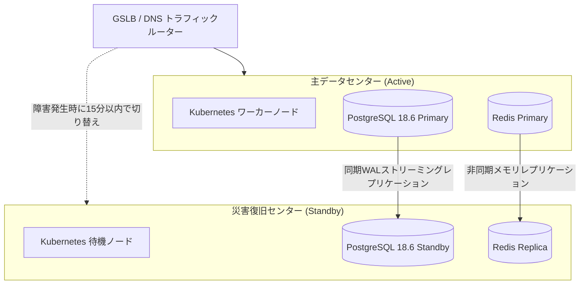

# 災害復旧（DR）および高可用性設計

## 1. 概要および復旧目標基準

SyncSeriesは、データ損失が致命的となる金融、製造、公共サービスを安定的に支援するため、明確な復旧目標指標（RPO、RTO）を定義し、マルチリージョンおよび冗長化インフラを運用します。

- **RPO（Recovery Point Objective - 目標復旧時点）**: **0分**（同期レプリケーション環境基準）／最大1分以内（非同期クロスリージョンレプリケーション基準）。
- **RTO（Recovery Time Objective - 目標復旧時間）**: **15分以内**（主センター障害発生時、副センターへのトラフィック切り替え完了基準）。



---

## 2. データ層の高可用性およびレプリケーションアーキテクチャ

### 1) PostgreSQL 18.6（pgvector）WALストリーミングレプリケーション
- ビジネステーブルおよびAI埋め込みベクトルデータの一貫性を維持するため、PostgreSQL 18.6の物理ストリーミングレプリケーション（Physical Streaming Replication）を適用します。
- `synchronous_commit = on` 設定により、トランザクションコミット信号が待機ノードのWAL（Write-Ahead Log）に記録された後に最終的なクライアント応答を返却し、障害発生時のコミット欠損を防止します。

```ini
# postgresql.conf (Primary)
wal_level = replica
max_wal_senders = 10
wal_keep_size = 4096MB
synchronous_commit = on
synchronous_standby_names = 'FIRST 1 (dr_standby_node)'
```

### 2) ポイントインタイムリカバリ（PITR: Point-In-Time Recovery）パイプライン
- 毎日02:00にベースバックアップ（Base Backup）をMinIOオブジェクトストレージへ圧縮・暗号化して格納します。
- 継続的に生成されるWALアーカイブファイルは60秒周期で待機ストレージへ同期され、管理者の誤操作によるデータ汚染が発生した際、特定の分・秒単位でデータベースを精密に復元できるPITR環境を提供します。

---

## 3. Redis分散ロックおよびセッションレプリケーション

- エージェント間の同時タスク競合を防止する分散ロック（Redlock）およびアクティブユーザーセッションは、Redis Sentinelベースの3ノード自動フェイルオーバークラスタとして構成されます。
- マスターノードに深刻なハードウェア障害が発生した場合、Sentinelクオーラム（Quorum）合意により3秒以内にレプリカノードが新しいマスターへ自動昇格します。

---

## 4. 災害発生時の段階別フェイルオーバー手順

主データセンターの物理的浸水、停電、または通信回線断絶事故が発生した場合、以下の標準運用手順（SOP）に従って待機センターへ切り替えます。

1. **状態検知および障害宣言（0〜3分）**:
   - 外部ヘルスチェックプローブ3拠点において、主センターの5xxエラーまたは無応答が180秒以上継続した場合、インフラ危機アラートを発報します。
2. **待機データベースの昇格（3〜7分）**:
   - 災害復旧センターのPostgreSQL Standbyノードで昇格コマンドを実行し、読み取り／書き込みモードへ切り替えます。
     ```bash
     pg_ctl promote -D /var/lib/postgresql/data
     ```
3. **Kubernetes Podのスケールアウトおよび起動（7〜10分）**:
   - 待機クラスタのドメインエージェントDeploymentレプリカ数を、平時の待機状態（1台）から本番稼働仕様（最小3台以上）へ即座にスケールアウトします。
4. **GSLBトラフィックの切り替え（10〜15分）**:
   - グローバルサーバーロードバランサー（GSLB）の重み付けを主センター0%、待機センター100%に切り替え、DNS TTL（60秒）の満了を待機します。
   - サービスの正常流入および認可トークンセッションの正常検証可否を最終確認します。

---

## 5. 定期模擬訓練および復旧検証

- **訓練周期**: 四半期に1回、定期DR模擬訓練を実施します。
- **検証項目**:
  - 実際の主センターネットワークインターフェースを強制遮断した後のトラフィック切り替え完了時間の計測。
  - 切り替え完了後、エージェント作業履歴およびRAGベクトルインデックスのデータ欠損（0件）の全数照合。
  - 模擬訓練結果レポートを作成し、エンタープライズコンプライアンス監査証跡として保管。
