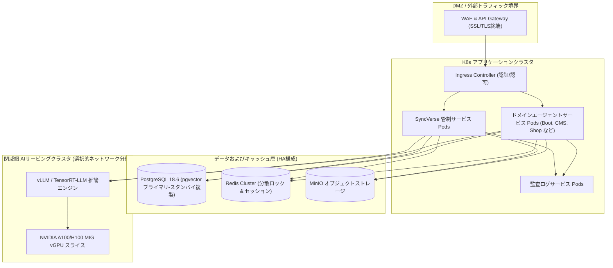

# エンタープライズインフラおよびセキュリティアーキテクチャ

## 1. インフラ設計原則

SyncSeriesは、金融、公共、製造など厳格なネットワーク分離規定およびセキュリティコンプライアンスが求められるエンタープライズ環境を支援するように設計されています。

プラットフォームインフラは、以下の3つの工学原則を中心に構築されます。
1. **隔離および多層防御（Defense-in-Depth）**: パブリッククラウドだけでなく、外部インターネット接続が遮断された物理的閉域網（On-Premise）環境でも独立して完全に稼働できるコンテナ化アーキテクチャ。
2. **宣言的GitOpsデプロイ**: すべてのKubernetesマニフェストおよび環境設定はGitリポジトリを単一の信頼できる情報源（Single Source of Truth）として管理し、ArgoCDを通じて追跡および自動同期を実施。
3. **厳格なデータ主権および個人情報保護**: 外部LLM API通信時のリアルタイムPII（個人識別情報）自動マスキング、および全社監査ログ（Audit Trail）の改ざん防止保管。

---

## 2. モジュール別物理層の構成

全社プラットフォームは、サービスの安定性と性能ボトルネックの防止のため、機能ごとに独立したノードプール（Node Pool）を構成して運用します。

| 層 | 主なコンポーネント | 推奨ハードウェア仕様 | ネットワークポリシー |
| :--- | :--- | :--- | :--- |
| **API & オーケストレーション** | `SyncVerse`、API Gateway、Nacos | 汎用コンピューティングノード（8 vCPU、32GB RAM） | 外部インバウンド許可、mTLS通信 |
| **ドメインビジネスサービス** | `SyncBoot`、`SyncCMS`、`SyncShop` | メモリ最適化ノード（16 vCPU、64GB RAM） | 内部プライベートネットワーク専用、クラスタ内部通信 |
| **データおよびRAGベクトルストア** | PostgreSQL 18.6、Redis、MinIO | NVMe SSD搭載ストレージノード | 内部隔離ネットワーク、データ暗号化（LUKS/TLS） |
| **ローカルAIサービング（オンプレミス）** | vLLM、TensorRT-LLM、埋め込みモデル | GPUアクセラレーションノード（NVIDIA L40S、A100、H100） | 推論専用隔離VLAN、外部ネットワーク遮断 |

---

## 3. エンタープライズ運用ドキュメントロードマップ

インフラおよびセキュリティ管理者が環境構成と障害対応時に即座に参照できるよう、詳細な運用ガイドを提供します。

- **閉域網ローカルLLMサービングおよびvGPUリソース分割**: 外部接続のない社内GPUサーバーの構成およびvLLMサービングの最適化。
- **AIセキュリティガードレールおよびPIIマスキング**: プロンプトインジェクション防御、有害出力の遮断、およびリアルタイム個人情報匿名化。
- **KubernetesデプロイおよびGitOpsパイプライン**: Helmチャート構造、ArgoCD継続的デプロイ、およびHPAオートスケーリング。
- **災害復旧（DR）および高可用性設計**: アクティブ-スタンバイ冗長化、ポイントインタイムリカバリ（PITR）、およびRTO 15分達成手順。
