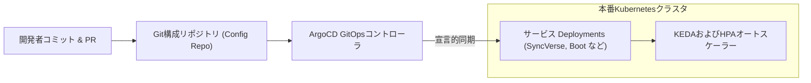

# KubernetesデプロイおよびGitOps運用パイプライン

## 1. GitOps運用体制の概要

SyncSeriesの全社本番環境では、インフラ構成の一貫性とトレーサビリティを保証するため、**GitOps**手法を採用しています。

開発チームや運用チームが本番Kubernetesクラスタに対して直接 `kubectl` コマンドを実行して変更を加える行為は制限されており、すべてのサービスデプロイ、環境変数の更新、スケーリング設定はGitリポジトリのコミットとPull Requestを通じて宣言的に実行されます。



---

## 2. Helmチャートディレクトリ標準構造

全社サービスは統一されたUmbrella Helmチャートパターンで管理され、各ドメインサービスは独立したSub-chartとして構成されます。

```
deploy/helm/
├── Chart.yaml                  # Umbrella Chart メタデータ
├── values.yaml                 # 全社共通デフォルト設定（ドメイン、イメージタグなど）
├── values-production.yaml      # 本番クラスタ専用オーバーライド
└── charts/
    ├── sync-verse/             # 管制塔サービスチャート
    ├── sync-boot/              # エンジニアリングバックエンドチャート
    ├── sync-cms/               # コンテンツサービスチャート
    ├── sync-shop/              # Eコマースマイクロサービスチャート
    └── sync-llm/               # AIゲートウェイチャート
```

### 全社共通 values.yaml の例
```yaml
global:
  environment: production
  domain: empasy.internal
  imageRegistry: harbor.empasy.internal/syncseries
  imagePullPolicy: IfNotPresent
  storageClass: fast-nvme-sc

sync-verse:
  replicaCount: 3
  resources:
    limits:
      cpu: "4"
      memory: 8Gi
    requests:
      cpu: "1"
      memory: 2Gi
  autoscaling:
    enabled: true
    minReplicas: 3
    maxReplicas: 10
    targetCPUUtilizationPercentage: 75
```

---

## 3. ArgoCD Application マニフェスト構成

ArgoCDはGitリポジトリの変更を3分周期で検知（またはWebhook受信）し、実際のクラスタ状態と一致させます。手動ドリフト（Drift）が発生した場合、自律修復（Self-Heal）ポリシーに従ってGitの元の状態へ強制復元します。

```yaml
apiVersion: argoproj.io/v1alpha1
kind: Application
metadata:
  name: sync-series-production
  namespace: argocd
  finalizers:
    - resources-finalizer.argocd.argoproj.io
spec:
  project: default
  source:
    repoURL: 'https://github.com/DramaticCollaboration/SyncSeries.git'
    targetRevision: main
    path: deploy/helm
    helm:
      valueFiles:
        - values.yaml
        - values-production.yaml
  destination:
    server: 'https://kubernetes.default.svc'
    namespace: sync-prod
  syncPolicy:
    automated:
      prune: true
      selfHeal: true
    syncOptions:
      - CreateNamespace=true
      - ApplyOutOfSyncOnly=true
```

---

## 4. KEDAベースのイベント駆動型オートスケーリング

大規模な処理リクエストやバッチクローリングタスクが流入する際、単純なCPU指標だけでは急激な負荷増加にタイムリーに対応することが困難です。SyncSeriesは **KEDA（Kubernetes Event-driven Autoscaling）** を活用し、メッセージキューの待機長（Queue Length）に基づいた先制的なスケールアウトを実行します。

```yaml
apiVersion: keda.sh/v1alpha1
kind: ScaledObject
metadata:
  name: sync-crawl-autoscaler
  namespace: sync-prod
spec:
  scaleTargetRef:
    name: sync-crawl-worker
  minReplicaCount: 2
  maxReplicaCount: 20
  triggers:
  - type: redis
    metadata:
      address: redis-ha.sync-prod.svc:6379
      listName: queue:crawl:tasks
      listLength: "15" # 待機タスクが15件を超えるたびにPodを1つ追加生成
```

---

## 5. 無停止ローリングアップデートおよびロールバックガイド

すべてのデプロイは `RollingUpdate` 戦略を基本として採用しており、トラフィック流入を中断することなく新バージョンのコンテナが準備完了状態（`readinessProbe: healthy`）を完全に通過した後、旧バージョンのコンテナを順次終了します。

- **アップデート戦略の設定**:
  ```yaml
  strategy:
    type: RollingUpdate
    rollingUpdate:
      maxSurge: 25%
      maxUnavailable: 0
  ```
- **即時ロールバック手順**: デプロイ直後に重大な欠陥が検知された場合、Gitで以前の安定コミットへRevertコミットをプッシュすると、ArgoCDがこれを検知して1分以内に前バージョンへクラスタを復旧させます。
