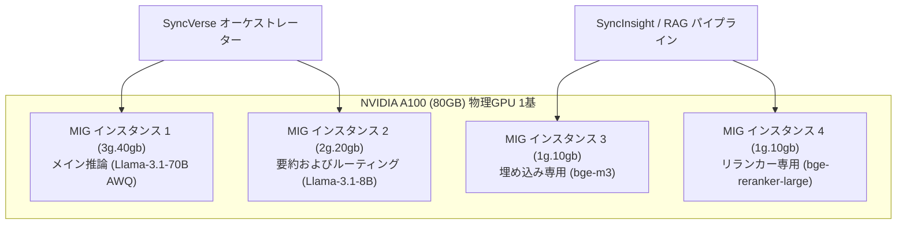

# 閉域網ローカルLLMサービングおよびvGPUリソース分割

## 1. 概要および背景

企業の中核ビジネスロジック、金融取引履歴、個人情報、またはソースコードが外部の商用API（例：OpenAI、Anthropicなど）へ送信されることを遮断するため、SyncSeriesは物理的に隔離された社内プライベートクラウドおよびオンプレミスGPUサーバー環境で独自のオープンソースモデル（Llama-3.3、Llama 3.3、OpenAI-o3 など）をサービングするアーキテクチャを支援します。

本ガイドでは、社内データセンター環境において高性能推論エンジンである **vLLM** とNVIDIAハードウェア仮想化技術である **MIG（Multi-Instance GPU）** を活用し、利用可能なGPUリソースを分割してサービングの安定性を確保する手順について説明します。



---

## 2. NVIDIA MIGベースのハードウェア仮想化設定

単一の高性能GPU（例：A100 80GB、H100 80GB）に単一のモデルのみをロードする場合、メモリと演算ユニットの浪費が発生します。MIG技術を適用することで、物理GPUをハードウェアレベルで完全に隔離された独立インスタンスへと分割できます。

### MIGの有効化およびインスタンス生成
```bash
# 1. GPUでMIGモードを有効化（再起動不要）
sudo nvidia-smi -i 0 -mig 1

# 2. サポートされるプロファイルを確認
nvidia-smi mig -lgip

# 3. インスタンス分割生成（例：40GB 1個、20GB 1個、10GB 2個）
# プロファイル ID 9 (3g.40gb), 14 (2g.20gb), 19 (1g.10gb) 基準
sudo nvidia-smi mig -cgi 9,14,19,19 -C

# 4. 生成されたMIGデバイスUUIDを確認
nvidia-smi -L
```

---

## 3. vLLM推論エンジン Kubernetesデプロイマニフェスト

分割されたMIGインスタンスのそれぞれに対して、Kubernetes Podを1:1でマッピングしてデプロイします。メモリの断片化を防止しスループット（Throughput）を最大化するため、PagedAttentionおよび量子化（AWQ）オプションを適用します。

```yaml
apiVersion: apps/v1
kind: Deployment
metadata:
  name: vllm-llama-70b
  namespace: sync-ai
spec:
  replicas: 1
  selector:
    matchLabels:
      app: vllm-llama-70b
  template:
    metadata:
      labels:
        app: vllm-llama-70b
    spec:
      containers:
      - name: vllm-server
        image: vllm/vllm-openai:v0.6.3
        args:
        - "--model=/models/Llama-3.1-70B-Instruct-AWQ"
        - "--quantization=awq"
        - "--max-model-len=16384"
        - "--gpu-memory-utilization=0.92"
        - "--enforce-eager"
        - "--port=8000"
        env:
        - name: NVIDIA_VISIBLE_DEVICES
          value: "MIG-GPU-xxxx-xxxx" # 対象のMIGインスタンスUUID
        ports:
        - containerPort: 8000
        resources:
          limits:
            nvidia.com/mig-3g.40gb: 1
            memory: 48Gi
            cpu: "8"
          requests:
            nvidia.com/mig-3g.40gb: 1
            memory: 32Gi
            cpu: "4"
        volumeMounts:
        - name: model-storage
          mountPath: /models
          readOnly: true
      volumes:
      - name: model-storage
        persistentVolumeClaim:
          claimName: nfs-ai-models-pvc
```

---

## 4. モデルサービングチューニングおよび性能最適化ガイド

### 1) AWQ 4-Bit量子化の適用
- 32B以上のモデルの場合、16ビット（FP16）の重みをロードする際に約65GB以上のVRAMが必要となり、40GBのMIGスライスに収容することができません。
- AWQ（Activation-aware Weight Quantization）4-bitモデルを採用することで、モデル重みの容量を約20GB水準まで圧縮しつつ、因果推論の性能損失を1%未満に抑えることができ、3g.40gbスライスに余裕を持って常駐させることが可能です。

### 2) PagedAttentionメモリ最適化
- `gpu-memory-utilization` の値を0.90〜0.92に設定し、KVキャッシュ用のメモリを最大限に確保します。
- 同時接続リクエストが集中する環境でも、OOM（Out of Memory）クラッシュを起こすことなく待機キュー（Continuous Batching）内で安定して処理されます。

### 3) ヘルスチェックおよびフェイルオーバー設定
- vLLMの `/health` エンドポイントをKubernetesの `livenessProbe` および `readinessProbe` に接続します。
- 推論エンジンに一時的な負荷が発生した場合、トラフィックの流入を即座に遮断し、待機中の補助インスタンスへ自動的に分散します。
