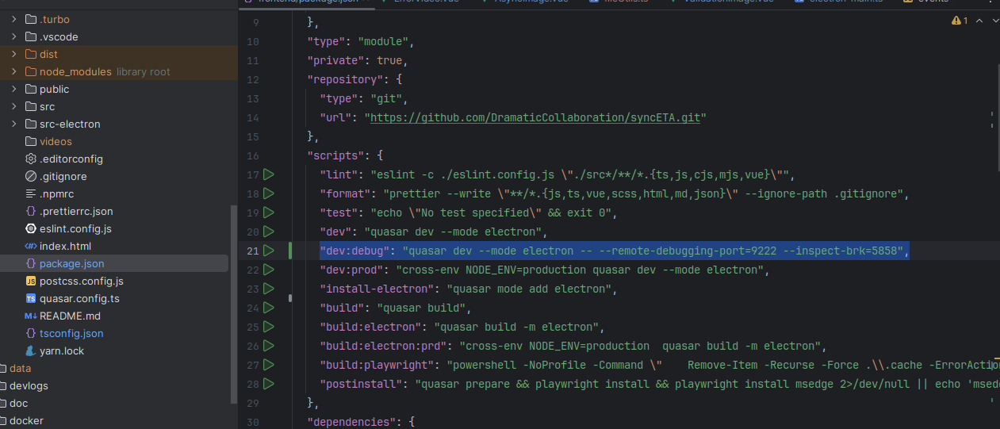
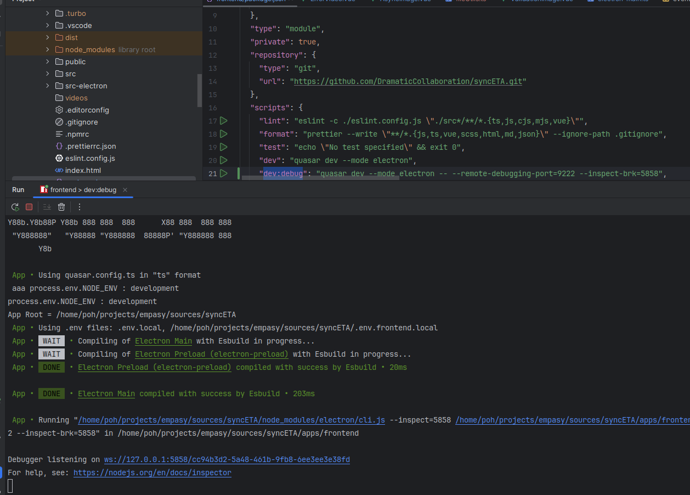
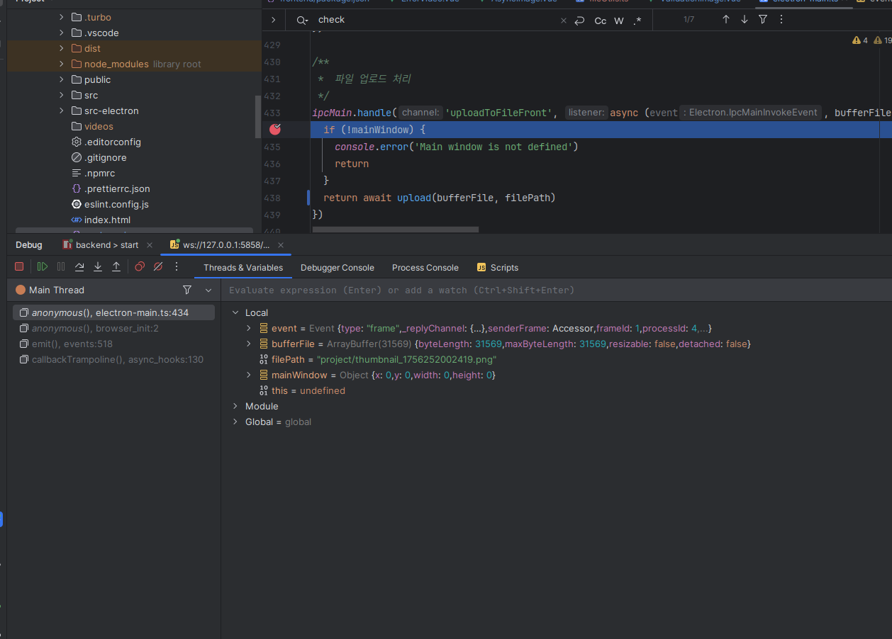

# IntelliJ IDEA ベース Electron メインプロセス リモートデバッガー接続ガイド

SyncETA デスクトップアプリケーションは、**Electron メインプロセス（Node.js / Playwright 制御）**と**レンダラープロセス（Vue 3 UI）**のマルチプロセス構成で動作します。本ドキュメントでは、IntelliJ IDEA から V8 Inspector WebSocket（`ws://127.0.0.1:5858`）を介して Electron メインプロセスにリモートデバッガーを接続し、ブレークポイント（Breakpoint）を追跡する標準手順を説明します。

---

## 1. デバッグモード（`dev:debug`）の実行

`package.json` に定義された `dev:debug` スクリプトを実行し、Electron メインプロセスを `--inspect=5858` フラグ付きで起動します。

| 実行スクリプト | 内部フラグ | デフォルトデバッグポート |
| :--- | :--- | :--- |
| `yarn dev:debug` | `electron --inspect=5858 .` | `127.0.0.1:5858`（V8 Inspector WebSocket） |

---

## 2. V8 Inspector リモートデバッガーソケットへの接続

ターミナルコンソールに出力される `Debugger listening on ws://127.0.0.1:5858/...` リンクを `Ctrl + Click`（または `Cmd + Click`）し、IntelliJ 内蔵の JavaScript/Node.js デバッガーを即座にアタッチ（Attach）します。

---

## 3. ブレークポイント（Breakpoint）の設定およびランタイム状態の検査

メインプロセスの TypeScript ソースコード（IPC ハンドラー、Playwright ブラウザコンテキスト制御部など）にブレークポイントを設定すると、イベント呼び出し時点で実行が一時停止し、コールスタック（Call Stack）とローカル変数の状態をリアルタイムに検査できます。

---

## 4. プロセス別のデバッグ対象および注意事項

| プロセス区分 | 実行ランタイム | デバッガー接続方式 | 主なデバッグ対象 |
| :--- | :--- | :--- | :--- |
| **Main Process** | Node.js / Electron Main | `ws://127.0.0.1:5858` V8 Inspector ソケット接続 | `ipcMain.handle`、Playwright ブラウザプール制御、ローカルファイル I/O |
| **Preload Script** | Isolated Context Bridge | Chromium DevTools（`Ctrl+Shift+I`）Sources タブ | `contextBridge.exposeInMainWorld` API バインディング検証 |
| **Renderer Process** | Chromium / Vue 3 | Chromium DevTools または Vite HMR コンソール | Vue 3 コンポーネント状態（Pinia）、シナリオキャンバス UI レンダリング |

> [!TIP]
> メインプロセスのブレークポイントで長時間待機すると、レンダラープロセス側で IPC レスポンスタイムアウトが発生する場合があります。そのため、非同期 IPC 呼び出しのデバッグ時にはタイムアウトしきい値を一時的に緩和するか、条件付きブレークポイント（Conditional Breakpoint）を使用することを推奨します。
