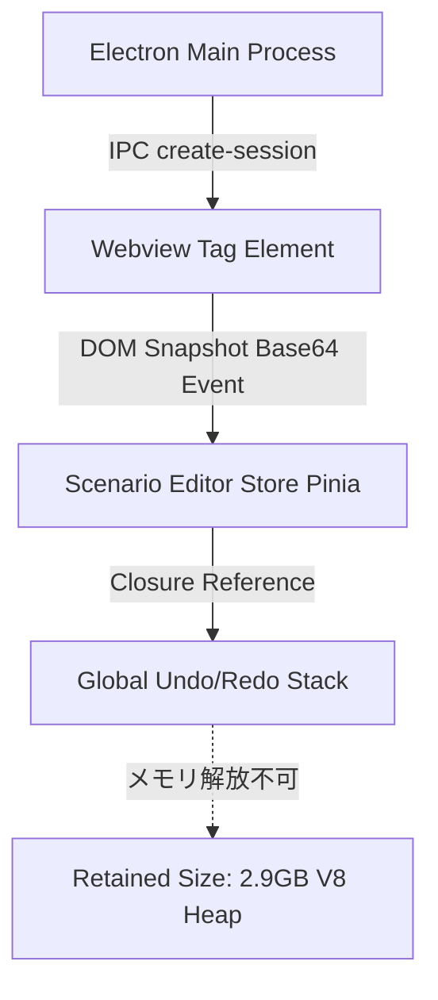

# [ポストモーテム] Electron マルチ Webview DOM スナップショット メモリリーク分析および解決

## 1. 概要および障害現象

- **発生日時**: 2026-02-10 14:20 KST
- **影響範囲**: SyncETA デスクトップアプリケーション（v0.0.31 ビルド）
- **症状**: ユーザーが 30 件以上の E2E シナリオを連続実行したり長時間の録画セッションを維持したりした際、Electron レンダラープロセスのメモリ占有率が 800MB から **3.8GB まで継続的に上昇**し、その後 `STATUS_BREAKPOINT (0x80000003)` エラーとともに画面がホワイトアウト（White-out）するクラッシュが発生。

---

## 2. 障害原因分析（Root Cause Analysis）

Chrome DevTools Memory タブの **Heap Snapshot** および **Allocation Instrumentation on Timeline** を用いてヒーププロファイリングを実施しました。



### 主なリーク原因 3 点

1. **Webview 破棄時の CDP リスナーリーク**:
   新しいシナリオタブへ切り替える際、以前の `<webview>` エレメントを DOM から削除していましたが、バックグラウンド CDP セッションの `Page.screencastFrame` イベントリスナーが解除されず呼び出され続けたため、メモリ上にフレームバッファが蓄積しました。
2. **Base64 画像文字列によるヒープ断片化**:
   ステップ検証用のビューポートスクリーンショットが Base64 エンコード文字列（1 件あたり約 1.8MB）の形式で Vue リアクティブ Store（Pinia）に保持されたことで、V8 Old Space ヒープが急速に膨張しました。
3. **Undo/Redo 履歴スタックの無制限保持**:
   履歴スタックに最大深度制限（Max Depth）が設けられておらず、過去のすべての DOM ツリースナップショットオブジェクトが GC（Garbage Collector）の回収対象から除外されていました。

---

## 3. 解決措置およびコードパッチ

### (1) Webview ライフサイクルの明示的終了および WeakRef への移行

```typescript
// パッチ前: 単純な DOM ノード削除
webviewContainer.removeChild(webviewElement);

// パッチ後: CDP セッション分離およびリソースの明示的破棄
export async function destroyWebviewSession(webview: Electron.WebviewTag): Promise<void> {
  try {
    const wc = webview.getWebContents();
    if (wc && !wc.isDestroyed()) {
      wc.debugger.detach();
      wc.stop();
    }
  } catch (err) {
    console.warn('[Cleanup] WebContents already detached:', err);
  } finally {
    webview.src = 'about:blank';
    webview.remove();
  }
}
```

### (2) スクリーンショットバイナリのディスクオフロード（Off-Heap Caching）

Base64 文字列をインメモリで保持せず、アプリの一時キャッシュディレクトリへ WebP 圧縮フォーマットで直接書き出し、ローカルファイル URI（`file://...`）のみを参照するよう構造を刷新しました。

```typescript
// スナップショット保存パイプライン
export async function persistStepSnapshot(stepId: string, imageBuffer: Buffer): Promise<string> {
  const cachePath = path.join(app.getPath('userData'), 'snapshots', `${stepId}.webp`);
  await fs.promises.writeFile(cachePath, imageBuffer);
  return `sync-file://${cachePath}`;
}
```

### (3) 履歴キューサイズ制限および循環バッファの導入

Undo/Redo 履歴を最大 20 件に制限し、上限を超過した古いスナップショットファイルは即座に非同期アンリンク（unlink）で削除するよう処理しました。

---

## 4. 検証結果およびメトリクス

パッチ適用後、同一環境（Windows 11、100 件連続回帰シナリオの無人バッチ稼働）で負荷テストを実施しました。

| 測定指標 | パッチ前 (v0.0.31) | パッチ後 (v0.0.33) | 改善率 |
|:---|:---|:---|:---|
| **最大レンダラーメモリ占有率** | 3,850 MB（クラッシュ） | **410 MB（安定化）** | **89.3% 削減** |
| **長時間実行後の残存メモリ** | 3.2 GB リーク | **180 MB（GC 正常回収）** | **正常回収を確認** |
| **連続 100 回シナリオ完走率** | 24%（中断頻発） | **100%（クラッシュ 0 件）** | **安定性を確保** |

---

## 5. 再発防止対策

1. **自動化されたメモリ回帰テストの CI 追加**: Playwright ベースの E2E パイプラインに `process.memoryUsage()` を測定する 50 回連続反復スモークテストを追加し、600MB 超過時はビルド失敗とする。
2. **社内 Electron 開発ガイドラインの策定**: `Webview` および `BrowserView` 使用時のライフサイクル解放フック実装を義務化。
