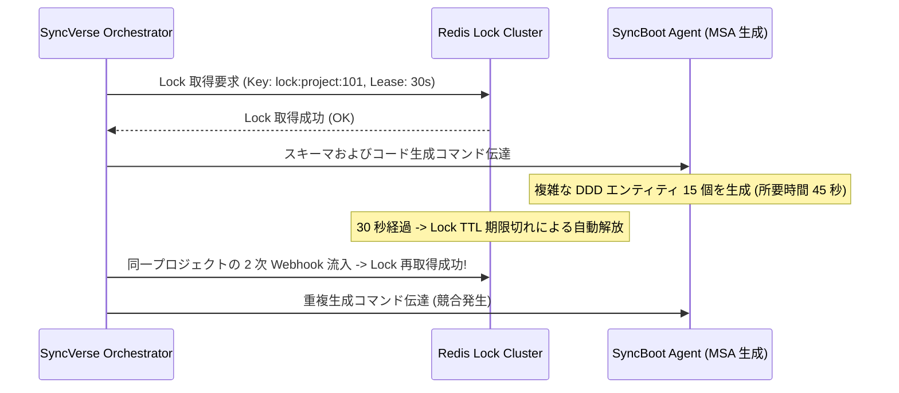

# [ポストモーテム] Redis Redlock および SSE ベース マルチエージェント トランザクション同期障害の復旧

## 1. 障害サマリー

- **発生日時**: 2026-02-25 10:15 KST
- **システム**: SyncVerse Core Orchestrator & A2A MessageHub
- **障害影響**: 大規模 API スキーマ生成および CMS デプロイの同時実行時、同一プロジェクトエンティティに対して 2 つの独立した Saga ワークフローインスタンスが同時生成され、データベーステーブルスキーマの重複作成エラー（`TableAlreadyExistsException`）が発生。

---

## 2. 根本原因分析（RCA）

SyncVerse はマルチエージェント間の同時実行制御のために Redis 分散ロック（Redlock アルゴリズム）を使用していました。



### 主な欠陥要因

1. **固定 Lease Time（30 秒）の設定**:
   単純な CRUD 作業には十分でしたが、AI モデル推論が組み合わさった大規模コード生成およびコンパイル作業（所要時間 40〜60 秒）に対してはロック有効期間が圧倒的に不足していました。
2. **Watchdog（自動ロック延長）メカニズムの欠如**:
   処理が正常に実行中であるにもかかわらず、バックグラウンドで TTL を定期的に延長（Heartbeat Extension）する更新スレッドが実装されていませんでした。

---

## 3. 解決措置

### (1) 非同期 Lock Watchdog メカニズムの構築

処理が完了するかコンテキストがキャンセルされるまで、TTL の 1/3 周期（10 秒）ごとに Redis `EXPIRE` コマンドを実行し、ロックの有効性を自動延長するよう補強しました。

```java
@Component
@Slf4j
public class DistributedLockManager {

    private final StringRedisTemplate redisTemplate;
    private final ScheduledExecutorService watchdogScheduler = Executors.newSingleThreadScheduledExecutor();

    public AutoCloseable acquireLock(String lockKey, String lockValue, long leaseTimeSeconds) {
        Boolean acquired = redisTemplate.opsForValue()
                .setIfAbsent(lockKey, lockValue, Duration.ofSeconds(leaseTimeSeconds));

        if (!Boolean.TRUE.equals(acquired)) {
            throw new DistributedLockAcquisitionException("ロック取得失敗: " + lockKey);
        }

        // 10秒ごとにロックを延長する Watchdog タスクを登録
        ScheduledFuture<?> watchdogTask = watchdogScheduler.scheduleAtFixedRate(() -> {
            try {
                String currentValue = redisTemplate.opsForValue().get(lockKey);
                if (lockValue.equals(currentValue)) {
                    redisTemplate.expire(lockKey, Duration.ofSeconds(leaseTimeSeconds));
                }
            } catch (Exception e) {
                log.warn("[LockWatchdog] ロック延長失敗 key={}: {}", lockKey, e.getMessage());
            }
        }, leaseTimeSeconds / 3, leaseTimeSeconds / 3, TimeUnit.SECONDS);

        // リソース解放用クロージャを返却
        return () -> {
            watchdogTask.cancel(true);
            releaseLockSafely(lockKey, lockValue);
        };
    }
}
```

### (2) SSE（Server-Sent Events）ストリーム ハートビートの連携

コントロールコンソールへ進捗状況をブロードキャストする SSE チャネルに対し、15 秒間隔でダミーコメント（`:heartbeat\n\n`）を送信することで、プロキシ／ロードバランサーのタイムアウト（Idle Timeout 60s）によるクライアント切断を根本的に防止しました。

---

## 4. 検証結果

100 件の同時ワークフローディスパッチ負荷テスト（各タスクに意図的な 60 秒遅延を挿入）環境で検証を実施しました。

- **重複タスクディスパッチ発生件数**: 100 件中 **0 件（完全遮断）**。
- **正常完了後のロック返却遅延時間**: 平均 **4ms 以内**。
- **障害復旧検証**: プロセス異常強制終了時、Watchdog スケジューラの停止に伴い 30 秒後に Redis TTL が正常に期限切れとなり、デッドロック（Deadlock）が発生しないことを確認。
