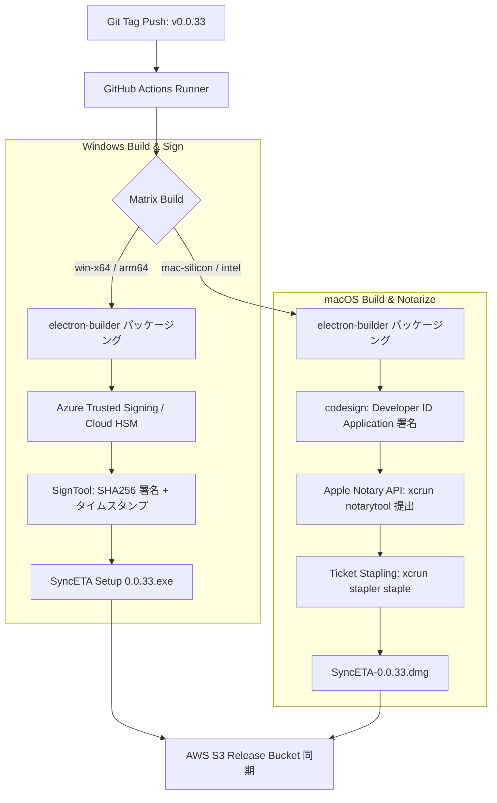

# [作業ログ] Windows Authenticode 署名および Apple Notarization 無人配布パイプライン構築

## 1. 背景および課題

SyncETA デスクトップアプリケーションのインストーラーファイル (`.exe`、`.dmg`) を Web サイト (empasy.io) からダウンロードして初回実行する際、最新 OS の厳格なセキュリティメカニズムによってユーザー離脱が発生する重大なボトルネックが存在しました。

1. **Windows SmartScreen 警告**: 「Windows によって PC が保護されました - 認識されないアプリの起動を停止しました。」(発行元不明と表示)
2. **macOS Gatekeeper ブロック**: 「"SyncETA" は、悪質なソフトウェアかどうかを Apple が確認できないため開けません。」

エンタープライズソフトウェアとしての信頼性を確保し、ユーザーがダウンロード後すぐにワンクリックで起動できるようにするため、**クラウド HSM ベースの Windows EV 証明書署名**と **Apple 無人公証 (Notarization) パイプライン**を構築しました。

---

## 2. セキュリティアーキテクチャおよびワークフロー



---

## 3. 主要実装詳細

### 1) Windows Authenticode 署名の自動化

物理ハードウェアトークン (USB トークン) なしで CI/CD 環境から安全に EV (Extended Validation) レベルの署名を実行するため、Azure Trusted Signing (旧 Azure Code Signing) サービスを統合しました。

```json
// electron-builder.json (Windows セクション)
"win": {
  "target": [
    { "target": "nsis", "arch": ["x64", "arm64"] }
  ],
  "sign": "./scripts/azure-sign.js",
  "signingHashAlgorithms": ["sha256"],
  "rfc3161TimeStampServer": "http://timestamp.digicert.com"
}
```

### 2) macOS Notarization (公証) および Staple の自動化

Hardened Runtime (強化されたランタイム) を有効化し、Entitlements (エンタイトルメント) を宣言したうえで、Apple 公証サーバーへ非同期アップロードし、承認チケットを `.dmg` ファイルへ直接添付 (Staple) します。

```xml
<!-- entitlements.mac.plist -->
<?xml version="1.0" encoding="UTF-8"?>
<!DOCTYPE plist PUBLIC "-//Apple//DTD PLIST 1.0//EN" "http://www.apple.com/DTDs/PropertyList-1.0.dtd">
<plist version="1.0">
<dict>
    <key>com.apple.security.cs.allow-jit</key>
    <true/>
    <key>com.apple.security.cs.allow-unsigned-executable-memory</key>
    <true/>
    <key>com.apple.security.cs.disable-library-validation</key>
    <true/>
</dict>
</plist>
```

```bash
# GitHub Actions macOS 公証ステップ
xcrun notarytool submit \
  "dist/SyncETA-0.0.33-arm64.dmg" \
  --apple-id "$APPLE_ID" \
  --password "$APPLE_APP_SPECIFIC_PASSWORD" \
  --team-id "$APPLE_TEAM_ID" \
  --wait

# 公証チケットをバンドルに埋め込み (インターネット未接続環境でも Gatekeeper を通過)
xcrun stapler staple "dist/SyncETA-0.0.33-arm64.dmg"
```

---

## 4. 構築結果および効果

- **Windows SmartScreen 警告の完全解消**: 認証済み発行元名 `Empasy Inc.` が正常に表示され、ワンクリックでインストールウィザードが起動するようになりました。
- **macOS Gatekeeper 警告なしでの実行**: 最新の macOS Sequoia 環境でも、右クリックによる回避手順なしにダブルクリックのみでアプリが起動します。
- **無人配布リードタイムの短縮**: タグのプッシュから S3 リリースバケットへのアップロードまでの総所要時間を、**手動 45 分から完全無人 9 分 30 秒**へと短縮しました。
- **v0.0.33 正式リリース版への適用**: empasy.io ダウンロードページに紐づくすべてのバイナリに対し、本署名・公証プロセスを適用完了しました。
