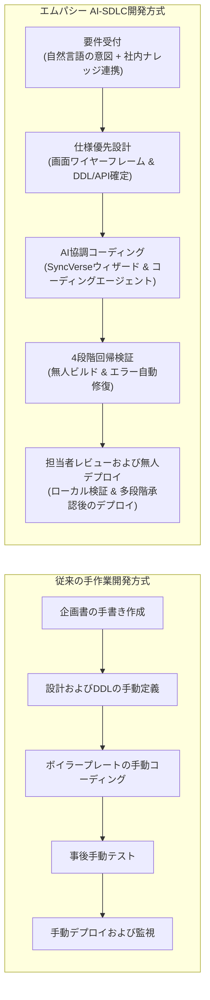
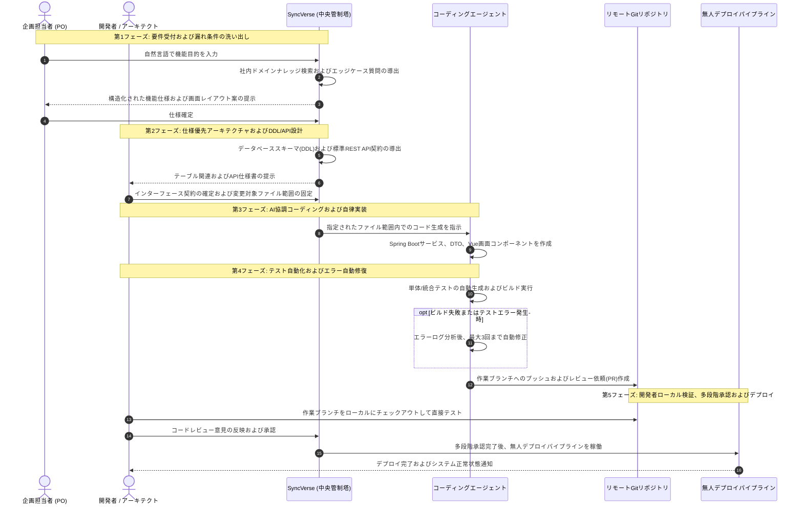

# エムパシー AI開発ライフサイクル (Empasy AI-SDLC)

> **要約:** エムパシー AI開発ライフサイクル（Empasy AI-SDLC）は、ビジネス要件の受付からアーキテクチャ設計、コード実装、自動化テスト、担当者承認、無人デプロイに至るソフトウェア開発ライフサイクル（SDLC）全体を、エンタープライズオーケストレーションツールである **SyncVerse** と **AIエージェント** によって体系的に統制・検証する実務エンジニアリングメソドロジーです。

::: tip 実践フェーズ別ガイドへのショートカット
プロジェクト推進時に必要なフェーズの実践ガイドおよびプロンプト例をすぐにご確認いただけます:
* **[プロジェクト全周期運用メソドロジー (RFP to Go-Live)](./enterprise-project-lifecycle.md)**: 提案から本番稼働までのエンドツーエンド組織運用
* **[フェーズ別アクションアイテムおよび実務実行ガイド (SOP)](./enterprise-action-items-guide.md)**: フェーズ別の具体的なAction Itemおよび手順
* **[営業支援および提案フェーズ実務ガイド (Pre-sales)](./presales-ai-playbook.md)**: RFP分析、PoCデモ制作、工数見積り
* **[第01フェーズ: 企画および要件具体化ガイド](./ai-sdlc-01-requirements.md)**（企画担当者 / PO向け）
* **[第02フェーズ: 仕様優先アーキテクチャおよびDDL/API設計ガイド](./ai-sdlc-02-architecture.md)**（アーキテクト / リード開発者向け）
* **[第03フェーズ: AI協調コーディングおよび自律実装ガイド](./ai-sdlc-03-implementation.md)**（開発者向け）
* **[第04フェーズ: テスト自動化および4段階エラー自動修復ガイド](./ai-sdlc-04-testing.md)**（QA / 開発者向け）
* **[第05フェーズ: コードレビューおよび無人デプロイガイド](./ai-sdlc-05-review-deploy.md)**（レビュアー / 運用担当者向け）
* **[付録: 状況別実践プロンプト集](./ai-sdlc-prompt-recipes.md)**（全職種共通）
:::

---

## 1. 概要および定義

### 1.1. AI駆動開発の背景および必要性

#### 従来のソフトウェア開発手法の限界
従来のウォーターフォール（Waterfall）およびアジャイル（Agile）手法は、担当者の手入力と記憶力に大きく依存していました。
* **反復作業による疲労**: データモデル変換、基本CRUD実装、設定ファイル作成、基礎単体テストなどの定型作業に多くの開発時間が費やされていました。
* **コミュニケーション過程における意味の歪み**: 企画担当者の意図がドキュメントやチケットを通じて開発者へ伝達される過程で解釈の差異が生じ、手戻りが発生しやすい状況でした。
* **欠陥発見の遅延**: 開発後半やデプロイ直前になってようやくインターフェースの不整合や回帰エラーが発見され、修正コストが膨らみました。
* **ドキュメントとコードの乖離**: リリーススケジュールに合わせるためにコードは変更されてもドキュメントが適時に更新されず、システム履歴の把握が困難になっていました。

#### エムパシー AI-SDLC導入効果とパラダイムシフト
エムパシー AI-SDLCは単なるチャットボットツールを超え、全開発工程を中央から指揮し、フェーズごとの成果物をクロスチェックします。中央オーケストレーションツールであるSyncVerseを活用することで、開発者は単純反復コーディングから解放され、システム構造設計やコアビジネスロジックの検証に集中できます。

| 比較項目 | 従来の開発方式 | エムパシー AI-SDLC | 実務上の期待効果 |
| :--- | :--- | :--- | :--- |
| **要件定義** | 数十ページに及ぶ静的ドキュメントの作成 | 対話型の要件具体化および仕様の自動整理 | コミュニケーションにおける解釈差異の縮小 |
| **設計方式** | 実装途中の段階的なインターフェース修正 | データモデル（DDL）およびAPI契約の先行確定 | 画面・サーバー間の整合性確保 |
| **コード実装** | 開発者がゼロから手動でファイルを作成 | フレームワーク標準コードの自動生成およびAI協調 | 基本機能の開発スピード向上 |
| **品質検証** | 開発完了後の事後手動テスト | 4段階反復ビルド検証およびエラー自動修復ループ | 早期欠陥発見および安定性向上 |
| **デプロイおよび管理** | 開発者による手動デプロイおよび障害追跡 | 担当者による多段階承認後の無人デプロイおよびロールバック | デプロイ安定性および履歴統制 |

---

### 1.2. 目標および適用範囲

#### コア目標
1. **開発リードタイムの短縮**: 企画フェーズのアイデアを本番デプロイ可能なコードとして実装するまでの全体時間を実質的に短縮します。
2. **ソフトウェア品質の確保**: コーディング前に仕様を先行確定し、4段階回帰検証を経ることでランタイムエラーを最小化します。
3. **標準アーキテクチャの遵守**: 社内標準ライブラリ（Lombok、AgentScope Javaなど）および共通フレームワーク規格を一貫して適用します。

#### フェーズ別適用範囲
* **レベル1（ツール補助）**: 開発者がIDEでコード自動補完および単純リファクタリングツールとして活用。
* **レベル2（機能単位の自律化）**: SyncVerse 4段階ウィザードを活用し、個別機能の仕様導出、コード生成・変更、ビルド検証を統合的に実行。
* **レベル3（全社協業エコシステム）**: 企画担当者、開発者、QA、運用担当者が管制塔のもとで承認決裁ルートとともに全開発工程を運用。

---

### 1.3. 主要用語の整理

* **SyncVerse**: すべての開発・運用タスクを統括指揮するエムパシーの中央オーケストレーターおよび管制システムです。
* **AIエージェント**: 与えられた目標を達成するために、ファイル探索、コード作成、ターミナルコマンド実行などの必要なツールを順次実行する作業主体です。
* **ドメインエージェント**: 各業務領域を専担する専門エージェントです（SyncCMS: コンテンツ、SyncShop: Eコマース、SyncBoot: 共通バックエンド、SyncLLM: AIゲートウェイ）。
* **仕様優先開発 (Spec-First)**: コードを記述する前にデータベーススキーマとAPI入出力規格を先に確定してからコーディングを開始する手法です。
* **受け入れ条件 (Acceptance Criteria)**: 企画した機能が正常に実装されたかを判断するための具体的な完了基準です。
* **エラー自動修復 (Auto Repair / Self-Healing)**: ビルドやテスト中にエラーが発生した際、エラーログを分析してAIがコードを自ら修正し、再ビルドを行う手順です。
* **担当者承認 (Human-in-the-Loop)**: データベース変更、権限変更、本番デプロイなどリスクの高い作業について、人間が直接内容を確認して承認するようにする安全制御装置です。

---

## 2. エムパシー AI開発ライフサイクル 5フェーズフロー

エムパシー AI-SDLCに基づく開発フローは、**要件受付 -> 仕様優先設計 -> 実装 -> 4段階検証 -> レビューおよびデプロイ**の順に進行します。

---

### 2.1. 第1フェーズ: 要件分析および企画
* **目的**: 企画意図を明確に整理し、見落としやすい例外状況を事前に洗い出します。
* **主な活動**:
  * 企画担当者が機能の背景と目的を自然言語で入力します。
  * SyncVerseが社内ナレッジベース（RAG）を参照し、漏れている例外ケース（有効期限切れ、残高不足、重複リクエストなど）を企画担当者へ質問します。
  * ユーザー視点の行動完了基準（Given-When-Then形式）と画面ワイヤーフレームを確定します。
* **詳細実践ガイド**: [第01フェーズ: 企画および要件具体化ガイド](./ai-sdlc-01-requirements.md)

---

### 2.2. 第2フェーズ: 仕様優先アーキテクチャ設計
* **目的**: コーディングを開始する前にデータモデルとAPI入出力規格を先に確定し、サーバーと画面間の不整合を削減します。
* **主な活動**:
  * PostgreSQL 18.6基準の6段階DDLスキーマ（`00_extensions.sql` ～ `05_sample_dev.sql`）を作成します。
  * 一時的な競合回避構文（`ON CONFLICT`）を排除し、正確な制約条件とインデックスを宣言します。
  * 単一マッピング原則を遵守する標準REST APIエンドポイント（`/api/v1/{domain}/{resource}`）を先行定義します。
* **詳細実践ガイド**: [第02フェーズ: 仕様優先アーキテクチャおよびDDL/API設計ガイド](./ai-sdlc-02-architecture.md)

---

### 2.3. 第3フェーズ: AI協調コーディングおよび自律実装
* **目的**: 全社アーキテクチャ標準を遵守しながら、迅速かつ安全にソースコードを作成します。
* **主な活動**:
  * 変更対象ファイル範囲（`focusFiles`）を明示し、他のソースコードに副作用が生じないよう隔離します。
  * バックエンド: Lombokアノテーションの必須適用、単一Canonical URLマッピング、AgentScope Javaツール連携。
  * フロントエンド: `BasicModal` コンポーネントの分離、データベースベースの動的メニュールーティングの遵守。
  * 偽のダミー応答（Mock）を排除し、実際のデータベースと正常に連携するよう実装します。
* **詳細実践ガイド**: [第03フェーズ: AI協調コーディングおよび自律実装ガイド](./ai-sdlc-03-implementation.md)

---

### 2.4. 第4フェーズ: テスト自動化および4段階回帰検証
* **目的**: 作成されたコードに構文、インターフェース、ビジネスロジック面の欠陥がないかを確認し、エラー発生時には自ら修復します。
* **主な活動**:
  * 例外ケースを含む単体テスト（JUnit 5、Vitest）を自動生成します。
  * **4段階検証ループ**:
    1. ソースコードのコンパイル検証
    2. APIおよびDTOインターフェースの整合性検証
    3. ビジネスロジックの単体/統合テスト検証
    4. 最終クリーンパッケージングビルド検証
  * ビルドエラー発生時は `autoRepairCode` を通じて最大3回までコードを自動修正します。
* **詳細実践ガイド**: [第04フェーズ: テスト自動化および4段階エラー自動修復ガイド](./ai-sdlc-04-testing.md)

---

### 2.5. 第5フェーズ: コードレビューおよび安全なデプロイ
* **目的**: 人間が直接コードを検証し、多段階承認プロセスを経て安定的にデプロイします。
* **主な活動**:
  * AIが変更点（Git Diff）を要約したPR（Pull Request）ドキュメントを自動作成します。
  * 開発者がローカルIDEで作業ブランチをチェックアウトして直接テストし、必要に応じてインラインフィードバックを伝達します。
  * リスク作業に対する多段階承認（`開発者` -> `QA` -> `管理者`）を経ます。
  * 無人デプロイを実行し、設定変更についてはサーバー再起動なしでランタイムに動的に反映します。
* **詳細実践ガイド**: [第05フェーズ: コードレビューおよび無人デプロイガイド](./ai-sdlc-05-review-deploy.md)

---

## 3. 実践開発ツールおよびプロンプトの活用

開発現場ですぐに活用できるプロンプトとルール設定ファイルは、別ドキュメントにて提供しています:
* **[状況別実践プロンプト集（チートシート）](./ai-sdlc-prompt-recipes.md)**: 企画、DDL設計、バックエンドサービス、フロントエンドモーダル、単体テスト、デバッグなど、そのままコピーして使用できる完成版テンプレートを提供します。
* **エージェント共通ルールの注入**: リポジトリルートの `.agents/AGENTS.md` およびIDEルール（`.cursorrules`、`copilot-instructions.md` など）に、全社標準ルール（AgentScope Java、Lombok強制、単一Canonical URL、モーダル分離、Zero-Mock 4-Cycle検証）を一貫して設定します。

---

## 4. 導入フェーズおよび成果管理

### 段階別導入手順
1. **パイロット運用（1～2ヶ月）**: 特定の開発チームを選定し、仕様優先設計とAIペアコーディングを試験適用。
2. **プロセス標準化（3～4ヶ月）**: 4段階ビルド検証およびエラー自動修復ループをCI環境に統合。
3. **ドメインエージェント連携（5～6ヶ月）**: SyncCMS、SyncShopなどドメイン別の専任エージェント活用を拡大。
4. **全社定着（7ヶ月以降）**: 企画担当者から運用担当者まで、SyncVerseを基盤として連携する自律協業プロセスを定着。

### 主要測定指標
* **開発所要時間**: 機能企画からデプロイまでにかかる全体リードタイムの推移を追跡。
* **初期欠陥発生率**: デプロイ後24時間以内に緊急修正が必要となった欠陥数を測定。
* **テストカバレッジ**: コアビジネスロジックに対する自動化テストコードの割合を点検。
* **手戻り率**: 仕様不整合により設計をやり直す必要が生じた頻度を点検。
