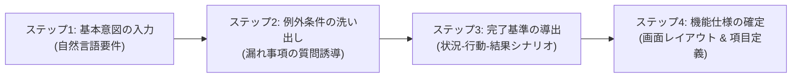

# [第01フェーズ] 企画および要件具体化実務ガイド

> **フェーズ要約:** 単純なアイデアやビジネスリクエストをもとに、SyncVerseとAIによる対話形式の質疑応答を経て、**見落としやすい例外状況、明確な完了基準（受け入れ条件）、画面レイアウトのワイヤーフレームが整理された「機能仕様書」**を作成します。

---

## 1. フェーズの目的および対象

* **主な担当者**: サービス企画担当者、プロダクトオーナー（PO）、ビジネスアナリスト
* **連携対象**: リード開発者、UI/UXデザイナー
* **想定所要時間**: 1機能あたり30分～1時間程度
* **活用ツール**: SyncVerse 要件分析ウィザード、社内ドメインナレッジハブ、AIチャットツール

---

## 2. 開始前チェック項目（開始基準）

本フェーズを開始する前に、以下の事項を確認します:
- 解決したい課題や顧客のペインポイントが1～2文で整理されているか?
- 当該機能が属する業務領域（ドメイン）が確認されているか?（例: 注文、決済、会員、コンテンツ管理など）
- 参考にできる社内の既存画面やポリシードキュメントが準備されているか?

---

## 3. 実務遂行の4ステップ手順



### ステップ1: 基本意図の入力
企画担当者は複雑な書式を使う代わりに、構築したい機能の目的と主要フローを自然言語で簡潔に入力します。
> 例: *「当社のショッピングモールのカートに年末割引クーポン適用機能を追加したいです。会員が保有しているクーポンのうち1つを選択して注文金額から割引を受ける方式です。」*

### ステップ2: 例外条件および漏れ事項の逆質問
企画担当者が考慮し漏れている可能性のあるビジネス上・技術上の例外状況を、AIから先に質問するよう誘導します。
* 例: *「クーポンの割引金額がカートの決済総額より大きい場合、残った差額は消滅しますか、それとも次回の注文に使用できますか?」*
* 例: *「決済進行中にキャンセルした場合、該当クーポンは即座に復元されて再度使用できる必要がありますか?」*

### ステップ3: 状況別完了基準（受け入れ条件）の導出
質疑応答の内容をもとに、企画担当者、開発者、QAが共通して理解できる行動基準（Given-When-Then: 事前条件-ユーザー行動-システム反応）を作成します。

### ステップ4: 機能仕様書および画面レイアウトの確定
入出力データ項目、バリデーションルール、テキスト形式の画面配置図をMarkdownドキュメントとして整理し、Jiraチケットやタスク管理ツールに添付します。

---

## 4. 実務プロンプト例（コピーして使用）

### プロンプト1: 例外状況および漏れ条件の洗い出し
```markdown
[役割] ITサービスシニア企画担当者兼ビジネスアナリスト
[コンテキスト] Eコマースプラットフォームにおいて新機能の要件を定義しています。
[企画アイデア]
"{{企画したい機能のコア内容を2〜3行で入力してください}}"

[依頼事項]
上記のアイデアをもとに、開発着手前に事前決定すべき例外状況とエッジケースを5つ、質問形式で提示してください。
- 決済/キャンセル/返金時のポリシー
- 最低注文金額および最大割引上限の境界条件
- 有効期限切れおよび複数端末での重複利用の試み
- 他の特典（ポイント、提携割引など）との併用適用ルール
```

---

### プロンプト2: 状況別完了基準（受け入れ条件）の作成
```markdown
[役割] 要件分析およびテスト設計の専門家
[コンテキスト] 以下の機能概要と決定事項をもとに、QA検証が可能な完了基準（Acceptance Criteria）を作成してください。
[機能概要]
- 機能名: {{機能名}}
- 確定済みポリシー: {{事前質問を通じて決定された主要ポリシー内容}}

[出力形式]
ユーザーシナリオ別に以下の形式を適用してください:
- シナリオ1: 正常フロー（正常なクーポン適用）
  - 事前条件 (Given):
  - ユーザー行動 (When):
  - システム反応 (Then):
- シナリオ2: 無効な入力値（条件未達）
- シナリオ3: 残高不足または有効期限切れ
- シナリオ4: 重複リクエストおよび同時実行エラー処理
```

---

### プロンプト3: Markdown機能仕様書および画面配置図の整理
```markdown
[役割] 開発チームと協業するテクニカル企画担当者
[入力データ]
{{先ほど確定したユーザーシナリオおよび完了基準の内容}}

[依頼事項]
開発チームとデザイナーが即座に参照できるよう、以下のMarkdown書式で機能仕様書を完成させてください:
1. 機能概要および目的
2. 画面配置ワイヤーフレーム（Markdown表またはテキスト配置図）
3. 画面入力項目の定義（項目名、データ型、必須有無、ガイド文言）
4. バックエンド連携に必要なデータ項目一覧
```

---

## 5. よくあるミスおよび留意事項

| ミスの類型 | よくある問題点 | 推奨対応策 |
| :--- | :--- | :--- |
| **曖昧な形容詞の使用** | 「高速に読み込まれる」「適切なエラーメッセージを表示する」など測定困難な表現の記述 | 具体的な数値（200ms以内）や確定した案内文言（「有効期限が切れたクーポンです」）を明記します。 |
| **企画段階でのインフラ強制** | 「Redisにキャッシュし、Kafkaへトピックを発行する」など実装技術を仕様書で宣言 | 特定の技術名ではなく「ユーザーが体験する画面の反応とビジネス上の結果」に焦点を当てて記述します。 |
| **セキュリティおよび例外基準の漏れ** | 正常動作フローのみを記述し、個人情報露出や同時リクエスト処理が欠落 | 個人情報のマスキング基準、二重クリック防止ルールを必須項目としてあわせて点検します。 |

---

## 6. フェーズ完了チェックリスト（終了基準）

次フェーズである **[第02フェーズ: 仕様優先アーキテクチャ設計](./ai-sdlc-02-architecture.md)** へ進むために、以下の項目を確認します:
- [ ] 主要ユーザーシナリオと完了基準が整理されているか?
- [ ] 有効期限切れ、残高不足、重複呼び出しなど主要な例外状況に対する処理が定義されているか?
- [ ] ユーザーに表示されるエラー案内文言が決まっているか?
- [ ] 企画担当者と開発リードが機能仕様の内容について相互レビューを完了したか?

### 連携公式成果物 (Phase 1)
* **[EMP-P1-13] 要件定義書(SRS)** · **[EMP-P1-14] 要件トレーサビリティマトリクス(RTM)** · **[EMP-P1-19] 内外部連携仕様協議書** · **[EMP-P1-20] スコープ確定合意書(Scope Freeze)** · **[EMP-P1-22] AIガバナンスおよび信頼性チェックリスト** → [標準テンプレートダウンロードセンターへ](./enterprise-document-templates.md#emp-p1-13)
