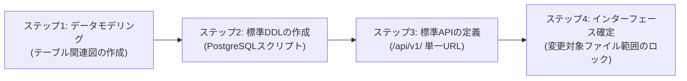

# [ステップ02] 仕様ファースト・アーキテクチャおよびDDL/API設計実践ガイド

> **ステップ概要:** コーディングを開始する前に**データベーススキーマ（PostgreSQL DDL）と標準REST API仕様（OpenAPI/Swagger）**を先に確定（仕様ファースト開発）し、バックエンドとフロントエンドが互いを待つことなく並行して作業できるようインターフェース契約を策定します。

---

## 1. ステップの目的と対象

* **主な担当者**: システムアーキテクト、バックエンドリード開発者、データベース管理者（DBA）
* **連携対象**: フロントエンドリード、セキュリティ管理者
* **想定所要時間**: モジュールあたり30分〜1時間程度
* **活用ツール**: SyncVerseスキーマスタジオ、PostgreSQL、OpenAPI/Swaggerエディタ

---

## 2. 開始前チェック項目（開始基準）

本ステップを開始する前に、以下の事項を確認します。
- [ステップ01] 機能仕様書および完了基準（受け入れ条件）のレビューが完了しているか？
- 対象システムの既存テーブル構造および共通エンティティ（監査フィールド、共通コードなど）を確認したか？
- ドメイン接頭辞ルール（例：CMSは `cms_`、Shopは `pms_`/`oms_`、プラットフォーム共通は `sys_`）が決定されているか？

---

## 3. 実務遂行の4ステップ手順



### ステップ1: データモデリングおよびテーブル関連図の作成
要件を満たすテーブル構造を設計し、既存テーブルとの関連（1:N、N:M）を把握します。既存テーブルを変更する場合は、カラムの追加や型変更による影響を事前に点検します。

### ステップ2: PostgreSQL標準DDLスクリプトの作成
全社標準である `<サブプロジェクト>/db/` ディレクトリ構成に合わせてスクリプトを作成します。
* `00_extensions.sql`: 必須拡張モジュールの宣言
* `02_schema_domain.sql`: 業務テーブルの作成（DDL）、主キー（PK）、外部キー（FK）、インデックス（INDEX）
* `04_seed_domain.sql`: 業務メニュー権限（`sys_permission`）およびロールマッピング
* **作成原則**: 競合回避用の暫定構文（`ON CONFLICT DO NOTHING` など）を排除し、事前にキー整合性を検証した純粋な `INSERT INTO` 構文で記述します。

### ステップ3: 標準REST API仕様の定義
* **単一マッピング原則**: 1つの機能に対して複数URLをマッピングせず、明確な単一のCanonical URLのみを定義します。
* **標準接頭辞の遵守**: 必ず `/api/v1/{ドメイン}/{リソース}` の体系で宣言します。
* **OpenAPI 3.0仕様の確定**: フロントエンドが即座に参照できるよう、リクエスト/レスポンスのJSONフォーマットを先行定義します。

### ステップ4: インターフェース確定および作業範囲のロック
確定したDDLとAPI仕様をGitリポジトリに登録してインターフェースを固定し、バックエンドとフロントエンドが並行してコーディングを開始します。

---

## 4. 実務プロンプト例（コピーして使用）

### プロンプト1: PostgreSQL DDLスキーマの生成
```markdown
[役割] シニアデータベースモデラー兼DBA
[コンテキスト]
- データベース: PostgreSQL 18.6
- ドメイン: {{ドメイン名、例: shop_coupon}}
- 機能要件:
{{ステップ01で確定した機能仕様書の内容}}

[作成ルール]
1. テーブル名は小文字のスネークケース（{{ドメイン_エンティティ名}}）で命名してください。
2. 主キー（id）にはBIGINT標準を適用してください。
3. created_at、updated_at、created_by、updated_by、del_flag（削除フラグ）の共通監査カラムを含めてください。
4. 頻繁に検索される条件（会員ID、ステータス値、日付）に対して適切なインデックスを作成してください。
5. データ整合性のため、外部キー（FK）および必須制約条件を明示してください。
6. 競合回避用の構文（`ON CONFLICT DO NOTHING` など）の代わりに、整合性が保証された純粋なCREATE TABLEおよびINSERT構文で記述してください。

[出力形式]
- Mermaidテーブル関連図
- 02_schema_domain.sql スクリプト（テーブル作成、インデックス作成）
- テーブルおよびカラム説明（COMMENT）
```

---

### プロンプト2: 標準REST API仕様およびOpenAPIの定義
```markdown
[役割] RESTful API設計エンジニア
[コンテキスト] 上記で導出したデータモデルに基づき、フロントエンドと連携するREST API仕様を設計してください。
[対象リソース] {{リソースパス、例: /api/v1/shop/cart/coupon}}

[作成ルール]
1. 単一マッピング原則: 1つの固有URLのみを付与してください（複数URLマッピングは避けてください）。
2. URLパスは `/api/v1/{製品}/{リソース}` の形式を遵守してください。
3. HTTPメソッド（GET、POST、PUT、DELETE）を性質に応じて適切に分離してください。
4. 共通レスポンス構造（CommonResult: code, message, result, timestamp）を適用してください。
5. ページネーション検索時は pageNo、pageSize、sortField を標準パラメータとして使用してください。

[出力形式]
1. APIエンドポイント一覧表（メソッド、URL、説明、権限）
2. エンドポイント別リクエスト/レスポンスJSON例（正常系および異常系）
3. OpenAPI 3.0 YAML仕様スニペット
```

---

### プロンプト3: バックエンドDTOおよびエンティティモデリング（Lombok適用）
```markdown
[役割] Spring Bootバックエンド開発リード
[コンテキスト] 上記のDDLおよびAPI仕様に対応するJavaエンティティとリクエスト/レスポンスDTOを作成してください。

[作成ルール]
1. 手動のGetter/Setterの代わりにLombokアノテーションを適用してください:
   - DTO: @Getter, @Setter, @Builder, @NoArgsConstructor, @AllArgsConstructor
   - Entity: @Getter, @NoArgsConstructor(access = AccessLevel.PROTECTED), @AllArgsConstructor, @Builder
2. 入力値検証のため、DTOフィールドにBean Validationアノテーション（@NotNull、@NotBlank、@Min など）を付与してください。
3. エンティティとDTO間の変換を支援する静的メソッドまたはマッパー形式を提案してください。
```

---

## 5. よくあるミスと注意事項

| ミスの種類 | よくある問題点 | 推奨される対応策 |
| :--- | :--- | :--- |
| **複数URLマッピング** | 後方互換性を理由に `@RequestMapping({"/coupon", "/api/v1/coupon"})` を記述する | 単一標準URL原則を適用し、`/api/v1/{domain}/...` の1つに統合します。 |
| **循環参照の発生** | 双方向リレーションに `@Data` を無作為に適用して無限ループが発生する | `@Data` の使用を避け、`@Getter`、`@NoArgsConstructor`、`@Builder` などを個別に宣言します。 |
| **暫定構文の乱用** | キー競合を回避するため `ON CONFLICT DO NOTHING` で済ませる | 事前にID生成ルールを検証し、重複なく実行される純粋なINSERT構文として管理します。 |

---

## 6. ステップ完了チェックリスト（終了基準）

次のステップである **[ステップ03: AI協調コーディングおよび自律実装](./ai-sdlc-03-implementation.md)** へ進むため、以下の項目を確認します。
- [ ] DDLスクリプトがローカルデータベースでエラーなく正常に実行されるか？
- [ ] API URLが `/api/v1/{ドメイン}/...` の標準接頭辞に従っているか？
- [ ] フロントエンド担当者が参照できるリクエスト/レスポンスJSON仕様が共有されたか？
- [ ] DTOに入力値バリデーションルールが漏れなく定義されているか？

### 関連公式成果物（Phase 2）
* **[EMP-P2-11] システムアーキテクチャ定義書(SAD)** · **[EMP-P2-15] 開発標準および開発環境定義書** · **[EMP-P2-20] データベース仕様書(9シート)** · **[EMP-P2-22] インターフェースおよびAPI仕様書** · **[EMP-P2-24] AI推論・プロンプト設計書** -> [標準テンプレートダウンロードセンターへ移動](./enterprise-document-templates.md#emp-p2-11)
