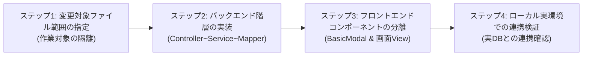

# [ステップ03] AI協調コーディングおよび自律実装実践ガイド

> **ステップ概要:** 先行確定されたデータスキーマとAPI仕様に基づき、**変更対象ファイル範囲を指定**することで不要なコード変更を防止し、全社アーキテクチャルール（Lombok適用、モーダルポップアップコンポーネント分離、動的メニュー連携）を遵守してコードを実装します。

---

## 1. ステップの目的と対象

* **主な担当者**: バックエンド開発者、フロントエンド開発者、フルスタックエンジニア
* **連携対象**: システムアーキテクト、コードレビュアー
* **想定所要時間**: 単位機能あたり1〜2時間程度
* **活用ツール**: SyncVerseコーディングエージェント、IDE（Cursor、IntelliJ IDEA、VS Code）、ローカルインフラ環境

---

## 2. 開始前チェック項目（開始基準）

本ステップを開始する前に、以下の事項を確認します。
- [ステップ02] 仕様ファースト・アーキテクチャ（DDLおよびAPI仕様）のレビューが完了しているか？
- 新規作業ブランチ（`feat/xxx`）が作成されているか？
- 変更すべきファイル一覧（`focusFiles`）が特定されているか？
- ローカル開発用インフラ（`docker-compose-local.yml` など）が正常に稼働しているか？

---

## 3. 実務遂行の4ステップ手順



### ステップ1: 変更対象ファイル範囲の指定（作業対象の隔離）
AIにプロジェクト全体の無制限な変更を任せると、意図しないファイルまで変更される問題が発生する可能性があります。今回の機能実装に必要なファイル一覧（`focusFiles`）を明示し、作業範囲を限定します。
* 例: `CouponController.java`, `CouponService.java`, `CouponRepository.java`, `CouponApplyModal.vue`

### ステップ2: バックエンド階層別の実装（AgentScope Java · Lombok標準）
1. **データアクセス層（Repository / Mapper）**: データベースクエリメソッドの作成（実PostgreSQL 18.6連携、暫定ダミー返却の禁止）。
2. **ビジネス層（Service）**: バリデーション（有効期限切れ、残高不足、重複防止）およびトランザクション（`@Transactional`）処理。AI推論（`AgentScope Java`）および外部MCP I/Oは必ず `@Transactional` の外部へ分離します。
3. **コントローラー層（Controller）**: `@RequiredArgsConstructor` によるコンストラクタインジェクション、`@Slf4j` による構造化ロギング、標準単一Canonical URL（`/api/v1/{product}/{resource}`）マッピング。

### ステップ3: フロントエンドコンポーネントの分離実装
1. **API呼び出しモジュール**: バックエンド標準URLを呼び出す通信関数の作成。
2. **モーダルポップアップコンポーネントの分離**: ページビューファイル内にモーダルコードをインラインで長く記述せず、独立ファイル（`components/CouponApplyModal.vue`）として分離します。
3. **動的メニュー登録**: ルートをソースコードにハードコーディングせず、データベース権限テーブル（`sys_permission`）を通じて管理します。

### ステップ4: ローカル実環境での連携検証
偽のダミーデータ（ハードコーディングされたリストや空値の返却）ではなく、ローカルデータベース、バックエンド、フロントエンドが実際に接続され、正常にデータをやり取りできるかを確認します。

---

## 4. 実務プロンプト例（コピーして使用）

### プロンプト1: Spring Bootビジネスロジックおよびトランザクションサービスの実装
```markdown
[役割] エンタープライズSpring Boot開発者
[コンテキスト]
- 技術環境: Java 25, Spring Boot 4.0, PostgreSQL 18.6
- 実装対象: {{ドメイン名、例: クーポン適用サービス}}
- 先行確定仕様:
{{ステップ02で確定したDDLおよびAPI仕様書の内容}}

[作成ルール]
1. Lombokアノテーションの適用:
   - @Autowired フィールドインジェクションを避け、private final フィールドと @RequiredArgsConstructor コンストラクタインジェクションを使用してください。
   - ロギングには @Slf4j を使用してください。
2. ビジネスロジック作成時:
   - 単純参照には @Transactional(readOnly = true)、データ更新メソッドには @Transactional を適用してください。
   - 条件を満たさない場合は適切なビジネス例外（ServiceException）を送出してください。
   - NullPointerExceptionを防止するため、入力値の妥当性を徹底的にチェックしてください。
3. 暫定ダミーリターン（return null など）の代わりに、実際のデータアクセス層を呼び出す完全なコードとして記述してください。

[出力形式]
1. CouponServiceImpl.java ソースコード
2. 主要な検証ロジックに関する説明
```

---

### プロンプト2: Vue 3およびモーダルポップアップ独立コンポーネントの分離実装
```markdown
[役割] Vue 3およびTypeScriptフロントエンド開発者
[コンテキスト] 上記バックエンドAPIと連携するクーポン選択ポップアップモーダルを作成します。

[作成ルール]
1. フレームワーク標準モーダルである BasicModal を使用してください。
2. モーダルのマークアップを親画面にインラインで記述せず、独立ファイル（components/CouponApplyModal.vue）として分離してください。
3. 画面要素が境界線に密着しないよう、内部パディング（p-4）を十分に確保してください。
4. 単なる空画面ではなく、テーブル、ラジオ選択、割引額プレビューなど実質的な視覚要素を含めてください。
5. TypeScriptインターフェース（Props、Emits）を明確に定義してください。

[出力形式]
- components/CouponApplyModal.vue 全ソースコード
- 親画面からモーダルを開閉する連携サンプルコード
```

---

### プロンプト3: エージェント共通ルールファイル例（`.agents/AGENTS.md` / IDEルール連携）
```markdown
# プロジェクトルートの .agents/AGENTS.md（およびIDEルールファイル）に全社開発標準を宣言します:

本エージェントは、プロジェクトの開発標準を厳格に遵守するエンジニアリングエージェントです。
以下のコーディングルールを遵守してください:
1. Java (JDK 25 / Spring Boot 4.0):
   - DTO、Entity、ServiceにLombokを適用します（@Getter, @Builder, @RequiredArgsConstructor, @Slf4j）。
   - Controllerマッピングは単一標準URLである `/api/v1/{product}/{resource}` 形式を使用します。
   - AI機能は AgentScope Java を標準として使用し、@Transactional の外部から呼び出します。
   - 暫定ダミーリターン（return null など）や偽の例外フォールバックを禁止し、実際のDBロジックと接続します。
2. Vue 3 (Vben Admin):
   - BasicTable、BasicModal、BasicForm の標準コンポーネントを優先して使用します。
   - モーダルポップアップは components/<Name>Modal.vue として独立分離し、内部パディング（p-4）を確保します。
   - 静的ルートのハードコーディングを禁止し、DB（sys_permission）に基づく動的メニュー連携を遵守します。
```

---

## 5. よくあるミスと注意事項

| ミスの種類 | よくある問題点 | 推奨される対応策 |
| :--- | :--- | :--- |
| **暫定ダミーデータの放置** | 迅速な実装のため `return new ArrayList<>()` だけを残して次へ進む | 実際のデータベースマッパーおよびリポジトリ連携コードが完成しているか点検します。 |
| **モーダルのインライン記述** | 親画面ファイルの下部にモーダルコードを長く記述し、可読性が低下する | モーダルを別ファイル（`components/XxxModal.vue`）に分離し、単一責任を維持します。 |
| **指定外ファイルの変更** | 作業範囲を指定しなかったため、無関係な設定ファイルまで任意に変更してしまう | `focusFiles` で変更対象ファイルを事前に限定し、変更範囲を統制します。 |

---

## 6. ステップ完了チェックリスト（終了基準）

次のステップである **[ステップ04: テストおよび自動修正](./ai-sdlc-04-testing.md)** へ進むため、以下の項目を確認します。
- [ ] DTO、サービス、コントローラーにLombokおよびコンストラクタインジェクションが適用されているか？
- [ ] モーダルポップアップが独立コンポーネントとして分離されているか？
- [ ] ローカル実行時にフロントエンドとバックエンドが実際のデータベースと正常に連携しているか？
- [ ] 指定した変更対象ファイル以外に他のファイルが変更されていないか？（`git status` 確認）

### 関連公式成果物（Phase 3）
* **[EMP-P3-01] 週間業務報告書** · **[EMP-P3-10] タスク変更依頼書(CR Form)** · **[EMP-P3-14] REST API開発マニュアル** · **[EMP-P3-15] AIビジネスルール辞書** · **[EMP-P3-16] AIプロンプト仕様書** -> [標準テンプレートダウンロードセンターへ移動](./enterprise-document-templates.md#emp-p3-01)
