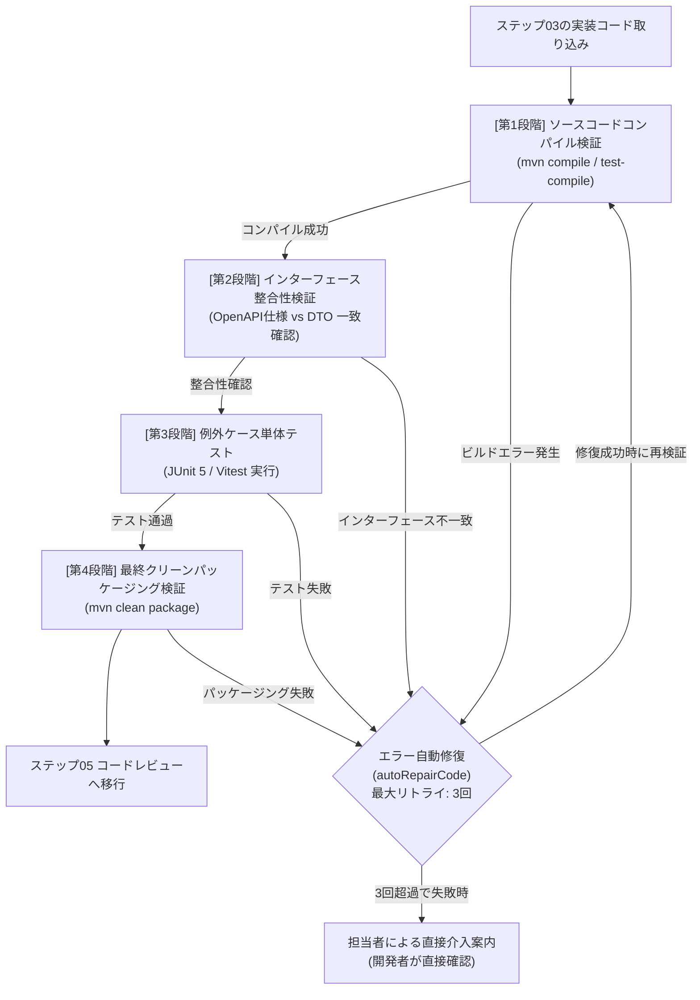

# [ステップ04] テスト自動化および4段階エラー自動修復実践ガイド

> **ステップ概要:** 実装されたコードに対して**単体テストおよび統合テストを自動生成**し、全社標準である**4段階回帰検証（コンパイル -> インターフェース -> ロジック -> クリーンビルド）**を実施するとともに、エラー発生時にはAIがエラーログを分析してコードを修復する**エラー自動修復（autoRepairCode）**を実行します。

---

## 1. ステップの目的と対象

* **主な担当者**: QAエンジニア、ソフトウェアテスト担当者、バックエンド／フロントエンド開発者
* **連携対象**: システムアーキテクト、デプロイ管理者
* **想定所要時間**: 機能あたり30〜45分程度
* **活用ツール**: Maven / Gradle, JUnit 5, MockMvc, Vitest, SyncVerse自己修復エンジン

---

## 2. 開始前チェック項目（開始基準）

本ステップを開始する前に、以下の事項を確認します。
- [ステップ03] コード実装が完了し、ローカルコンパイルが1次通過しているか？
- [ステップ01] 機能仕様書のシナリオ別完了基準（受け入れ基準）が確認されているか？
- テスト用データベースまたはテストコンテナ環境が準備されているか？

---

## 3. 実務遂行の4段階検証およびエラー自動修復手順



### [第1段階] 静的Zero-Mock監査およびソースコードコンパイル検証（Cycle 1）
* `verify-hardcoded-smells`、`verify-zero-mock` 静的整合性検査を通過した後、`mvn compile` および `mvn test-compile`（フロントエンドは `pnpm build` / 型チェック）を実行し、構文・型・ダミーコード違反を1次ブロックします。

### [第2段階] インターフェース契約およびセキュリティシークレット交差検証（Cycle 2）
* ステップ02で先行定義されたOpenAPI仕様とフロントエンド・バックエンド間の `/api/v1/` URL 1:1一致確認（`verify-api-contracts`）、平文シークレット0件確認（`verify-security-leaks`）、および行政安全部・KISA開発セキュリティ49項目の脆弱性を点検します。

### [第3段階] 例外ケース単体・統合テストおよびAIゴールデンセット評価（Cycle 3）
* 正常系ケースに加えて、例外状況（有効期限切れ、残高不足、重複リクエスト）に対する隔離単体テスト（JUnit 5 / Vitest）を実施します。AI/LLM機能を含む場合は、**50問標準ゴールデンセット（EMP-P4-09）**に対する適合率・再現率の回帰評価を並行して実施します。

### [第4段階] 最終クリーンパッケージングおよび独立QA交差監査（Cycle 4）
* 前回のビルドキャッシュを削除して `mvn clean package` を実行した後、**独立したQAサブエージェント（または交差レビュアー）**が変更ファイルと要件トレーサビリティマトリクス（RTM）を交差監査し、最終合格判定を下します。

### エラー自動修復ループ（autoRepairCode）
* 検証中にエラーが発生した場合、システムがエラーログを分析して原因を特定し、コードを自律的に修復します。
* 無限ループを防止するため、最大3回まで自動修復を試行し、3回を超過した場合は処理を安全に停止して開発者に確認を要請します。

---

## 4. 実務プロンプト例（コピーして使用）

### プロンプト1: 例外ケース単体テスト（JUnit 5）の自動生成
```markdown
[役割] シニアQAエンジニア兼バックエンドテスト専門家
[コンテキスト] 以下のビジネスサービスコードに対して、JUnit 5ベースの単体テストクラスを作成してください。
[テスト対象コード]
{{ステップ03で作成したServiceまたはControllerのソースコード}}
[完了基準]
{{ステップ01で導出した状況-行動-結果シナリオ}}

[作成ルール]
1. 正常系ケース以外に、以下の例外状況を個別の @Test メソッドとして作成してください:
   - 有効期限切れクーポンの適用試行 -> 適切なビジネス例外が発生することを検証
   - 最低注文金額未満での適用試行 -> バリデーション失敗例外が発生することを確認
   - 存在しないIDの受け渡し時 -> リソース未存在例外を確認
   - 同一会員による同時重複適用の試行 -> 重複ブロックを検証
2. AssertJ（assertThat、assertThatThrownBy）を使用し、可読性の高いアサーションを記述してください。
3. @DisplayName に日本語でテストの目的を明確に記述してください。
```

---

### プロンプト2: ビルドエラー自動修復（autoRepairCode）
```markdown
[役割] ソフトウェアデバッグおよびエラー修復エージェント
[コンテキスト]
ビルド検証中に以下のようなコンパイルエラーまたはテストエラーが発生しました。既存のビジネスポリシーを維持したままエラーを修正してください。

[エラーログ]
{{ビルドエラースタックトレースの内容}}

[エラー発生ソースコード]
{{該当ファイルのソースコード内容}}

[作成ルール]
1. 原因分析: エラーの根本原因を2行以内で要約してください。
2. 副作用点検: 修正によって他の箇所に影響がないか確認してください。
3. 置換コード: 該当ソースコード全体をそのまま置き換え可能な形式で作成してください。
   - [注意] エラー解消のために必須のバリデーション文（if文）を任意に削除しないでください。
   - [注意] メソッド内部を空欄（// TODO）のまま残さないでください。
```

---

## 5. よくあるミスと注意事項

| ミスの種類 | よくある問題点 | 推奨される対応策 |
| :--- | :--- | :--- |
| **アサーション（assert）のないテスト** | メソッドを実行するだけで結果検証がなく、常に成功する偽のテストを作成する | テストメソッドごとに最低2つ以上の結果アサーション（assertThat）を含めるようにします。 |
| **検証ロジックの任意削除** | テストを通過させることだけを目的に、サービスの必須バリデーション文を削除してしまう | エラー修正時にはビジネス検証文を維持したまま、型やパラメータを適合させるよう指示します。 |
| **無限修正の試行** | エラーが継続して発生しているにもかかわらず、際限なく再ビルドを試行して時間を浪費する | 最大リトライ回数を3回に制限し、超過時は開発者が直接介入するようにします。 |

---

## 6. ステップ完了チェックリスト（終了基準）

次のステップである **[ステップ05: コードレビューおよびデプロイ](./ai-sdlc-05-review-deploy.md)** へ進むため、以下の項目を確認します。
- [ ] 4-Cycle Zero-Mock検証（静的・コンパイル、API契約・セキュリティ、単体・統合・AIゴールデンセット、クリーンパッケージング・独立QA監査）がすべて通過したか？
- [ ] 主要な例外状況に対する隔離単体テストが作成され、正常に実行されるか？
- [ ] エラー自動修復が動作した場合、修正後のコードが本来の企画意図を損なっていないか？
- [ ] ビルドされた成果物（JARなど）が正常にパッケージングされているか？

### 関連公式成果物（Phase 4）
* **[EMP-P4-02] 単体テストケース** · **[EMP-P4-04] 統合テストシナリオ・結果報告書** · **[EMP-P4-06] SW開発セキュリティ49項目チェックリスト（行政安全部・KISA）** · **[EMP-P4-07] オープンソースライセンス検証書** · **[EMP-P4-09] AIゴールデンセット品質評価書** · **[EMP-P4-11] UAT確認書** -> [標準テンプレートダウンロードセンターへ移動](./enterprise-document-templates.md#emp-p4-02)
