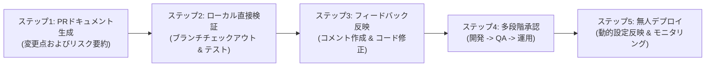

# [ステップ05] コードレビューおよび無人デプロイ実践ガイド

> **ステップ概要:** ステップ04のビルド検証を通過した作業ブランチに対して、**AIが変更理由とリスクを要約したレビュー依頼（PR）を生成**し、担当開発者が**ローカル環境で実際に実行して確認（協調開発）**した後、**多段階承認**を経て安全にデプロイします。

---

## 1. ステップの目的と対象

* **主な担当者**: コードレビュアー、シニア開発者、テックリード、インフラ／デプロイ担当者
* **連携対象**: ビジネス企画担当者、セキュリティ担当者
* **想定所要時間**: 1件あたり15〜30分程度
* **活用ツール**: GitHub / GitLab, IntelliJ IDEA, Docker / K8s, CI/CDデプロイパイプライン

---

## 2. 開始前チェック項目（開始基準）

本ステップを開始する前に、以下の事項を確認します。
- [ステップ04] 4段階回帰検証および単体テストがすべて通過しているか？
- 作業ブランチ（`feat/xxx`）がリモートリポジトリへ正常にプッシュされているか？
- デプロイ対象の基準ブランチ（mainまたはdev）の最新ソースコードが反映されているか？

---

## 3. 実務遂行の5ステップ手順



### ステップ1: レビュー依頼（PR）本文の自動整理
作業ブランチがプッシュされると、AIが変更されたコード（Git Diff）を分析し、以下の内容をマークダウンで整理します。
* **作業背景**: 企画意図および関連作業チケット番号
* **主な変更事項**: 追加または修正されたファイル一覧
* **データベース変更の有無**: テーブル作成やカラム変更の有無
* **テスト結果の要約**: 4段階検証の通過可否および新規テスト項目

### ステップ2: 開発者によるローカル直接検証（協調開発原則）
Web画面上でコード行をざっと眺めるだけで承認するリスクを回避するため、開発者がローカルターミナルから作業ブランチを直接チェックアウトして起動します。
```bash
git fetch origin feat/issue-101-cart-coupon
git checkout feat/issue-101-cart-coupon
```
ローカルIDEでブレークポイントを設定し、実際の機能動作と画面の反応を直接確認します。

### ステップ3: フィードバック反映および対話型修正
* 修正が必要な箇所がある場合はレビューコメントを残します（例: *「このループ内でクエリが重複実行される可能性があるため、結合クエリに変更してください」*）。
* AIまたは担当作業者がその意見を反映し、追加コミットを登録します。

### ステップ4: 多段階承認手順（作業者承認統制）
データベース変更やコアビジネスロジック修正などリスクを伴う作業は、事前定義された権限体系に従い順次承認を経ます。
1. `開発者承認`: コーディング規約およびビジネスロジックの妥当性確認
2. `QA承認`: 完了基準およびシナリオの充足確認
3. `運用者承認`: デプロイ時期およびシステム影響度の最終認可

### ステップ5: 無人デプロイおよびリアルタイムモニタリング
* 承認完了時にデプロイパイプラインが自動実行され、対象サーバーへ反映されます。
* システム環境設定の変更については、サーバー再起動なしでランタイムイベント（`ConfigRefreshEvent`）を通じてメモリへ即時反映されます。
* デプロイ後のモニタリングにより異常なエラー率が検知された場合は、直前の正常バージョンへ迅速にロールバックします。

---

## 4. 実務プロンプト例（コピーして使用）

### プロンプト1: コード変更点（Git Diff）ベースのPR本文整理
```markdown
[役割] リリースエンジニアリング・テクニカルライター
[コンテキスト] 作業ブランチで生成されたGit Diffを分析し、レビュアー（Reviewer）が読みやすいPR本文をマークダウン形式で作成してください。
[Git Diff内容]
{{git diff 内容を貼り付け}}

[作成項目]
## 1. 作業概要 (Why & What)
- 機能追加の目的および背景 (2〜3文)
## 2. 主な変更内容 (Key Changes)
- バックエンド / フロントエンド / DBスキーマ別の変更事項要約
## 3. 注意事項およびリスク点検 (Risk Check)
- 既存機能への影響 (後方互換性の有無)
- クエリ性能 (検索インデックスの活用有無)
## 4. テスト結果の要約 (Verification)
- 4段階検証結果および実行された単体テスト一覧
```

---

### プロンプト2: シニアアーキテクト視点でのコードレビューおよび脆弱性点検
```markdown
[役割] 首席システムアーキテクト兼セキュリティ監査担当
[コンテキスト] 新規作成されたPRコードに対して深層コードレビューを実施してください。
[対象コード]
{{レビュー対象の変更ソースコード}}

[点検基準]
1. 同時実行性: 複数ユーザーが同時にリクエストした際、データ整合性が損なわれるリスクはないか？
2. クエリ性能: 大容量データ検索時にN+1問題や過度なフルスキャンが発生しないか？
3. 全社標準遵守: Lombok適用、単一標準URL（/api/v1/...）遵守、モーダルコンポーネント分離の有無
4. セキュリティ: SQLインジェクション、機密情報のログ出力、権限チェック漏れがないか？

[出力形式]
- 総合所見 (承認推奨 / 修正必要)
- ファイル名および行番号ごとの具体的な改善提案 (改善前後のコード例を含む)
```

---

## 5. よくあるミスと注意事項

| ミスの種類 | よくある問題点 | 推奨される対応策 |
| :--- | :--- | :--- |
| **目視のみのレビュー** | マークダウンの要約だけを信じてローカル実行せずに承認し、ランタイムバグが発生する | 開発者がローカルで直接ソースを取得して起動・確認する協調検証原則を徹底します。 |
| **後方互換性の破壊** | 既存APIのレスポンスフィールド名を任意に変更し、連携システムで障害が発生する | 既存API仕様を変更する際は、事前に影響を受けるクライアントと協議します。 |
| **単独での独断デプロイ** | 重要なデータベース変更作業を1人が承認して即座にデプロイする | 多段階承認手順を通じて複数の担当者が交差確認できるようにします。 |

---

## 6. ステップ完了チェックリスト（終了基準）

本AI-SDLCサイクルを完了しデプロイを確定するため、以下の項目を確認します。
- [ ] 開発者がローカル環境でソースコードを取得し、直接動作を確認したか？
- [ ] コードレビューで指摘された改善意見が反映されたか？
- [ ] 定められた承認フロー（開発、QA、運用）の承認がすべて完了したか？
- [ ] デプロイ後のシステムエラー率および応答速度が正常範囲を維持しているか？
- [ ] 関連する機能仕様書およびシステム案内ドキュメントが最新状態に同期されているか？

### 関連公式成果物（Phase 5）
* **[EMP-P5-01] システム移行計画書** · **[EMP-P5-02] 移行チェックリスト** · **[EMP-P5-03] システムデプロイ・ロールバックランブック** · **[EMP-P5-04] データ移行整合性突合表** · **[EMP-P5-12] 最終検収完了確認書** · **[EMP-P5-19] 月次AI FinOps精算報告書** -> [標準テンプレートダウンロードセンターへ移動](./enterprise-document-templates.md#emp-p5-01)
