# Empasy 段階別アクションアイテム（45件の Action Items）および実務実行ガイド（SOP）

> **概要:** 本ガイドは、**Phase 0（プリセールス）〜 Phase 5（本番公開・精算）** の各段階において、担当者が**何を（`Action Item`）、どのような順序で実行し、どの公式書式（`EMP-*`）を作成してどのように合格判定を行うか**を規定した全社標準業務手順書（SOP）です。

::: tip 関連上位および実務ガイドへのクイックリンク
* **[Empasy 事業・プロジェクト管理標準文書テンプレート統合ダウンロードセンター（125種）](./enterprise-document-templates.md)**: 90-8-2 全社標準フォーマット 125種の単一マスター（Blank）+ 6種の規模別プリセットパッケージ
* **[Empasy 事業・開発メソドロジー概要（Phase 0〜5）](./enterprise-project-lifecycle.md)**: 全ライフサイクル運用、4大 Sign-off および S/M/L テイラリング基準
* **[Empasy 事業全ライフサイクル標準文書体系および納品・管理実務ガイド](./enterprise-business-documents.md)**: 公共・金融・AI 基本法規制、AI FinOps、外注・危機対応標準
* **[営業支援および提案段階実務ガイド（Pre-sales）](./presales-ai-playbook.md)**: RFP 分析、提案書作成、PoC デモ制作、工数見積り
* **[開発ライフサイクル概要（AI-SDLC）](./ai-driven-development.md)**: 5段階開発プロセスの詳細
* **[状況別実践プロンプト集（チートシート）](./ai-sdlc-prompt-recipes.md)**: 実務段階別の即コピー用テンプレート
:::

---

## 1. Phase 0 〜 Phase 5 全 45件の Action Items 一覧

```mermaid
flowchart TD
    subgraph P0 ["Phase 0: プリセールス & 提案（7件: A0.0〜A0.6）"]
        A00["A0.0 Go/No-Go 審議および NDA 締結"]
        A01["A0.1 RFP 要件分解"]
        A02["A0.2 技術提案書作成"]
        A03["A0.3 PoC デモおよび結果報告書"]
        A04["A0.4 公式見積・3か年 TCO 算定"]
        A05["A0.5 入札書類および PT Q&A 防御"]
        A06["A0.6 技術遂行事前承認（Sign-off）"]
    end
    subgraph P1 ["Phase 1: 契約締結 & 着手・分析（8件: A1.0〜A1.7）"]
        A10["A1.0 本契約・保証保険・前払金・下請・着手届"]
        A11["A1.1 PMP・セキュリティ誓約・AI ガバナンス点検"]
        A12["A1.2 要件定義書（SRS）・RTM 確定"]
        A13["A1.3 業務例外ポリシーの先制発掘"]
        A14["A1.4 マスター WBS およびマイルストーン確定"]
        A15["A1.5 変更管理（CR 3 M/D）ガバナンス"]
        A16["A1.6 レガシーデータ移行の早期実証"]
        A17["A1.7 業務スコープ確定（Sign-off #1）"]
    end
    subgraph P2 ["Phase 2: 設計 & 規格化（7件: A2.0〜A2.6）"]
        A20["A2.0 画面設計書ストーリーボード（Sign-off #2）"]
        A21["A2.1 SAD・クラウド・ファイアウォール申請確定"]
        A22["A2.2 PostgreSQL 6-File DDL・DB 9シート"]
        A23["A2.3 単一 /api/v1/ API・連携・AI プロンプト"]
        A24["A2.4 エージェントコーディング標準（.agents/AGENTS.md）"]
        A25["A2.5 外部連携 Mock Server の先行構築"]
        A26["A2.6 設計段階完了報告および承認"]
    end
    subgraph P3 ["Phase 3: 協業実装 & 工程管理（7件: A3.1〜A3.7）"]
        A31["A3.1 修正ファイル範囲（focusFiles）隔離"]
        A32["A3.2 バックエンド・AgentScope Zero-Mock 実装"]
        A33["A3.3 フロントエンド Vben 標準・モーダル分離実装"]
        A34["A3.4 週間・月間進捗報告（S-Curve）"]
        A35["A3.5 課題・リスク・日次欠陥管理台帳の運用"]
        A36["A3.6 業務変更要求書（CR）・工期延長（EOT）"]
        A37["A3.7 中間報告書および出来高検収（40%）"]
    end
    subgraph P4 ["Phase 4: 検証、セキュリティ & 監査（6件: A4.1〜A4.6）"]
        A41["A4.1 4-Cycle Zero-Mock 回帰検証"]
        A42["A4.2 ビルドエラー自己修復（autoRepair）"]
        A43["A4.3 行政安全部・KISA セキュリティ 49項目・OSS 検証"]
        A44["A4.4 性能負荷試験および AI ゴールデンセット評価"]
        A45["A4.5 ユーザー受入テスト UAT（Sign-off #3）"]
        A46["A4.6 第三者監査指摘事項の是正完了"]
    end
    subgraph P5 ["Phase 5: 本番公開、検収 & 精算（10件: A5.1〜A5.10）"]
        A51["A5.1 デプロイ・ロールバックランブックおよび無停止カットオーバー"]
        A52["A5.2 ランタイム設定反映・リアルタイム監視"]
        A53["A5.3 ユーザー・管理者マニュアルおよびパイロット"]
        A54["A5.4 顧客教育およびアカウント・権限引継ぎ"]
        A55["A5.5 運用ランブックおよびワンクリックオンボーディング"]
        A56["A5.6 完了報告および最終検収（Sign-off #4）"]
        A57["A5.7 竣工残金（30%）請求および回収"]
        A58["A5.8 瑕疵担保保証証券および瑕疵対応計画書"]
        A59["A5.9 維持管理 SLA・月間 FinOps 精算"]
        A510["A5.10 プロジェクト終了振り返り・P&L 精算"]
    end

    P0 --> P1 --> P2 --> P3 --> P4 --> P5
```

---

## 2. 段階別 Action Item 実務実行詳細ガイド

---

### [Phase 0] プリセールスおよび提案支援（Pre-sales & Proposal — 7件）

#### Action Item A0.0: 入札参加妥当性審議（Go / No-Go）および秘密保持契約書（NDA）締結
* **目的**: 不採算・赤字入札を事前に遮断し、顧客の原本資料受領前に法的セキュリティおよび外部 AI 学習禁止を確立する。
* **担当者**: 事業本部長、営業代表、提案技術 PM、法務担当者
* **実行手順**:
  1. 顧客 RFP 詳細資料やデータを受領する前に、相互秘密保持契約書（NDA）を締結します。
  2. 技術適合度（30点）、収益性（25点）、納期現実性（20点）、資産再利用率（15点）、契約・セキュリティリスク（10点）を定量採点します。
  3. 合計 **70点以上** で入札参加（Go）を承認し、基準未満の場合は不参加（No-Go）を決定します。
* **標準成果物**: [EMP-P0-01 相互秘密保持契約書（NDA）](./enterprise-document-templates.md#emp-p0-01), [EMP-P0-02 入札妥当性 Go/No-Go 審議表](./enterprise-document-templates.md#emp-p0-02)
* **合格判定基準**: NDA の押印が完了し、Go/No-Go 合計点 70点以上で公式に参加承認が得られているか。

#### Action Item A0.1: RFP 要件分解および事前質疑
* **目的**: 数百ページの RFP から機能（SFR）・データ（DAR）・連携（SIR）・非機能（NFR）要件を漏れなく抽出する。
* **担当者**: プリセールスエンジニア、提案技術 PM
* **実行手順**:
  1. RFP 要件を固有 ID・分類・難易度（高/中/低）で構造化します。
  2. 不明確な制約事項とレガシー連携範囲は事前顧客質疑書として整理し、発注元の確認を取得します。
* **標準成果物**: [EMP-P0-03 プリセールス顧客質疑書](./enterprise-document-templates.md#emp-p0-03), [EMP-P0-08 事前技術提案方針書](./enterprise-document-templates.md#emp-p0-08)
* **合格判定基準**: RFP 原文のすべての要件項目が漏れなく分類され、主要な論点が識別されているか。

#### Action Item A0.2: 事業技術提案書作成
* **目的**: 目標システム 4階層アーキテクチャ、セキュリティ・品質保証および遂行メソドロジーの差別化を立証する。
* **担当者**: ソリューションアーキテクト、提案 PM
* **実行手順**:
  1. 提案作業詳細計画書に基づき、目次ごとの担当者とレビュースケジュールを割り当てます。
  2. アーキテクチャ構成図、Spec-First メソドロジー、4-Cycle Zero-Mock 品質検証および AI ガバナンス戦略を記述します。
* **標準成果物**: [EMP-P0-07 提案作業詳細計画書](./enterprise-document-templates.md#emp-p0-07), [EMP-P0-09 事業技術提案書標準テンプレート](./enterprise-document-templates.md#emp-p0-09)
* **合格判定基準**: 顧客の必須制約条件と評価配点項目をすべて満たしているか。

#### Action Item A0.3: 営業デモ用 PoC デモ制作および技術検証結果報告書
* **目的**: 提案プレゼンテーション（PT）時に実動作する主要画面 1〜2件をデモし、技術評価の優位性を確保する。
* **担当者**: プロトタイプ開発者、フロントエンド・AI エンジニア
* **実行手順**:
  1. 顧客が特に関心を持つ主要画面 1〜2件を選定し、社内標準コンポーネント（`Vben BasicModal` 等）で実動作プロトタイプをビルドします。
  2. 精度・応答速度などの実証結果を整理して営業代表へ共有します。
* **標準成果物**: 実動作デモ URL, [EMP-P0-08 事前技術提案方針書](./enterprise-document-templates.md#emp-p0-08)
* **合格判定基準**: デモ環境においてクリック・照会・AI 分析がエラーなく正常に動作するか。

#### Action Item A0.4: 公式見積書、3か年 TCO 原価計算書および実行予算書算定
* **目的**: 人件費・クラウド/GPU・商用 LLM トークン・外注費を統合算定し、目標マージンを確保する。
* **担当者**: 提案 PM、営業代表、開発リード
* **実行手順**:
  1. 機能難易度基準の投入工数（M/M）とインフラ・LLM トークン 3か年 TCO を算出します。
  2. 社内原価に対する営業利益率を反映し、公式見積書と実行予算書を確定します。
* **標準成果物**: [EMP-P0-04 3か年 TCO 原価計算書](./enterprise-document-templates.md#emp-p0-04), [EMP-P0-05 受注実行予算書](./enterprise-document-templates.md#emp-p0-05), [EMP-P0-06 SW開発標準見積書](./enterprise-document-templates.md#emp-p0-06)
* **合格判定基準**: 稼働可能人員と期間内で遂行可能であり、目標マージン率を満たしているか。

#### Action Item A0.5: 入札参加書類準備および提案 PT Q&A 防御シミュレーション
* **目的**: 入札資格の欠格防止および審査委員の鋭い質問 10選に対する論理的防御を行う。
* **担当者**: 経営支援チーム、プリセールス、提案プレゼンター
* **実行手順**:
  1. 法人印鑑、国税／地方税完納証明書、信用評価等級書、実績証明書、入札保証保険証券を完備します。
  2. 審査委員からの定番質問 10選に対する［原則 -> 技術的解決策 -> 検証実績］の 3段防御スクリプトをリハーサルします。
* **標準成果物**: 入札資格書類一式, [EMP-P0-10 提案発表 PT 審査スライド](./enterprise-document-templates.md#emp-p0-10)
* **合格判定基準**: 行政書類の有効期限・社印漏れがなく、10選の Q&A 防御が準備されているか。

#### Action Item A0.6: 技術的遂行可能性の事前合意（Technical Sign-off）
* **目的**: 開発組織の検証なしに行われる無理な低価格・短納期入札を事前に遮断する。
* **担当者**: 開発リード（Tech Lead）、事業本部長
* **実行手順**:
  1. 入札前に開発リードが工数、納期、技術仕様および AI SLA 達成可能性を最終レビューします。
  2. 実現可能性を確認した後、事前承認書に署名します。
* **標準成果物**: [EMP-P0-11 技術遂行妥当性事前承認書](./enterprise-document-templates.md#emp-p0-11)
* **合格判定基準**: 開発リードの公式書面承認が確保されているか。

---

### [Phase 1] 契約締結、着手および要件分析（Inception & SRS — 8件）

#### Action Item A1.0: 本契約締結、保証保険、前払金・下請承認および着手届提出
* **目的**: 法的権利・義務を確定し、前払金（30〜50%）の早期確保および公式着手届出を行う。
* **担当者**: 事業代表、営業／法務、PM、経営支援チーム
* **実行手順**:
  1. 代金支払（30/40/30）、遅延損害金（0.075%）、知的財産権、瑕疵担保（1年）が明記された標準契約書を締結します。
  2. 契約履行保証保険証券の発行および着手届・前払金申請書（前払金保証保険を含む）を提出します。
  3. 外注協力会社を投入する場合、SW振興法第51条に基づき下請事前承認申請書（50%以内・再委託禁止）を提出します。
* **標準成果物**: [EMP-P1-01 SW委託標準契約書](./enterprise-document-templates.md#emp-p1-01), [EMP-P1-02 着手届および PMP](./enterprise-document-templates.md#emp-p1-02), [EMP-P1-06 前払金申請書](./enterprise-document-templates.md#emp-p1-06), [EMP-P1-07 下請事前承認書](./enterprise-document-templates.md#emp-p1-07)
* **合格判定基準**: 両社の契約押印、保証証券発行、着手届および前払金申請が完了しているか。

#### Action Item A1.1: 事業遂行計画書（PMP）確定、セキュリティ誓約および AI 基本法ガバナンス点検
* **目的**: 着手報告会の承認、投入要員のセキュリティ遵守および 2026 AI 基本法要件の先制的点検を行う。
* **担当者**: 統括 PM、セキュリティ担当者、AI リード
* **実行手順**:
  1. 着手報告会およびキックオフワークショップを通じて、遂行体制、連絡網、定例会議体系および標準フォルダ構成を確定します。
  2. 参画要員全員のセキュリティ誓約書・個人情報処理委託契約書を提出し、AI を含む事業では AI 基本法の高影響該当有無・外部学習排除・PII マスキング 18項目を点検します。
* **標準成果物**: [EMP-G0-01 標準フォルダ構成](./enterprise-document-templates.md#emp-g0-01), [EMP-P1-04 着手報告会発表資料](./enterprise-document-templates.md#emp-p1-04), [EMP-P1-08 セキュリティ誓約・委託契約書](./enterprise-document-templates.md#emp-p1-08), [EMP-P1-09 連絡網・会議体系](./enterprise-document-templates.md#emp-p1-09), [EMP-P1-22 AI ガバナンス点検表](./enterprise-document-templates.md#emp-p1-22)
* **合格判定基準**: 着手報告会での承認、全員分のセキュリティ誓約書提出および AI ガバナンス 1次点検が完了しているか。

#### Action Item A1.2: 要件定義書（SRS）およびトレーサビリティマトリクス（RTM）確定
* **目的**: 提案時の約束と実際の実装スコープを固有 ID ベースで 1:1 マッピングする。
* **担当者**: PM、BA／プランナー、顧客側業務 PM
* **実行手順**:
  1. 業務部門インタビュー、環境分析、ベンチマーキングおよび AS-IS プロセス診断を実施します。
  2. 機能・データ・連携・セキュリティ要件を SRS として確定し、双方向 RTM および基幹システム連携仕様協議書を合意します。
* **標準成果物**: [EMP-P1-13 要件定義書（SRS）](./enterprise-document-templates.md#emp-p1-13), [EMP-P1-14 要件追跡表（RTM）](./enterprise-document-templates.md#emp-p1-14), [EMP-P1-16 環境分析書](./enterprise-document-templates.md#emp-p1-16), [EMP-P1-18 AS-IS 定義書](./enterprise-document-templates.md#emp-p1-18), [EMP-P1-19 連携仕様協議書](./enterprise-document-templates.md#emp-p1-19)
* **合格判定基準**: すべての要件に固有 ID・受入基準が付与され、顧客実務者の確認を完了しているか。

#### Action Item A1.3: 業務例外ポリシーの先制発掘および業務部門インタビュー
* **目的**: 開発途中の頻繁なポリシー変更と手戻りを事前に遮断する。
* **担当者**: サービスプランナー、BA
* **実行手順**:
  1. キャンセル、返金、有効期限切れ、同時リクエスト、権限境界などのエッジケース質疑書を作成し、業務部門インタビューを実施します。
  2. 顧客から提供を受けるテキスト・画像・マスターデータの受給スケジュールを確定します。
* **標準成果物**: [EMP-P1-15 要件質疑書およびコンテンツ受給一覧](./enterprise-document-templates.md#emp-p1-15), [EMP-P2-03 運用ポリシー定義書](./enterprise-document-templates.md#emp-p2-03)
* **合格判定基準**: 正常フロー以外の主な例外処理ポリシーとコンテンツ受給スケジュールが書面合意されているか。

#### Action Item A1.4: マスター WBS およびマイルストーンベースライン確定
* **目的**: 全ライフサイクルの作業分解、重み付け進捗率基準およびスプリント計画を策定する。
* **担当者**: 統括 PM、テックリード
* **実行手順**:
  1. RTM ベースで Phase 0〜5 の詳細 Task、重み（合計 100%）、祝日基準を反映した WBS を確定します。
  2. 規模別 Tailoring 成果物一覧と主要マイルストーンを発注元と合意します。
* **標準成果物**: [EMP-P1-10 WBS マスター](./enterprise-document-templates.md#emp-p1-10), [EMP-P1-11 マイルストーン要約](./enterprise-document-templates.md#emp-p1-11), [EMP-P1-12 遂行範囲および成果物一覧](./enterprise-document-templates.md#emp-p1-12)
* **合格判定基準**: 重み合計 100% の検証および全体スケジュールベースラインの合意が完了しているか。

#### Action Item A1.5: 業務変更管理（CR 3 M/D 基準）ガバナンス確立
* **目的**: 口頭要望および無秩序なスコープ拡大（Scope Creep）による赤字を防止する。
* **担当者**: 統括 PM、顧客側 PM
* **実行手順**:
  1. 口頭要望の不受理および公式 CR Form 書面受付プロセスを合意します。
  2. 影響度分析の結果、**3 M/D 超** の変更（大型契約特約時は 5 M/D）については、機能入替（Swap）、納期順延または追加契約連動の原則を明文化します。
* **標準成果物**: [EMP-P3-10 業務変更要求書（CR Form）](./enterprise-document-templates.md#emp-p3-10), [EMP-P3-11 変更管理累積台帳](./enterprise-document-templates.md#emp-p3-11)
* **合格判定基準**: 変更統制基準と承認プロセスが顧客と書面合意されているか。

#### Action Item A1.6: レガシーデータ移行の早期実証
* **目的**: リリース直前のデータ欠損・フォーマット不一致による公開遅延を遮断する。
* **担当者**: データエンジニア、DBA
* **実行手順**:
  1. 着手 2〜3週目にレガシー DB サンプルを早期抽出し、新スキーマへの変換を実証します。
  2. 検出された欠損値・コードエラー一覧を顧客システム部門へ公式通知し、事前のデータクレンジングを促します。
* **標準成果物**: [EMP-P1-19 対内外連携仕様協議書](./enterprise-document-templates.md#emp-p1-19), [EMP-P5-04 データ移行整合性突合表（初版）](./enterprise-document-templates.md#emp-p5-04)
* **合格判定基準**: サンプル変換テストを完了し、クレンジング対象のエラーデータが早期に識別されているか。

#### Action Item A1.7: 業務スコープ確定合意書への署名（Sign-off #1 — Scope Freeze）
* **目的**: Phase 1 を公式に終結し、開発対象スコープを法的に凍結する。
* **担当者**: 統括 PM、発注元業務・IT 責任者
* **実行手順**:
  1. 確定した SRS（`EMP-P1-13`）、RTM（`EMP-P1-14`）、連携仕様協議書（`EMP-P1-19`）を添付してスコープ凍結を稟議します。
  2. 両社責任者の公式社印／署名を確保し、Phase 2 への移行承認を受けます。
* **標準成果物**: [EMP-P1-20 業務スコープ確定 Scope Freeze 合意書](./enterprise-document-templates.md#emp-p1-20)
* **合格判定基準**: 両社統括責任者の署名済み原本が確保されているか。

---

### [Phase 2] 仕様優先アーキテクチャおよび詳細設計（Design & Spec — 7件）

#### Action Item A2.0: 画面設計書（UI/UX ストーリーボード）作成および顧客承認（Sign-off #2）
* **目的**: 業務部門が直接レビュー可能な UI/UX 仕様をコーディング前に書面凍結し、手戻りを遮断する。
* **担当者**: UI/UX プランナー、デザイナー、顧客側業務部門
* **実行手順**:
  1. 情報構造図（IA）、単位機能定義書、TO-BE プロセス、デザイン戦略書および画面ストーリーボードを作成します。
  2. 業務部門レビュー会を経て、画面数・レイアウト・インタラクションに対する公式承認を取得します。
* **標準成果物**: [EMP-P2-01 情報構造図（IA）](./enterprise-document-templates.md#emp-p2-01), [EMP-P2-02 単位機能定義書](./enterprise-document-templates.md#emp-p2-02), [EMP-P2-06 画面設計書ストーリーボード](./enterprise-document-templates.md#emp-p2-06), [EMP-P2-07 デザイン戦略書](./enterprise-document-templates.md#emp-p2-07), [EMP-P2-10 画面設計承認確認書](./enterprise-document-templates.md#emp-p2-10)
* **合格判定基準**: すべてのメニュー画面設計が完了し、顧客の公式承認署名（Sign-off #2）を取得しているか。

#### Action Item A2.1: システムアーキテクチャ設計書（SAD）およびクラウド・ファイアウォール申請確定
* **目的**: サーバー仕様、ネットワーク分離区間およびファイアウォールポートポリシーを早期確定し、インフラボトルネックを解消する。
* **担当者**: インフラアーキテクト（AA）、顧客側システムチーム
* **実行手順**:
  1. DEV/STG/PRD の 3階層構成図、コンテナ（EKS/Docker）、HA/バックアップおよびセキュリティアーキテクチャを設計します。
  2. 送信元・宛先 IP・ポートのファイアウォール開放申請書を顧客セキュリティチームへ早期提出します。
* **標準成果物**: [EMP-P2-11 システムアーキテクチャ定義書（SAD）](./enterprise-document-templates.md#emp-p2-11), [EMP-P2-12 アーキテクチャ構成図](./enterprise-document-templates.md#emp-p2-12), [EMP-P2-13 クラウド・ファイアウォール申請書](./enterprise-document-templates.md#emp-p2-13)
* **合格判定基準**: サーバー・ネットワーク・ファイアウォール仕様がインフラ・セキュリティチームと合意されているか。

#### Action Item A2.2: データ標準化、6-File PostgreSQL DDL および DB 9シート仕様確定
* **目的**: 監査必須のデータ標準化成果物を完備し、SQL 競合エラーを根本から遮断する。
* **担当者**: データアーキテクト（DA）、DBA
* **実行手順**:
  1. 標準用語・共通コード・論理/物理モデル・DB 9シート仕様書および CRUD Matrix を作成します。
  2. `<SubProject>/db/` に `00_extensions.sql` 〜 `05_sample_dev.sql` の 6段階純粋 SQL（`ON CONFLICT` 禁止）を作成し、クリーン 1回実行を検証します。
* **標準成果物**: [EMP-P2-17 標準用語定義書](./enterprise-document-templates.md#emp-p2-17), [EMP-P2-18 共通コード定義書](./enterprise-document-templates.md#emp-p2-18), [EMP-P2-19 論理・物理データモデル](./enterprise-document-templates.md#emp-p2-19), [EMP-P2-20 DB仕様書 9シート](./enterprise-document-templates.md#emp-p2-20), [EMP-P2-21 CRUD Matrix](./enterprise-document-templates.md#emp-p2-21)
* **合格判定基準**: ローカル PostgreSQL 18.6 において 6段階 SQL が 1回の実行でエラーなく初期化されるか。

#### Action Item A2.3: 単一 Canonical REST API、バッチおよび AI プロンプト設計確定
* **目的**: バックエンド・フロントエンド・AI 並列開発のためのインタフェース契約を凍結する。
* **担当者**: バックエンドリード、フロントエンドリード、AI エンジニア
* **実行手順**:
  1. すべての API を単一 `/api/v1/{product}/{resource}` 標準パスと OpenAPI 3.0 仕様で確定します。
  2. 定期バッチスケジューラ（前後関係・再処理）および AI 推論パイプライン・JSON 出力スキーマを設計します。
* **標準成果物**: [EMP-P2-22 インタフェース・API 仕様書](./enterprise-document-templates.md#emp-p2-22), [EMP-P2-23 バッチプログラム設計書](./enterprise-document-templates.md#emp-p2-23), [EMP-P2-24 AI 推論・プロンプト設計書](./enterprise-document-templates.md#emp-p2-24)
* **合格判定基準**: 単一 URL 標準の遵守およびフロント・バックエンド・AI 間の契約レビューが完了しているか。

#### Action Item A2.4: 全社開発標準定義およびエージェント共通ルール（`.agents/AGENTS.md`）配布
* **目的**: 全チームメンバーとコーディングエージェントが同一の 2026 標準を一貫して遵守するよう強制する。
* **担当者**: アーキテクト、テックリード
* **実行手順**:
  1. Java 25、Spring Boot 4.0、AgentScope Java、Lombok、Vue 3 Vben 標準および Zero-Mock ルールを定義します。
  2. リポジトリルート `.agents/AGENTS.md` および IDE ルールファイルにコミットし、全開発環境へ配布します。
* **標準成果物**: [EMP-P2-15 開発標準および開発環境定義書](./enterprise-document-templates.md#emp-p2-15), リポジトリ `.agents/AGENTS.md`
* **合格判定基準**: コーディングエージェントおよび CI 検証スクリプトが全社標準ルールを自動強制しているか。

#### Action Item A2.5: 外部連携システム仮想化（Mock Server）先行構築
* **目的**: 対外機関・基幹システムネットワーク開放遅延による内部開発の待機ボトルネックを排除する。
* **担当者**: バックエンド連携 PL
* **実行手順**:
  1. インタフェース設計書（`EMP-P2-22`）に基づき、正常・タイムアウト・エラー応答を模擬する Mock Server を起動します。
  2. 実ネットワーク開放時に環境変数エンドポイントの切替のみで即座に実連携へ切り替えられるよう、アダプターを分離します。
* **標準成果物**: Mock Server 構成ファイル, [EMP-P2-16 ソフトウェアコンポーネント設計書](./enterprise-document-templates.md#emp-p2-16)
* **合格判定基準**: 外部ネットワーク未開放の状態でもローカル／開発系 E2E シナリオが独立駆動するか。

#### Action Item A2.6: 設計段階完了報告および開発移行承認
* **目的**: Phase 2 の全設計成果物を凍結し、モジュール別開発スケジュールを確定する。
* **担当者**: 統括 PM、顧客側 PM
* **実行手順**:
  1. 画面・SAD・DB・API・AI 設計成果物を一括レビューし、モジュール別詳細開発スケジュール計画書を確定します。
  2. 設計完了承認を経て、Phase 3 実装段階へ移行します。
* **標準成果物**: [EMP-P2-10 画面設計承認確認書](./enterprise-document-templates.md#emp-p2-10), [EMP-P2-25 モジュール別開発スケジュール計画書](./enterprise-document-templates.md#emp-p2-25)
* **合格判定基準**: 主要設計成果物の承認が完了し、開発スプリントバックログが割り当てられているか。

---

### [Phase 3] AI 協業実装および工程・変更統制（Implementation & Control — 7件）

#### Action Item A3.1: 修正対象ファイル範囲（`focusFiles`）限定作業
* **目的**: 単位作業以外の他モジュール・設定ファイルに対する意図しない副作用を遮断する。
* **担当者**: 開発者全員
* **実行手順**:
  1. 機能チケット着手前に、修正対象ファイル一覧（`Controller`, `Service`, `Modal.vue` 等）を明示的に隔離します。
  2. 作業完了後、`git status` および `git diff` により範囲外の変更がないことを確認します。
* **標準成果物**: チケット別 `focusFiles` 一覧および隔離 PR ブランチ
* **合格判定基準**: 指定された作業ファイル以外の不要な変更が 0件であるか。

#### Action Item A3.2: バックエンド・AgentScope Java 標準実装（Zero-Mock 遵守）
* **目的**: ダミーデータ・偽のフォールバックなしで実際の PostgreSQL 18.6 および AI パイプラインと 100% 実連携する。
* **担当者**: バックエンド開発者、AI エンジニア
* **実行手順**:
  1. Lombok（`@RequiredArgsConstructor`, `@Slf4j`）、単一 `/api/v1/` URL、`@Transactional` 外部への LLM 呼出分離を遵守します。
  2. AI ビジネスルール辞書、プロンプト仕様および基幹系 DB 連携アダプターを実連携実装します。
* **標準成果物**: 標準準拠バックエンドソースコード, [EMP-P3-14 REST API マニュアル](./enterprise-document-templates.md#emp-p3-14), [EMP-P3-15 AI ルール辞書](./enterprise-document-templates.md#emp-p3-15), [EMP-P3-16 AI プロンプト仕様書](./enterprise-document-templates.md#emp-p3-16), [EMP-P3-17 レガシー DB 連携仕様書](./enterprise-document-templates.md#emp-p3-17)
* **合格判定基準**: Mock/Stub および偽の例外フォールバックが 0件であり、実際の DB・AI が正常に動作するか。

#### Action Item A3.3: フロントエンド Vben 標準およびモーダルコンポーネント独立分離実装
* **目的**: 画面の一貫性、保守性および DB ベースの動的権限制御を確保する。
* **担当者**: フロントエンド開発者
* **実行手順**:
  1. `BasicTable`、`BasicForm`、`BasicModal` などの Vben 標準コンポーネントを使用し、モーダルを `components/<Name>Modal.vue` として分離します。
  2. 静的ルートのハードコーディングを禁止し、`04_seed_domain.sql` の `sys_permission` と 1:1 マッピングします。
* **標準成果物**: 独立分離された Vue 3 コンポーネントおよび動的メニューシード
* **合格判定基準**: 生のインラインモーダル・静的メニューのハードコーディングが 0件であり、実 API と正常に通信するか。

#### Action Item A3.4: 週間・月間進捗報告および工数・コスト統制
* **目的**: 計画対実績の進捗率（S-Curve）および予算消化率を定例追跡し、遅延を早期に挽回する。
* **担当者**: 統括 PM、PMO
* **実行手順**:
  1. 毎週週間業務報告書と公式議事録を作成し、毎月月間進捗報告書・投入工数・費用執行台帳を報告します。
  2. 計画対実績の乖離が `-5%p` 以下の場合、直ちに挽回対策を策定します。
* **標準成果物**: [EMP-P3-01 週間業務報告書](./enterprise-document-templates.md#emp-p3-01), [EMP-P3-02 月間進捗報告書](./enterprise-document-templates.md#emp-p3-02), [EMP-P3-04 標準議事録 3種](./enterprise-document-templates.md#emp-p3-04), [EMP-P3-06 月別投入工数](./enterprise-document-templates.md#emp-p3-06), [EMP-P3-07 費用管理台帳](./enterprise-document-templates.md#emp-p3-07)
* **合格判定基準**: 週間・月間の定例報告が漏れなく提出され、進捗乖離が統制範囲内にあるか。

#### Action Item A3.5: 課題・リスク管理台帳および日次欠陥管理台帳の運用
* **目的**: 外部連携の遅延、データ欠損、実装欠陥をランク別に追跡し、早期に解消する。
* **担当者**: PM、テックリード、QA
* **実行手順**:
  1. すべての課題・リスクを `High/Medium/Low` に分類し、担当者・目標解決日・対応策を管理します。
  2. 開発環境の画面・機能日次点検（Daily Check）の欠陥を直ちに登録・修正・再テストします。
* **標準成果物**: [EMP-P3-08 課題およびリスク管理台帳](./enterprise-document-templates.md#emp-p3-08), [EMP-P3-09 日次欠陥管理台帳](./enterprise-document-templates.md#emp-p3-09)
* **合格判定基準**: 期限超過の High ランク課題および未是正の致命的欠陥が 0件であるか。

#### Action Item A3.6: 業務変更要求書（CR Form）処理および工期延長（EOT）証憑
* **目的**: 追加要求工数の連動および発注元帰責遅延時の遅延損害金法的免責を確保する。
* **担当者**: 統括 PM、営業／法務
* **実行手順**:
  1. 変更要求の受付時、定量影響度（DB/API/UI/M/D）を分析し、3 M/D を超える案件は入替（Swap）・スケジュール・契約調整を書面合意します。
  2. 発注元のファイアウォール・資料遅延時は 3営業日以内に協力公文書を送付し、国家契約法第74条基準で EOT を申請します。
* **標準成果物**: [EMP-P3-10 業務変更要求書（CR Form）](./enterprise-document-templates.md#emp-p3-10), [EMP-P3-11 変更管理累積台帳](./enterprise-document-templates.md#emp-p3-11), [EMP-P3-13 工期延長・免責立証書（EOT）](./enterprise-document-templates.md#emp-p3-13)
* **合格判定基準**: すべての変更作業が両社署名完了後に着手され、遅延証憑が公式に蓄積されているか。

#### Action Item A3.7: 中間報告書デモおよび出来高検収（中間金 40%）申請
* **目的**: 中間マイルストーンの実動作デモにより業務部門のフィードバックを早期反映し、中間金を回収する。
* **担当者**: 統括 PM、営業／経営支援チーム
* **実行手順**:
  1. 設計完了成果物と主要実装モジュールの実動作デモを含む中間報告会を実施します。
  2. 出来高検収申請書を提出して出来高確認書を取得し、中間金を請求します。
* **標準成果物**: [EMP-P3-03 中間報告書発表資料](./enterprise-document-templates.md#emp-p3-03), [EMP-P3-12 出来高検収申請書](./enterprise-document-templates.md#emp-p3-12)
* **合格判定基準**: 中間報告会の承認および出来高検収確認書が受領されているか。

---

### [Phase 4] 品質検証、セキュリティおよび監査（Verification, Security & Audit — 6件）

#### Action Item A4.1: 4-Cycle Zero-Mock 無人回帰検証および独立 QA 交差監査
* **目的**: 静的欠陥、インタフェース不一致、ビジネス欠陥および Mock 残骸をリリース前に 100% 遮断する。
* **担当者**: QA エンジニア、開発者、独立 QA 監査者
* **実行手順**:
  1. Cycle 1: Zero-Mock・ハードコーディングスメル検査 + `mvn compile test-compile`。
  2. Cycle 2: フロント・バックエンド `/api/v1/` API 契約 1:1 照合 + シークレット漏洩検査。
  3. Cycle 3: JUnit 5 / Vitest 隔離単体テスト + E2E 統合テスト + `pnpm build`。
  4. Cycle 4: クリーンパッケージング + 独立 QA 交差監査（Traceability Matrix 照合）。
* **標準成果物**: [EMP-P4-01 単体テスト計画書](./enterprise-document-templates.md#emp-p4-01), [EMP-P4-02 単体テストケース](./enterprise-document-templates.md#emp-p4-02), [EMP-P4-03 統合テスト計画書](./enterprise-document-templates.md#emp-p4-03), [EMP-P4-04 統合テストシナリオ・結果書](./enterprise-document-templates.md#emp-p4-04)
* **合格判定基準**: 4-Cycle 検証違反 0件、単体/統合テスト 100% 合格および独立 QA 承認を受けているか。

#### Action Item A4.2: ビルドエラー発生時の `autoRepairCode` 自己修復
* **目的**: コンパイル・テストエラーをエラーログに基づき迅速に復旧しつつ、ビジネスルール毀損を防止する。
* **担当者**: 開発者、コーディングエージェント
* **実行手順**:
  1. ビルド失敗ログを分析し、中核となるビジネス検証文を削除しないパッチを生成して再検証します（最大 3回）。
  2. 3回を超えて失敗した場合は作業を中断し、担当シニア開発者へエスカレーションします。
* **標準成果物**: 自動修正パッチコミットおよび再検証ビルドログ
* **合格判定基準**: 修正後の全 4-Cycle ビルドが成功し、既存のビジネス検証ポリシーが保持されているか。

#### Action Item A4.3: 行政安全部・KISA SW 開発セキュリティ 49項目点検および OSS ライセンス検証
* **目的**: セキュリティ脆弱性およびオープンソースライセンス汚染（GPL 等）による本番公開保留を予防する。
* **担当者**: セキュリティ担当者、テックリード
* **実行手順**:
  1. **行政安全部・韓国インターネット振興院（KISA）SW 開発セキュリティガイド 49件のセキュリティ脆弱性**を診断し、是正します。
  2. SBOM を抽出してオープンソースライセンス適合性を検証し、配布用告知文（NOTICE）を生成します。
* **標準成果物**: [EMP-P4-06 SW開発セキュリティ 49項目点検表](./enterprise-document-templates.md#emp-p4-06), [EMP-P4-07 オープンソースライセンス検証書](./enterprise-document-templates.md#emp-p4-07)
* **合格判定基準**: Critical/High セキュリティ脆弱性 0件および GPL 系ライセンス競合 0件であるか。

#### Action Item A4.4: 性能負荷試験および AI ゴールデンセット（Golden-Set）定量品質評価
* **目的**: 目標同時接続数・応答時間 SLA と AI 判定精度を客観的数値で立証する。
* **担当者**: インフラ/QA リード、AI エンジニア
* **実行手順**:
  1. JMeter/k6 で目標同時ユーザー数（VU）・TPS 負荷を印加し、平均・P95 応答時間および DB ロックを検証します。
  2. AI を含む事業では、**50問のドメイン標準ゴールデンセット**と 1:1 で照合し、適合率（Precision）・再現率（Recall）の目標達成可否を判定します。
* **標準成果物**: [EMP-P4-08 性能負荷試験結果報告書](./enterprise-document-templates.md#emp-p4-08), [EMP-P4-09 AI ゴールデンセット品質評価報告書](./enterprise-document-templates.md#emp-p4-09)
* **合格判定基準**: 応答時間 SLA の充足および AI ゴールデンセット目標適合率を達成しているか。

#### Action Item A4.5: ユーザー受入テスト（UAT）デモおよび合格確認書署名（Sign-off #3）
* **目的**: 顧客の業務部門が直接業務シナリオを遂行・検証し、商用公開の適合性を公認する。
* **担当者**: PO/QA リード、顧客側業務担当者
* **実行手順**:
  1. 検証環境（STG）において業務テスターが Given-When-Then シナリオを直接遂行します。
  2. 致命的・主要欠陥 0件への是正後、UAT 完了確認書に両社責任者の署名を確保します。
* **標準成果物**: [EMP-P4-05 システム設置計画書](./enterprise-document-templates.md#emp-p4-05), [EMP-P4-11 ユーザー受入テスト UAT 確認書](./enterprise-document-templates.md#emp-p4-11)
* **合格判定基準**: UAT シナリオ通過および顧客側責任者の合格署名（Sign-off #3）が完了しているか。

#### Action Item A4.6: 第三者監査指摘事項の是正および適格判定取得（該当する場合）
* **目的**: 電子政府法第57条など公共・大型事業専門監査団の最終適格判定を確保する。
* **担当者**: 統括 PM、テックリード
* **実行手順**:
  1. 監査団の応用・DB・セキュリティ指摘事項の全項目について是正前/後の証憑を作成します。
  2. 監査団の再レビューを通じて、最終「是正完了（適格）」確認を受領します。
* **標準成果物**: [EMP-P4-10 第三者監査指摘事項是正結果書](./enterprise-document-templates.md#emp-p4-10)
* **合格判定基準**: 監査団から是正完了適格判定を受領しているか。

---

### [Phase 5] 本番公開、最終検収、精算および維持管理（Release & Settlement — 10件）

#### Action Item A5.1: システム移行計画、デプロイ・ロールバックランブックおよびデータ移行突合
* **目的**: D-Day 無停止カットオーバーの実行およびデータ移行件数・金額の差異ゼロ検証を行う。
* **担当者**: DevOps エンジニア、DBA、PM
* **実行手順**:
  1. 公開 D-7/D-Day/D+1 チェックリストと緊急ロールバックランブックに従い、商用デプロイを実行します。
  2. ソース DB 対 新 DB の全件数および累積金額 100% 交差突合表を作成し、顧客システムチームと確認署名します。
* **標準成果物**: [EMP-P5-01 システム移行計画書](./enterprise-document-templates.md#emp-p5-01), [EMP-P5-02 移行チェックリスト](./enterprise-document-templates.md#emp-p5-02), [EMP-P5-03 デプロイ・ロールバックランブック](./enterprise-document-templates.md#emp-p5-03), [EMP-P5-04 データ移行整合性突合表](./enterprise-document-templates.md#emp-p5-04)
* **合格判定基準**: 多段階承認後の無停止デプロイ完了およびデータ移行誤差 0件が確認されているか。

#### Action Item A5.2: ランタイム設定反映および公開直後の集中安定性監視
* **目的**: 本番公開直後の障害・遅延兆候をリアルタイム検知し、5xx エラー率の閾値管理を行う。
* **担当者**: システム運用者、DevOps
* **実行手順**:
  1. 設定変更案件は無停止ランタイム更新で反映し、APM・ログ監視を集中稼働させます。
  2. P1/P2 障害発生時は 30分以内に展開 -> 2時間以内に回避復旧 -> 24時間以内に Post-Mortem 報告プロセスを稼働させます。
* **標準成果物**: [EMP-P5-15 障害発生報告書（Post-Mortem）](./enterprise-document-templates.md#emp-p5-15), [EMP-P5-16 月間定期点検運用報告書](./enterprise-document-templates.md#emp-p5-16)
* **合格判定基準**: 5xx エラー率 0.1% 未満および可用性 99.9% 以上が維持されているか。

#### Action Item A5.3: パイロット試験運用およびユーザー・管理者マニュアル納品
* **目的**: 2週間のパイロット安定化検証および業務部門・運用者の独立運用マニュアル移管を行う。
* **担当者**: テクニカルライター、PM、業務部門リード
* **実行手順**:
  1. 全社公開前にパイロットグループの試験運用実績・満足度を評価し、グランドオープンへの切替を判定します。
  2. 業務一般ユーザーマニュアルとシステムチーム管理者マニュアル（Word および教育用 PPT）を分離納品します。
* **標準成果物**: [EMP-P5-05 パイロット試験運用結果報告書](./enterprise-document-templates.md#emp-p5-05), [EMP-P5-06 統合マニュアル（Word）](./enterprise-document-templates.md#emp-p5-06), [EMP-P5-07 ユーザーマニュアル教材](./enterprise-document-templates.md#emp-p5-07), [EMP-P5-08 運用者マニュアル教材](./enterprise-document-templates.md#emp-p5-08)
* **合格判定基準**: パイロット切替基準への合格およびすべての主要機能マニュアルが納品されているか。

#### Action Item A5.4: 顧客向け職種別教育の実施およびシステムアカウント・権限の公式引継ぎ
* **目的**: 運用権限の公式移譲および教育証憑の確保を行う。
* **担当者**: PM、教育担当者、顧客側運用チーム
* **実行手順**:
  1. 業務ユーザー・システム管理者教育を実施し、出席者署名簿と満足度結果を整理します。
  2. 最高管理者アカウント、SSL 証明書、API キー、成果物一式を引継ぎ計画書に従って安全に移管します。
* **標準成果物**: [EMP-P5-09 教育訓練計画・結果報告書](./enterprise-document-templates.md#emp-p5-09), [EMP-P5-10 運用チーム引継ぎ計画書](./enterprise-document-templates.md#emp-p5-10)
* **合格判定基準**: 教育出席者署名簿とアカウント・資産受領確認署名が確保されているか。

#### Action Item A5.5: 運用ランブック最新化およびワンクリック開発オンボーディングパッケージング
* **目的**: 事後保守投入要員が当日中にローカル環境起動および障害対応できるよう標準化する。
* **担当者**: テックリード
* **実行手順**:
  1. 障害対応、バックアップ周期、バッチ再処理手順が記載された運用ランブックと `docker-compose-local.yml` を最新化します。
  2. 新規要員がガイドのみでローカルビルド・実行を再現できるか検証します。
* **標準成果物**: [EMP-P5-03 システムデプロイおよびロールバックランブック](./enterprise-document-templates.md#emp-p5-03), 最新 `docker-compose-local.yml` および `ONBOARDING.md`
* **合格判定基準**: 新規エンジニアがドキュメントのみで当日中にローカルビルドおよび点検を実行できるか。

#### Action Item A5.6: 事業完了報告および最終検収完了確認書署名（Sign-off #4）
* **目的**: 契約履行の最終公認を受け、残金回収の法的請求権と売上認識日を確定する。
* **担当者**: 統括 PM、事業本部長、発注元代表・検収責任者
* **実行手順**:
  1. 最終推進実績、品質指標、成果物完備一覧を整理し、竣工完了報告会を実施します。
  2. 顧客法人社印が押印された最終検収完了確認書およびシステム引受証の原本を受領します。
* **標準成果物**: [EMP-P5-11 事業完了報告書（竣工報告）](./enterprise-document-templates.md#emp-p5-11), [EMP-P5-12 最終検収完了確認書および引受証](./enterprise-document-templates.md#emp-p5-12)
* **合格判定基準**: 顧客公式社印が押印された最終検収確認書原本が確保されているか。

#### Action Item A5.7: 竣工残金（30%）請求公文書提出および回収完了
* **目的**: 会計チーム確認書類の漏れなく残金全額を約定期日内に法人口座へ回収する。
* **担当者**: 経営支援／会計チーム、営業代表
* **実行手順**:
  1. 検収完了日基準で電子税金計算書を発行します。
  2. 代金請求公文書と 7大必須証憑（検収確認書、税金計算書、瑕疵保証証券、国税／地方税／4大保険完納証明、通帳写し）を一括提出し、入金を確認します。
* **標準成果物**: [EMP-P5-13 竣工代金請求公文書](./enterprise-document-templates.md#emp-p5-13), 電子税金計算書および入金確認証
* **合格判定基準**: 残金全額が約定期日内に誤差なく法人口座へ入金されたか。

#### Action Item A5.8: 瑕疵担保履行保証保険証券発行および無償瑕疵保守開始
* **目的**: 1年間無償瑕疵担保責任の履行保証および受付窓口の公式化を行う。
* **担当者**: 経営支援チーム、保守チーム
* **実行手順**:
  1. 契約金額の 5〜10% の瑕疵担保履行保証保険証券を発行し、顧客へ提出します。
  2. 無償瑕疵受付および処理履歴台帳と作業要求書の運用プロセスを顧客運用チームへ案内します。
* **標準成果物**: 瑕疵担保保証保険証券, [EMP-P5-17 保守作業要求書](./enterprise-document-templates.md#emp-p5-17), [EMP-P5-18 瑕疵保守処理履歴台帳](./enterprise-document-templates.md#emp-p5-18)
* **合格判定基準**: 保証証券提出および無償瑕疵受付窓口の合意が完了しているか。

#### Action Item A5.9: 維持管理 SLA 協約提案および月間 AI FinOps 精算の定例化
* **目的**: 無償瑕疵保守（欠陥）と有償保守（機能追加・プロンプトチューニング）の境界確定および AI 運用費の透明な精算を行う。
* **担当者**: 営業代表、保守チーム、AI 運用担当
* **実行手順**:
  1. 障害ランク別（P1〜P4）SLA と有償切替条件が明記された瑕疵保守・維持管理 SLA 協約書を締結します。
  2. AI 導入事業では毎月モデル別呼出・トークン・キャッシュ削減額・部門別チャージバックを整理した AI FinOps 報告書を提出します。
* **標準成果物**: [EMP-P5-14 瑕疵保守および維持管理 SLA 協約書](./enterprise-document-templates.md#emp-p5-14), [EMP-P5-19 月間 AI FinOps トークン精算報告書](./enterprise-document-templates.md#emp-p5-19)
* **合格判定基準**: 無償／有償境界の明文化および月間運用・FinOps 報告体制が稼働しているか。

#### Action Item A5.10: プロジェクト終了振り返り、事後原価精算（P&L）および 5年アーカイブ
* **目的**: 目標マージン対比の実績損益決算、組織知識の資産化および法定 5年文書保存を完了する。
* **担当者**: 統括 PM、開発リード、経営支援チーム
* **実行手順**:
  1. 実行予算（`EMP-P0-05`）および費用台帳（`EMP-P3-07`）を締め切り、最終事業損益（P&L）を経営陣へ報告します。
  2. 契約・検収・セキュリティ・AI 評価証憑一式を社内リポジトリへ 5年永久アーカイブし、振り返り記録を登録します。
* **標準成果物**: [EMP-G0-03 プロジェクト統合管理マスター（確定版）](./enterprise-document-templates.md#emp-g0-03), [EMP-P3-07 費用管理台帳（決算版）](./enterprise-document-templates.md#emp-p3-07), プロジェクト振り返り記録
* **合格判定基準**: 最終損益報告、振り返り登録および 5年アーカイブが完了しているか。